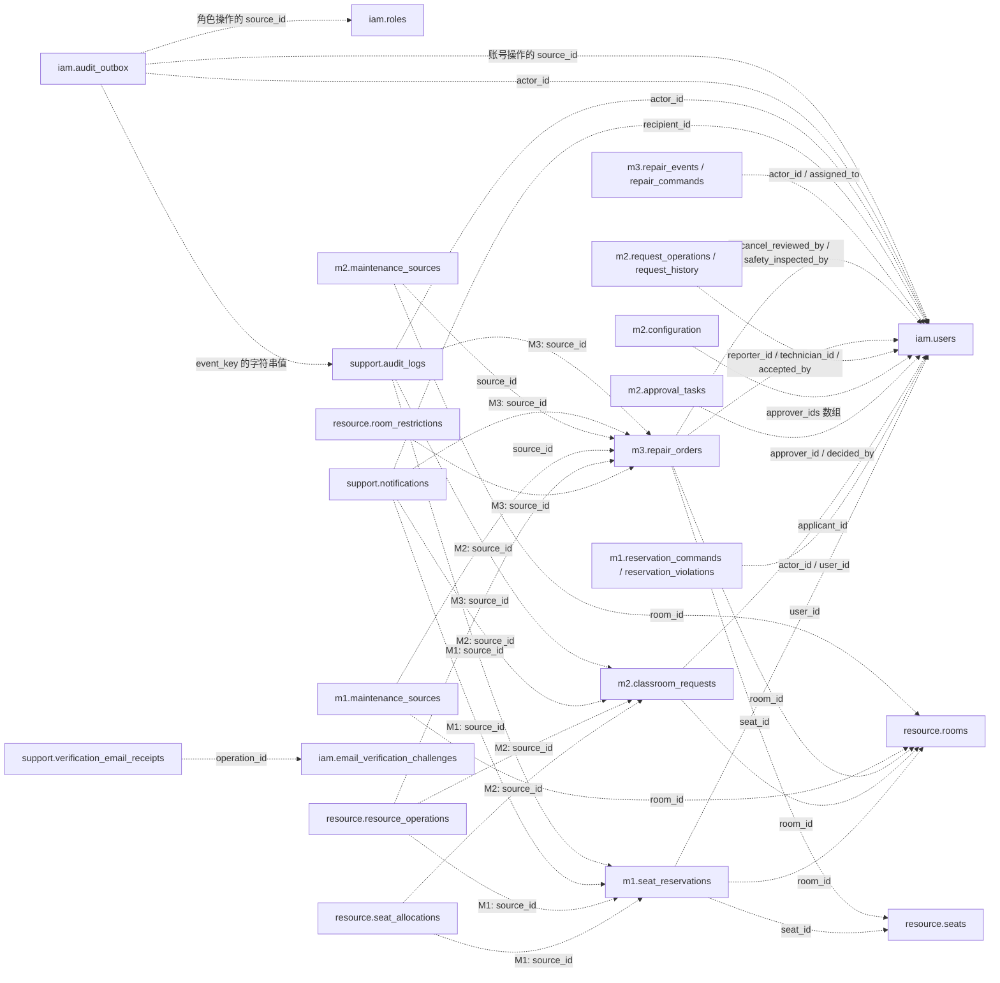

# PostgreSQL 表结构与关系

按当前主应用迁移的最终结构整理，共 37 张表。`resource-service` 使用 `iam`、`resource`、`m1`；`workflow-service` 使用 `m2`、`m3`、`support`。`integration` 当前只有 schema，没有应用表。

不包含缓冲站数据库、测试夹具和 Flyway 历史表。下面的“外键”只表示迁移中实际声明的数据库外键；代码通过接口校验的 ID 关联放在末尾单独画图。

| 标记 | 含义 |
| --- | --- |
| 非空：是 | 不允许 SQL NULL；主键和 IDENTITY 字段也非空。 |
| 默认值：— | 没有数据库 DEFAULT，需要应用填写或允许为空。 |
| 组合 U1 / PK | 和同一张表的其他字段一起唯一，定义见表下约束。 |
| CHECK | 数据库校验；字段允许 NULL 时，CHECK 不等同于非空。 |
| UNIQUE 与 NULL | 普通 UNIQUE 允许多个 NULL；组合唯一含 NULL 时也按 PostgreSQL 默认规则处理。 |
| EXCLUDE | 防止生效占用的座位或用户时间重叠，依赖迁移安装的 btree_gist。 |
| 时间 | `timestamptz` 保存时间点；`time` 保存一天内的时间。界面按 Asia/Shanghai 展示。 |
| 更新时间 | `DEFAULT now()` 只在插入时生效，不代表修改时数据库会自动刷新。 |

## 1 身份、权限与系统参数

### iam.roles（角色）

| 字段 | 类型 | 非空 | 主键 | 外键 | 唯一 | 默认值 | 其他约束 | 引用目标 |
| --- | --- | --- | --- | --- | --- | --- | --- | --- |
| `id` | `uuid` | 是 | 是 | 否 | 是 | `gen_random_uuid()` | — | — |
| `created_at` | `timestamptz` | 是 | 否 | 否 | 否 | `now()` | — | — |
| `updated_at` | `timestamptz` | 是 | 否 | 否 | 否 | `now()` | — | — |
| `code` | `varchar(64)` | 是 | 否 | 否 | 是 | — | — | — |
| `name` | `varchar(64)` | 是 | 否 | 否 | 否 | — | — | — |
| `enabled` | `boolean` | 是 | 否 | 否 | 否 | `true` | — | — |

**字段作用**

- `id`：这条记录的编号。
- `created_at`：这条记录创建的时间。
- `updated_at`：这条记录最近一次修改的时间。
- `code`：角色编码，预置 USER、SYSTEM_ADMIN、MAINTAINER，也允许增加新角色。
- `name`：界面显示的名称。
- `enabled`：是否继续允许使用这个角色的权限。

### iam.permissions（操作权限）

| 字段 | 类型 | 非空 | 主键 | 外键 | 唯一 | 默认值 | 其他约束 | 引用目标 |
| --- | --- | --- | --- | --- | --- | --- | --- | --- |
| `id` | `uuid` | 是 | 是 | 否 | 是 | `gen_random_uuid()` | — | — |
| `created_at` | `timestamptz` | 是 | 否 | 否 | 否 | `now()` | — | — |
| `updated_at` | `timestamptz` | 是 | 否 | 否 | 否 | `now()` | — | — |
| `code` | `varchar(128)` | 是 | 否 | 否 | 是 | — | — | — |
| `name` | `varchar(128)` | 是 | 否 | 否 | 否 | — | — | — |
| `module` | `varchar(32)` | 是 | 否 | 否 | 否 | — | — | — |

**字段作用**

- `id`：这条记录的编号。
- `created_at`：这条记录创建的时间。
- `updated_at`：这条记录最近一次修改的时间。
- `code`：后端检查操作权限时使用的编码，例如 reservation:create。
- `name`：界面显示的名称。
- `module`：界面按业务分组显示权限时使用。

### iam.role_permissions（角色拥有的权限）

| 字段 | 类型 | 非空 | 主键 | 外键 | 唯一 | 默认值 | 其他约束 | 引用目标 |
| --- | --- | --- | --- | --- | --- | --- | --- | --- |
| `id` | `uuid` | 是 | 是 | 否 | 是 | `gen_random_uuid()` | — | — |
| `created_at` | `timestamptz` | 是 | 否 | 否 | 否 | `now()` | — | — |
| `updated_at` | `timestamptz` | 是 | 否 | 否 | 否 | `now()` | — | — |
| `role_id` | `uuid` | 是 | 否 | 是 | 组合 U1 | — | `ON DELETE RESTRICT`；`ON UPDATE RESTRICT` | `iam.roles.id` |
| `permission_id` | `uuid` | 是 | 否 | 是 | 组合 U1 | — | `ON DELETE RESTRICT`；`ON UPDATE RESTRICT` | `iam.permissions.id` |

**字段作用**

- `id`：这一条角色授权记录的编号。
- `created_at`：这条记录创建的时间。
- `updated_at`：这条记录最近一次修改的时间。
- `role_id`：账号或授权记录对应的角色编号。
- `permission_id`：对应的一项操作权限编号。

| 约束或索引 | 定义 |
| --- | --- |
| U1 | `UNIQUE (role_id,permission_id)` |

### iam.users（账号）

| 字段 | 类型 | 非空 | 主键 | 外键 | 唯一 | 默认值 | 其他约束 | 引用目标 |
| --- | --- | --- | --- | --- | --- | --- | --- | --- |
| `id` | `uuid` | 是 | 是 | 否 | 是 | `gen_random_uuid()` | — | — |
| `created_at` | `timestamptz` | 是 | 否 | 否 | 否 | `now()` | — | — |
| `updated_at` | `timestamptz` | 是 | 否 | 否 | 否 | `now()` | — | — |
| `login_name` | `varchar(128)` | 是 | 否 | 否 | 是 | — | — | — |
| `display_name` | `varchar(128)` | 是 | 否 | 否 | 否 | — | — | — |
| `email` | `varchar(254)` | 否 | 否 | 否 | 否 | — | — | — |
| `identity_type` | `varchar(16)` | 否 | 否 | 否 | 否 | — | `CHECK (identity_type IN ('STUDENT','STAFF'))` | — |
| `identity_source` | `varchar(16)` | 是 | 否 | 否 | 否 | `'LOCAL'` | — | — |
| `identity_active` | `boolean` | 是 | 否 | 否 | 否 | `false` | — | — |
| `role_id` | `uuid` | 是 | 否 | 是 | 否 | — | `ON DELETE RESTRICT`；`ON UPDATE RESTRICT` | `iam.roles.id` |
| `department_code` | `varchar(64)` | 否 | 否 | 否 | 否 | — | — | — |
| `can_apply_room` | `boolean` | 是 | 否 | 否 | 否 | `false` | — | — |
| `enabled` | `boolean` | 是 | 否 | 否 | 否 | `true` | — | — |
| `auth_version` | `integer` | 是 | 否 | 否 | 否 | `1` | `CHECK (auth_version > 0)` | — |
| `password_hash` | `varchar(255)` | 否 | 否 | 否 | 否 | — | — | — |
| `email_verified_at` | `timestamptz` | 否 | 否 | 否 | 否 | — | — | — |
| `email_version` | `integer` | 是 | 否 | 否 | 否 | `1` | `CHECK (email_version>0)` | — |

**字段作用**

- `id`：这条记录的编号。
- `created_at`：这条记录创建的时间。
- `updated_at`：这条记录最近一次修改的时间。
- `login_name`：用户登录时填写的账号。
- `display_name`：界面显示的用户名称。
- `email`：用户填写的通知邮箱。
- `identity_type`：保留的学生或教职工身份类型；本地注册账号可以为空。
- `identity_source`：账号来源，本地注册使用 LOCAL。
- `identity_active`：保留的学校身份状态，不作为本地密码登录条件。
- `role_id`：账号或授权记录对应的角色编号。
- `department_code`：管理员维护的可选部门代码，用来匹配限定部门的教室。
- `can_apply_room`：是否允许该账号申请整间教室，还需要相应操作权限。
- `enabled`：是否允许这个账号登录和继续使用系统。
- `auth_version`：会话版本号；退出或更改授权后递增，让旧登录会话失效。
- `password_hash`：保存密码的加盐摘要，登录时用来验证密码。
- `email_verified_at`：当前邮箱完成验证的时间；为空表示尚未验证。
- `email_version`：当前邮箱版本，换邮箱后递增，让旧验证链接失效。

| 约束或索引 | 定义 |
| --- | --- |
| CHECK | `CHECK (identity_type = 'STUDENT' OR department_code IS NULL)` |
| CHECK | `CONSTRAINT users_identity_source_check CHECK (identity_source IN ('FUDAN_UIS','DEVELOPMENT','LOCAL'))` |
| CHECK | `CONSTRAINT users_password_required CHECK (identity_source <> 'LOCAL' OR password_hash IS NOT NULL)` |
| CHECK | `CONSTRAINT users_password_format CHECK (password_hash IS NULL OR password_hash ~ '^\{pbkdf2-sha256-v1\}[0-9a-f]{96}$')` |
| 索引 | `CREATE INDEX users_role_idx ON iam.users(role_id)` |
| 唯一索引 | `CREATE UNIQUE INDEX users_local_login_name_ci_idx ON iam.users(lower(login_name)) WHERE identity_source='LOCAL'` |

### iam.system_settings（系统参数）

| 字段 | 类型 | 非空 | 主键 | 外键 | 唯一 | 默认值 | 其他约束 | 引用目标 |
| --- | --- | --- | --- | --- | --- | --- | --- | --- |
| `id` | `smallint` | 是 | 是 | 否 | 是 | — | `CHECK (id=1)` | — |
| `version` | `integer` | 是 | 否 | 否 | 否 | — | `CHECK (version>0)` | — |
| `max_reservation_hours` | `integer` | 是 | 否 | 否 | 否 | — | `CHECK (max_reservation_hours>0)` | — |
| `before_start_reminder_minutes` | `integer` | 是 | 否 | 否 | 否 | — | `CHECK (before_start_reminder_minutes>0)` | — |
| `after_start_reminder_minutes` | `integer` | 是 | 否 | 否 | 否 | — | `CHECK (after_start_reminder_minutes>0)` | — |
| `checkin_deadline_minutes` | `integer` | 是 | 否 | 否 | 否 | — | `CHECK (checkin_deadline_minutes>after_start_reminder_minutes)` | — |
| `approval_ttl_minutes` | `integer` | 是 | 否 | 否 | 否 | — | `CHECK (approval_ttl_minutes>0)` | — |
| `repair_sla_minutes` | `integer` | 是 | 否 | 否 | 否 | — | `CHECK (repair_sla_minutes>0)` | — |

**字段作用**

- `id`：固定为 1，使系统参数只保留一行当前值。
- `version`：当前数据版本，修改时用来检查是否已被其他操作更新。
- `max_reservation_hours`：一次个人预约最多可以预约多少小时。
- `before_start_reminder_minutes`：在预约开始前多少分钟发送提醒。
- `after_start_reminder_minutes`：开始后仍未签到时，过多少分钟发送提醒。
- `checkin_deadline_minutes`：预约开始后允许签到的分钟数。
- `approval_ttl_minutes`：新整室申请使用的审批等待时限，单位为分钟。
- `repair_sla_minutes`：新派单使用的维修时限，单位为分钟。

初始化记录为：`version=1`、最长预约 `4` 小时、开始前提醒 `15` 分钟、开始后提醒 `10` 分钟、签到期限 `15` 分钟、审批时限 `60` 分钟、维修时限 `120` 分钟。这些是迁移插入的初始值，各字段没有设置 DEFAULT。

### iam.system_settings_history（系统参数修改记录）

| 字段 | 类型 | 非空 | 主键 | 外键 | 唯一 | 默认值 | 其他约束 | 引用目标 |
| --- | --- | --- | --- | --- | --- | --- | --- | --- |
| `id` | `uuid` | 是 | 是 | 否 | 是 | `gen_random_uuid()` | — | — |
| `actor_id` | `uuid` | 是 | 否 | 是 | 否 | — | `ON DELETE RESTRICT`；`ON UPDATE NO ACTION` | `iam.users.id` |
| `changed_at` | `timestamptz` | 是 | 否 | 否 | 否 | — | — | — |
| `version` | `integer` | 是 | 否 | 否 | 是 | — | — | — |
| `before_data` | `jsonb` | 是 | 否 | 否 | 否 | — | — | — |
| `after_data` | `jsonb` | 是 | 否 | 否 | 否 | — | — | — |

**字段作用**

- `id`：这条记录的编号。
- `actor_id`：执行这次操作的账号编号。
- `changed_at`：本次系统参数修改的时间。
- `version`：本次修改后的系统参数版本号。
- `before_data`：保存修改前的整份系统参数。
- `after_data`：保存修改后的整份系统参数。

### iam.email_verification_challenges（邮箱验证记录）

| 字段 | 类型 | 非空 | 主键 | 外键 | 唯一 | 默认值 | 其他约束 | 引用目标 |
| --- | --- | --- | --- | --- | --- | --- | --- | --- |
| `operation_id` | `uuid` | 是 | 是 | 否 | 是 | — | — | — |
| `user_id` | `uuid` | 是 | 否 | 是 | 否 | — | `ON DELETE RESTRICT`；`ON UPDATE NO ACTION` | `iam.users.id` |
| `email` | `varchar(254)` | 是 | 否 | 否 | 否 | — | — | — |
| `email_version` | `integer` | 是 | 否 | 否 | 否 | — | — | — |
| `nonce` | `varchar(64)` | 是 | 否 | 否 | 否 | — | — | — |
| `token_hash` | `char(64)` | 是 | 否 | 否 | 是 | — | — | — |
| `issued_at` | `timestamptz` | 是 | 否 | 否 | 否 | — | — | — |
| `expires_at` | `timestamptz` | 是 | 否 | 否 | 否 | — | — | — |
| `consumed_at` | `timestamptz` | 否 | 否 | 否 | 否 | — | — | — |
| `delivery_status` | `varchar(32)` | 是 | 否 | 否 | 否 | `'UNKNOWN'` | — | — |
| `delivery_error` | `varchar(64)` | 否 | 否 | 否 | 否 | — | — | — |
| `next_retry_at` | `timestamptz` | 否 | 否 | 否 | 否 | — | — | — |
| `retryable` | `boolean` | 是 | 否 | 否 | 否 | `false` | — | — |

**字段作用**

- `operation_id`：本次操作的编号；重试时仍使用同一个编号。
- `user_id`：对应账号的编号。
- `email`：本次验证针对的邮箱，换邮箱后旧验证记录不能继续使用。
- `email_version`：本次验证对应的邮箱版本，用来识别换邮箱前的旧链接。
- `nonce`：生成本次验证令牌时使用的随机值。
- `token_hash`：验证令牌的摘要，用来查找验证记录。
- `issued_at`：本次验证记录生成的时间。
- `expires_at`：本次记录允许继续处理的截止时间。
- `consumed_at`：验证链接首次使用成功的时间。
- `delivery_status`：验证邮件最近一次发送结果。
- `delivery_error`：验证邮件最近一次失败的原因代码。
- `next_retry_at`：下一次允许尝试处理的时间。
- `retryable`：是否允许再次尝试发送。

| 约束或索引 | 定义 |
| --- | --- |
| CHECK | `CHECK(expires_at>issued_at)` |
| 索引 | `CREATE INDEX email_challenges_user_idx ON iam.email_verification_challenges(user_id,issued_at)` |

### iam.audit_outbox（账号与权限审计待办）

| 字段 | 类型 | 非空 | 主键 | 外键 | 唯一 | 默认值 | 其他约束 | 引用目标 |
| --- | --- | --- | --- | --- | --- | --- | --- | --- |
| `event_key` | `uuid` | 是 | 是 | 否 | 是 | — | — | — |
| `actor_id` | `uuid` | 否 | 否 | 否 | 否 | — | — | — |
| `action` | `varchar(128)` | 是 | 否 | 否 | 否 | — | — | — |
| `source_id` | `uuid` | 是 | 否 | 否 | 否 | — | — | — |
| `payload` | `jsonb` | 是 | 否 | 否 | 否 | — | — | — |
| `created_at` | `timestamptz` | 是 | 否 | 否 | 否 | — | — | — |
| `next_attempt_at` | `timestamptz` | 是 | 否 | 否 | 否 | — | — | — |
| `attempts` | `integer` | 是 | 否 | 否 | 否 | `0` | — | — |
| `sent_at` | `timestamptz` | 否 | 否 | 否 | 否 | — | — | — |
| `last_error` | `varchar(64)` | 否 | 否 | 否 | 否 | — | — | — |

**字段作用**

- `event_key`：待发送审计事件的编号，与审计服务里的 event_key 对应。
- `actor_id`：执行这次操作的账号编号。
- `action`：这次执行的操作名称。
- `source_id`：被操作的账号、角色或系统参数等对象的编号，具体含义由 action 决定。
- `payload`：保存待发送的内容，失败后仍按同一份内容重试。
- `created_at`：这条记录创建的时间。
- `next_attempt_at`：下一次允许尝试发送审计事件的时间。
- `attempts`：已经尝试处理的次数。
- `sent_at`：审计服务确认已经接收这条事件的时间。
- `last_error`：最近一次处理失败的原因代码。

| 约束或索引 | 定义 |
| --- | --- |
| 索引 | `CREATE INDEX audit_outbox_pending_idx ON iam.audit_outbox(next_attempt_at) WHERE sent_at IS NULL` |

## 2 教室、座位与资源状态

### resource.rooms（教室）

| 字段 | 类型 | 非空 | 主键 | 外键 | 唯一 | 默认值 | 其他约束 | 引用目标 |
| --- | --- | --- | --- | --- | --- | --- | --- | --- |
| `id` | `uuid` | 是 | 是 | 否 | 是 | `gen_random_uuid()` | — | — |
| `created_at` | `timestamptz` | 是 | 否 | 否 | 否 | `now()` | — | — |
| `updated_at` | `timestamptz` | 是 | 否 | 否 | 否 | `now()` | — | — |
| `code` | `varchar(64)` | 是 | 否 | 否 | 是 | — | — | — |
| `name` | `varchar(128)` | 是 | 否 | 否 | 否 | — | — | — |
| `campus` | `varchar(64)` | 是 | 否 | 否 | 组合 U1 | — | — | — |
| `building` | `varchar(128)` | 是 | 否 | 否 | 组合 U1 | — | — | — |
| `capacity` | `integer` | 是 | 否 | 否 | 否 | — | `CHECK (capacity > 0)` | — |
| `department_code` | `varchar(64)` | 否 | 否 | 否 | 否 | — | — | — |
| `open_time` | `time` | 是 | 否 | 否 | 否 | — | — | — |
| `close_time` | `time` | 是 | 否 | 否 | 否 | — | — | — |
| `checkin_code` | `char(6)` | 否 | 否 | 否 | 否 | — | — | — |
| `checkin_code_date` | `date` | 否 | 否 | 否 | 否 | — | — | — |
| `external_code` | `varchar(128)` | 否 | 否 | 否 | 组合 U1 | — | — | — |
| `booking_enabled` | `boolean` | 是 | 否 | 否 | 否 | `false` | — | — |
| `enabled` | `boolean` | 是 | 否 | 否 | 否 | `true` | — | — |
| `version` | `integer` | 是 | 否 | 否 | 否 | `1` | `CHECK (version>0)` | — |

**字段作用**

- `id`：这条记录的编号。
- `created_at`：这条记录创建的时间。
- `updated_at`：这条记录最近一次修改的时间。
- `code`：系统内唯一的教室编号。
- `name`：界面显示的教室名称。
- `campus`：教室所在的校区名称。
- `building`：教室所在的楼宇名称。
- `capacity`：教室可以容纳的人数。
- `department_code`：填入后，预约这间教室需要匹配用户的部门资格。
- `open_time`：每天开始开放的时间。
- `close_time`：每天结束开放的时间。
- `checkin_code`：该教室当天使用的六位签到码。
- `checkin_code_date`：当前签到码对应的日期。
- `external_code`：外部系统里的教室编号，和校区、楼宇一起识别同一外部教室。
- `booking_enabled`：是否允许接受新的预约。
- `enabled`：是否允许继续使用这条数据。
- `version`：当前数据版本，修改时用来检查是否已被其他操作更新。

| 约束或索引 | 定义 |
| --- | --- |
| U1 | `CONSTRAINT rooms_external_source_unique UNIQUE(campus,building,external_code)` |
| CHECK | `CONSTRAINT rooms_checkin_code_pair CHECK ((checkin_code IS NULL AND checkin_code_date IS NULL) OR (checkin_code IS NOT NULL AND checkin_code_date IS NOT NULL))` |
| CHECK | `CONSTRAINT rooms_checkin_code_format CHECK (checkin_code IS NULL OR checkin_code ~ '^[0-9]{6}$')` |

### resource.seats（座位）

| 字段 | 类型 | 非空 | 主键 | 外键 | 唯一 | 默认值 | 其他约束 | 引用目标 |
| --- | --- | --- | --- | --- | --- | --- | --- | --- |
| `id` | `uuid` | 是 | 是 | 否 | 是 | `gen_random_uuid()` | — | — |
| `room_id` | `uuid` | 是 | 否 | 是 | 组合 U1 | — | `ON DELETE RESTRICT`；`ON UPDATE RESTRICT` | `resource.rooms.id` |
| `code` | `varchar(64)` | 是 | 否 | 否 | 组合 U1 | — | — | — |
| `socket_type` | `varchar(16)` | 是 | 否 | 否 | 否 | `'NONE'` | `CHECK (socket_type IN('NONE','FIXED','RAIL'))` | — |
| `enabled` | `boolean` | 是 | 否 | 否 | 否 | `true` | — | — |
| `version` | `integer` | 是 | 否 | 否 | 否 | `1` | `CHECK (version>0)` | — |
| `created_at` | `timestamptz` | 是 | 否 | 否 | 否 | `now()` | — | — |
| `updated_at` | `timestamptz` | 是 | 否 | 否 | 否 | `now()` | — | — |

**字段作用**

- `id`：这条记录的编号。
- `room_id`：对应的教室编号。
- `code`：教室内的座位编号，同一教室内不能重复。
- `socket_type`：座位的插座类型。
- `enabled`：是否允许继续使用这条数据。
- `version`：当前数据版本，修改时用来检查是否已被其他操作更新。
- `created_at`：这条记录创建的时间。
- `updated_at`：这条记录最近一次修改的时间。

| 约束或索引 | 定义 |
| --- | --- |
| U1 | `UNIQUE(room_id,code)` |

### resource.seat_allocations（座位实际占用）

| 字段 | 类型 | 非空 | 主键 | 外键 | 唯一 | 默认值 | 其他约束 | 引用目标 |
| --- | --- | --- | --- | --- | --- | --- | --- | --- |
| `id` | `uuid` | 是 | 是 | 否 | 是 | `gen_random_uuid()` | — | — |
| `seat_id` | `uuid` | 是 | 否 | 是 | 组合 U1 | — | `ON DELETE RESTRICT`；`ON UPDATE RESTRICT` | `resource.seats.id` |
| `occupied_period` | `tstzrange` | 是 | 否 | 否 | 否 | — | — | — |
| `source_module` | `varchar(8)` | 是 | 否 | 否 | 组合 U1 | — | `CHECK (source_module IN('M1','M2'))` | — |
| `source_id` | `uuid` | 是 | 否 | 否 | 组合 U1 | — | — | — |
| `source_version` | `integer` | 是 | 否 | 否 | 否 | — | `CHECK (source_version>0)` | — |
| `user_id` | `uuid` | 否 | 否 | 是 | 否 | — | `ON DELETE RESTRICT`；`ON UPDATE RESTRICT` | `iam.users.id` |
| `active` | `boolean` | 是 | 否 | 否 | 否 | `true` | — | — |
| `created_at` | `timestamptz` | 是 | 否 | 否 | 否 | `now()` | — | — |
| `updated_at` | `timestamptz` | 是 | 否 | 否 | 否 | `now()` | — | — |

**字段作用**

- `id`：这条记录的编号。
- `seat_id`：对应的座位编号。
- `occupied_period`：实际占用的时间段，包含开始时间、不包含结束时间。
- `source_module`：来源业务类型，用来判断来源编号应怎样解释。
- `source_id`：个人预约编号或整室申请编号，由 source_module 决定。
- `source_version`：来源业务的版本号，用来拒绝迟到的旧请求。
- `user_id`：个人占用时记录对应用户，整室占用时为空。
- `active`：是否让这条占用继续参与座位和用户时间冲突检查。
- `created_at`：这条记录创建的时间。
- `updated_at`：这条记录最近一次修改的时间。

| 约束或索引 | 定义 |
| --- | --- |
| U1 | `UNIQUE(source_module,source_id,seat_id)` |
| CHECK | `CHECK(NOT isempty(occupied_period) AND lower(occupied_period) IS NOT NULL AND upper(occupied_period) IS NOT NULL AND lower_inc(occupied_period) AND NOT upper_inc(occupied_period))` |
| CHECK | `CHECK((source_module='M1' AND user_id IS NOT NULL) OR (source_module='M2' AND user_id IS NULL))` |
| EXCLUDE | `EXCLUDE USING gist(seat_id WITH =,occupied_period WITH &&) WHERE(active)` |
| EXCLUDE | `EXCLUDE USING gist(user_id WITH =,occupied_period WITH &&) WHERE(active AND source_module='M1')` |

### resource.room_restrictions（教室预约限制）

| 字段 | 类型 | 非空 | 主键 | 外键 | 唯一 | 默认值 | 其他约束 | 引用目标 |
| --- | --- | --- | --- | --- | --- | --- | --- | --- |
| `id` | `uuid` | 是 | 是 | 否 | 是 | `gen_random_uuid()` | — | — |
| `room_id` | `uuid` | 是 | 否 | 是 | 否 | — | `ON DELETE RESTRICT`；`ON UPDATE RESTRICT` | `resource.rooms.id` |
| `blocked_period` | `tstzrange` | 是 | 否 | 否 | 否 | — | — | — |
| `source_type` | `varchar(16)` | 是 | 否 | 否 | 组合 U1 | — | `CHECK (source_type IN('M3','ADMIN'))` | — |
| `source_id` | `uuid` | 是 | 否 | 否 | 组合 U1 | — | — | — |
| `source_version` | `integer` | 是 | 否 | 否 | 否 | — | `CHECK (source_version>0)` | — |
| `reason` | `text` | 是 | 否 | 否 | 否 | — | — | — |
| `active` | `boolean` | 是 | 否 | 否 | 否 | — | — | — |
| `created_at` | `timestamptz` | 是 | 否 | 否 | 否 | `now()` | — | — |
| `updated_at` | `timestamptz` | 是 | 否 | 否 | 否 | `now()` | — | — |

**字段作用**

- `id`：这条记录的编号。
- `room_id`：对应的教室编号。
- `blocked_period`：该教室被限制预约的时间范围。
- `source_type`：限制来自维修还是管理员操作。
- `source_id`：维修工单或管理员限制操作的编号。
- `source_version`：来源业务的版本号，用来拒绝迟到的旧请求。
- `reason`：本次处理的原因。
- `active`：这条资源状态是否仍然生效。
- `created_at`：这条记录创建的时间。
- `updated_at`：这条记录最近一次修改的时间。

| 约束或索引 | 定义 |
| --- | --- |
| U1 | `UNIQUE(source_type,source_id)` |
| 索引 | `CREATE INDEX room_restrictions_active ON resource.room_restrictions(room_id,active)` |

### resource.resource_operations（资源操作与历史快照）

| 字段 | 类型 | 非空 | 主键 | 外键 | 唯一 | 默认值 | 其他约束 | 引用目标 |
| --- | --- | --- | --- | --- | --- | --- | --- | --- |
| `operation_id` | `uuid` | 是 | 是 | 否 | 是 | — | — | — |
| `source_module` | `varchar(16)` | 是 | 否 | 否 | 否 | — | — | — |
| `source_id` | `uuid` | 是 | 否 | 否 | 否 | — | — | — |
| `source_version` | `integer` | 是 | 否 | 否 | 否 | — | `CHECK (source_version>0)` | — |
| `kind` | `varchar(16)` | 是 | 否 | 否 | 否 | — | — | — |
| `room_id` | `uuid` | 否 | 否 | 是 | 否 | — | `ON DELETE RESTRICT`；`ON UPDATE RESTRICT` | `resource.rooms.id` |
| `fingerprint` | `char(64)` | 是 | 否 | 否 | 否 | — | — | — |
| `snapshot` | `jsonb` | 是 | 否 | 否 | 否 | — | — | — |
| `applied_at` | `timestamptz` | 是 | 否 | 否 | 否 | — | — | — |
| `replay` | `boolean` | 是 | 否 | 否 | 否 | `false` | — | — |
| `audit_state` | `varchar(16)` | 是 | 否 | 否 | 否 | `'SKIP'` | `CHECK (audit_state IN('SKIP','PENDING','SENT','FAILED'))` | — |
| `audit_attempts` | `integer` | 是 | 否 | 否 | 否 | `0` | — | — |
| `audit_next` | `timestamptz` | 是 | 否 | 否 | 否 | `now()` | — | — |
| `audit_payload` | `jsonb` | 否 | 否 | 否 | 否 | — | — | — |

**字段作用**

- `operation_id`：本次操作的编号；重试时仍使用同一个编号。
- `source_module`：来源业务类型，用来判断来源编号应怎样解释。
- `source_id`：来源业务的编号，和来源类型一起确定是哪一笔业务。
- `source_version`：来源业务的版本号，用来拒绝迟到的旧请求。
- `kind`：区分占用、释放、限制和教室座位修改等资源操作。
- `room_id`：对应的教室编号。
- `fingerprint`：保存操作参数的摘要，重试时检查参数是否一致。
- `snapshot`：保存本次资源操作后的状态，供重复请求和历史统计使用。
- `applied_at`：资源操作写入记录的时间。
- `replay`：是否只是已有操作的重复回执，避免重复计算历史变化。
- `audit_state`：这次资源操作的审计消息处理进度。
- `audit_attempts`：这条资源审计消息已尝试发送的次数。
- `audit_next`：下一次允许发送资源审计消息的时间。
- `audit_payload`：需要交给审计服务保存的事件内容。

| 约束或索引 | 定义 |
| --- | --- |
| 索引 | `CREATE INDEX resource_operations_source ON resource.resource_operations(source_module,source_id,source_version DESC)` |
| 索引 | `CREATE INDEX resource_operations_history ON resource.resource_operations(room_id,applied_at)` |
| 索引 | `CREATE INDEX resource_audit_pending ON resource.resource_operations(audit_state,audit_next)` |

## 3 个人预约

### m1.seat_reservations（个人预约）

| 字段 | 类型 | 非空 | 主键 | 外键 | 唯一 | 默认值 | 其他约束 | 引用目标 |
| --- | --- | --- | --- | --- | --- | --- | --- | --- |
| `id` | `uuid` | 是 | 是 | 否 | 是 | `gen_random_uuid()` | — | — |
| `created_at` | `timestamptz` | 是 | 否 | 否 | 否 | `now()` | — | — |
| `updated_at` | `timestamptz` | 是 | 否 | 否 | 否 | `now()` | — | — |
| `user_id` | `uuid` | 是 | 否 | 否 | 否 | — | — | — |
| `seat_id` | `uuid` | 是 | 否 | 否 | 否 | — | — | — |
| `starts_at` | `timestamptz` | 是 | 否 | 否 | 否 | — | — | — |
| `ends_at` | `timestamptz` | 是 | 否 | 否 | 否 | — | `CHECK (ends_at > starts_at)` | — |
| `status` | `varchar(24)` | 是 | 否 | 否 | 否 | `'RESERVED'` | — | — |
| `checked_in_at` | `timestamptz` | 否 | 否 | 否 | 否 | — | — | — |
| `checkin_deadline_at` | `timestamptz` | 是 | 否 | 否 | 否 | — | — | — |
| `cancel_reason` | `varchar(32)` | 否 | 否 | 否 | 否 | — | — | — |
| `cancelled_at` | `timestamptz` | 否 | 否 | 否 | 否 | — | — | — |
| `policy_snapshot` | `jsonb` | 是 | 否 | 否 | 否 | — | — | — |
| `version` | `integer` | 是 | 否 | 否 | 否 | `1` | `CHECK (version > 0)` | — |
| `room_id` | `uuid` | 否 | 否 | 否 | 否 | — | — | — |
| `room_snapshot` | `jsonb` | 否 | 否 | 否 | 否 | — | — | — |
| `seat_snapshot` | `jsonb` | 否 | 否 | 否 | 否 | — | — | — |
| `confirmed_at` | `timestamptz` | 否 | 否 | 否 | 否 | — | — | — |
| `terminal_status` | `varchar(24)` | 否 | 否 | 否 | 否 | — | — | — |
| `resource_version` | `integer` | 是 | 否 | 否 | 否 | `1` | `CHECK (resource_version>0)` | — |
| `resource_state` | `varchar(24)` | 是 | 否 | 否 | 否 | `'CONFIRMED'` | `CHECK (resource_state IN ('PENDING','CONFIRMED','RELEASE_PENDING','RELEASED','REJECTED'))` | — |
| `resource_receipt` | `jsonb` | 否 | 否 | 否 | 否 | — | — | — |
| `failure_code` | `varchar(64)` | 否 | 否 | 否 | 否 | — | — | — |
| `record_seq` | `bigint` | 是 | 否 | 否 | 否 | 自动生成（IDENTITY） | `GENERATED ALWAYS AS IDENTITY` | — |

**字段作用**

- `id`：这条记录的编号。
- `created_at`：这条记录创建的时间。
- `updated_at`：这条记录最近一次修改的时间。
- `user_id`：对应账号的编号。
- `seat_id`：对应的座位编号。
- `starts_at`：预约开始的时间。
- `ends_at`：预约结束的时间。
- `status`：记录当前进行到哪一步。
- `checked_in_at`：用户成功签到的时间。
- `checkin_deadline_at`：这次预约最晚允许签到的时间。
- `cancel_reason`：取消或系统终结这笔业务的原因。
- `cancelled_at`：这笔业务被取消或终结的时间。
- `policy_snapshot`：保存创建预约时采用的规则，之后改配置不重算旧预约。
- `version`：当前数据版本，修改时用来检查是否已被其他操作更新。
- `room_id`：预约时对应的教室编号，保留的旧预约记录允许为空。
- `room_snapshot`：保存预约时的教室信息，历史页面不随教室改名而变化。
- `seat_snapshot`：保存预约时的座位信息，历史页面不随座位改名而变化。
- `confirmed_at`：资源服务首次确认座位占用成功的时间。
- `terminal_status`：等待释放座位结束后，这笔预约应变成的最终状态。
- `resource_version`：发给资源服务的版本号，防止迟到请求恢复已取消的占用。
- `resource_state`：记录资源是否已经确认占用、正在释放或已经释放。
- `resource_receipt`：保存资源服务返回的确认结果。
- `failure_code`：创建或处理失败的原因代码。
- `record_seq`：数据库生成的递增记录号，翻页时用来固定首次查询范围。

| 约束或索引 | 定义 |
| --- | --- |
| CHECK | `CHECK (status <> 'CHECKED_IN' OR checked_in_at IS NOT NULL)` |
| CHECK | `CHECK (status NOT IN ('CANCELLED','NO_SHOW') OR (cancel_reason IS NOT NULL AND cancelled_at IS NOT NULL))` |
| CHECK | `CHECK (checkin_deadline_at > starts_at)` |
| CHECK | `CONSTRAINT seat_reservations_status_check CHECK (status IN ('PENDING','RESERVED','CHECKED_IN','COMPLETED','CANCEL_PENDING','CANCELLED','NO_SHOW','REJECTED'))` |
| CHECK | `CONSTRAINT seat_reservations_cancel_reason_check CHECK(cancel_reason IN ('USER','NO_SHOW','REPAIR','ADMIN','EXTERNAL_CONFLICT','SYSTEM_TIMEOUT','SYSTEM_MAINTENANCE'))` |
| 索引 | `CREATE INDEX seat_reservations_user_start ON m1.seat_reservations(user_id,starts_at DESC)` |
| 索引 | `CREATE INDEX seat_reservations_status_deadline ON m1.seat_reservations(status,checkin_deadline_at)` |
| 唯一索引 | `CREATE UNIQUE INDEX reservation_record_seq ON m1.seat_reservations(record_seq)` |
| 索引 | `CREATE INDEX reservation_room_active ON m1.seat_reservations(room_id,status,ends_at)` |

### m1.reminder_tasks（旧预约的签到提醒待办）

| 字段 | 类型 | 非空 | 主键 | 外键 | 唯一 | 默认值 | 其他约束 | 引用目标 |
| --- | --- | --- | --- | --- | --- | --- | --- | --- |
| `event_id` | `uuid` | 是 | 是 | 否 | 是 | — | — | — |
| `reservation_id` | `uuid` | 是 | 否 | 是 | 是 | — | `ON DELETE NO ACTION`；`ON UPDATE NO ACTION` | `m1.seat_reservations.id` |
| `scheduled_at` | `timestamptz` | 是 | 否 | 否 | 否 | — | — | — |
| `payload` | `jsonb` | 是 | 否 | 否 | 否 | — | — | — |
| `status` | `varchar(24)` | 是 | 否 | 否 | 否 | `'PENDING'` | `CHECK (status IN ('PENDING','SENT','CANCEL_PENDING','CANCELLED'))` | — |
| `attempts` | `integer` | 是 | 否 | 否 | 否 | `0` | `CHECK (attempts >= 0)` | — |
| `next_retry_at` | `timestamptz` | 是 | 否 | 否 | 否 | — | — | — |
| `last_error_code` | `varchar(64)` | 否 | 否 | 否 | 否 | — | — | — |
| `created_at` | `timestamptz` | 是 | 否 | 否 | 否 | `now()` | — | — |
| `updated_at` | `timestamptz` | 是 | 否 | 否 | 否 | `now()` | — | — |

**字段作用**

- `event_id`：旧预约的签到提醒事件编号，重复投递时仍使用同一编号。
- `reservation_id`：对应的个人预约编号。
- `scheduled_at`：计划发送这条消息的时间。
- `payload`：保留的旧预约需要发送的签到提醒内容。
- `status`：记录当前进行到哪一步。
- `attempts`：已经尝试处理的次数。
- `next_retry_at`：下一次允许尝试处理的时间。
- `last_error_code`：最近一次处理失败的原因代码。
- `created_at`：这条记录创建的时间。
- `updated_at`：这条记录最近一次修改的时间。

| 约束或索引 | 定义 |
| --- | --- |
| 索引 | `CREATE INDEX reminder_tasks_due ON m1.reminder_tasks(next_retry_at,scheduled_at) WHERE status IN ('PENDING','CANCEL_PENDING')` |

### m1.reservation_commands（个人预约操作去重）

| 字段 | 类型 | 非空 | 主键 | 外键 | 唯一 | 默认值 | 其他约束 | 引用目标 |
| --- | --- | --- | --- | --- | --- | --- | --- | --- |
| `operation_id` | `uuid` | 是 | 是 | 否 | 是 | — | — | — |
| `reservation_id` | `uuid` | 是 | 否 | 是 | 否 | — | `ON DELETE CASCADE`；`ON UPDATE NO ACTION` | `m1.seat_reservations.id` |
| `actor_id` | `uuid` | 是 | 否 | 否 | 否 | — | — | — |
| `action` | `varchar(32)` | 是 | 否 | 否 | 否 | — | — | — |
| `fingerprint` | `varchar(64)` | 是 | 否 | 否 | 否 | — | — | — |
| `created_at` | `timestamptz` | 是 | 否 | 否 | 否 | — | — | — |

**字段作用**

- `operation_id`：本次操作的编号；重试时仍使用同一个编号。
- `reservation_id`：对应的个人预约编号。
- `actor_id`：执行这次操作的账号编号。
- `action`：本次预约操作类型，用于核对重复请求。
- `fingerprint`：保存操作参数的摘要，重试时检查参数是否一致。
- `created_at`：这条记录创建的时间。

### m1.reservation_outbox（个人预约持久待办）

| 字段 | 类型 | 非空 | 主键 | 外键 | 唯一 | 默认值 | 其他约束 | 引用目标 |
| --- | --- | --- | --- | --- | --- | --- | --- | --- |
| `id` | `uuid` | 是 | 是 | 否 | 是 | — | — | — |
| `reservation_id` | `uuid` | 否 | 否 | 是 | 否 | — | `ON DELETE CASCADE`；`ON UPDATE NO ACTION` | `m1.seat_reservations.id` |
| `kind` | `varchar(24)` | 是 | 否 | 否 | 否 | — | `CHECK (kind IN ('ALLOCATE','RELEASE','NOTIFY','NOTIFY_CANCEL','AUDIT'))` | — |
| `payload` | `jsonb` | 是 | 否 | 否 | 否 | — | — | — |
| `frozen` | `boolean` | 是 | 否 | 否 | 否 | `true` | — | — |
| `reminder_kind` | `varchar(16)` | 否 | 否 | 否 | 否 | — | — | — |
| `status` | `varchar(16)` | 是 | 否 | 否 | 否 | `'PENDING'` | `CHECK (status IN ('PENDING','CLAIMED','DONE','CANCELLED'))` | — |
| `attempts` | `integer` | 是 | 否 | 否 | 否 | `0` | `CHECK (attempts>=0)` | — |
| `next_retry_at` | `timestamptz` | 是 | 否 | 否 | 否 | — | — | — |
| `lease_until` | `timestamptz` | 否 | 否 | 否 | 否 | — | — | — |
| `claim_id` | `uuid` | 否 | 否 | 否 | 否 | — | — | — |
| `response` | `jsonb` | 否 | 否 | 否 | 否 | — | — | — |
| `last_error` | `varchar(64)` | 否 | 否 | 否 | 否 | — | — | — |
| `created_at` | `timestamptz` | 是 | 否 | 否 | 否 | — | — | — |

**字段作用**

- `id`：这条记录的编号。
- `reservation_id`：对应的个人预约编号。
- `kind`：区分确认占用、释放座位、发送通知、取消通知和发送审计等待办。
- `payload`：保存待发送的内容，失败后仍按同一份内容重试。
- `frozen`：是否已经固定完整通知内容和收件地址，重试时不再重建。
- `reminder_kind`：这条待办属于开始前提醒还是开始后提醒。
- `status`：记录当前进行到哪一步。
- `attempts`：已经尝试处理的次数。
- `next_retry_at`：下一次允许尝试处理的时间。
- `lease_until`：本次领取待办的有效时间，超时后允许重新领取。
- `claim_id`：本次领取待办的编号，避免过期处理者覆盖新结果。
- `response`：保存资源或消息服务返回的处理结果。
- `last_error`：最近一次处理失败的原因代码。
- `created_at`：这条记录创建的时间。

| 约束或索引 | 定义 |
| --- | --- |
| 索引 | `CREATE INDEX reservation_outbox_due ON m1.reservation_outbox(next_retry_at) WHERE status IN ('PENDING','CLAIMED')` |

### m1.reservation_reminders（预约提醒登记）

| 字段 | 类型 | 非空 | 主键 | 外键 | 唯一 | 默认值 | 其他约束 | 引用目标 |
| --- | --- | --- | --- | --- | --- | --- | --- | --- |
| `reservation_id` | `uuid` | 是 | 组合 PK | 是 | 组合 PK | — | `ON DELETE CASCADE`；`ON UPDATE NO ACTION` | `m1.seat_reservations.id` |
| `kind` | `varchar(16)` | 是 | 组合 PK | 否 | 组合 PK | — | `CHECK (kind IN ('BEFORE','AFTER'))` | — |
| `event_id` | `uuid` | 是 | 否 | 否 | 是 | — | — | — |
| `due_at` | `timestamptz` | 是 | 否 | 否 | 否 | — | — | — |

**字段作用**

- `reservation_id`：对应的个人预约编号。
- `kind`：区分开始前提醒 BEFORE 和开始后提醒 AFTER。
- `event_id`：这一种提醒对应的通知事件编号。
- `due_at`：这一条提醒应当发送的时间。

| 约束或索引 | 定义 |
| --- | --- |
| 组合主键 | `PRIMARY KEY(reservation_id,kind)` |

### m1.reservation_violations（未签到违约记录）

| 字段 | 类型 | 非空 | 主键 | 外键 | 唯一 | 默认值 | 其他约束 | 引用目标 |
| --- | --- | --- | --- | --- | --- | --- | --- | --- |
| `reservation_id` | `uuid` | 是 | 是 | 是 | 是 | — | `ON DELETE CASCADE`；`ON UPDATE NO ACTION` | `m1.seat_reservations.id` |
| `user_id` | `uuid` | 是 | 否 | 否 | 否 | — | — | — |
| `occurred_at` | `timestamptz` | 是 | 否 | 否 | 否 | — | — | — |
| `reason` | `varchar(16)` | 是 | 否 | 否 | 否 | — | `CHECK (reason='NO_SHOW')` | — |

**字段作用**

- `reservation_id`：对应的个人预约编号。
- `user_id`：对应账号的编号。
- `occurred_at`：业务实际发生的时间。
- `reason`：记录未签到造成的违约，固定为 NO_SHOW。

### m1.maintenance_sources（个人预约收到的维修状态）

| 字段 | 类型 | 非空 | 主键 | 外键 | 唯一 | 默认值 | 其他约束 | 引用目标 |
| --- | --- | --- | --- | --- | --- | --- | --- | --- |
| `source_id` | `uuid` | 是 | 是 | 否 | 是 | — | — | — |
| `room_id` | `uuid` | 是 | 否 | 否 | 否 | — | — | — |
| `source_version` | `integer` | 是 | 否 | 否 | 否 | — | `CHECK (source_version>0)` | — |
| `active` | `boolean` | 是 | 否 | 否 | 否 | — | — | — |
| `receipt` | `jsonb` | 是 | 否 | 否 | 否 | — | — | — |
| `fingerprint` | `varchar(64)` | 是 | 否 | 否 | 否 | — | — | — |
| `updated_at` | `timestamptz` | 是 | 否 | 否 | 否 | — | — | — |

**字段作用**

- `source_id`：发来维修状态的维修工单编号。
- `room_id`：对应的教室编号。
- `source_version`：来源业务的版本号，用来拒绝迟到的旧请求。
- `active`：这条资源状态是否仍然生效。
- `receipt`：保存资源服务已核实的维修限制状态。
- `fingerprint`：保存操作参数的摘要，重试时检查参数是否一致。
- `updated_at`：这条记录最近一次修改的时间。

### m1.maintenance_operations（个人预约维修事件去重）

| 字段 | 类型 | 非空 | 主键 | 外键 | 唯一 | 默认值 | 其他约束 | 引用目标 |
| --- | --- | --- | --- | --- | --- | --- | --- | --- |
| `operation_id` | `uuid` | 是 | 是 | 否 | 是 | — | — | — |
| `fingerprint` | `varchar(64)` | 是 | 否 | 否 | 否 | — | — | — |
| `response` | `jsonb` | 是 | 否 | 否 | 否 | — | — | — |
| `created_at` | `timestamptz` | 是 | 否 | 否 | 否 | — | — | — |

**字段作用**

- `operation_id`：本次操作的编号；重试时仍使用同一个编号。
- `fingerprint`：保存操作参数的摘要，重试时检查参数是否一致。
- `response`：保存这次维修事件的处理结果，重复请求直接返回。
- `created_at`：这条记录创建的时间。

## 4 整间教室申请与审批

### m2.classroom_requests（整间教室申请）

| 字段 | 类型 | 非空 | 主键 | 外键 | 唯一 | 默认值 | 其他约束 | 引用目标 |
| --- | --- | --- | --- | --- | --- | --- | --- | --- |
| `id` | `uuid` | 是 | 是 | 否 | 是 | `gen_random_uuid()` | — | — |
| `created_at` | `timestamptz` | 是 | 否 | 否 | 否 | `now()` | — | — |
| `updated_at` | `timestamptz` | 是 | 否 | 否 | 否 | `now()` | — | — |
| `applicant_id` | `uuid` | 是 | 否 | 否 | 否 | — | — | — |
| `room_id` | `uuid` | 是 | 否 | 否 | 否 | — | — | — |
| `starts_at` | `timestamptz` | 是 | 否 | 否 | 否 | — | — | — |
| `ends_at` | `timestamptz` | 是 | 否 | 否 | 否 | — | `CHECK (ends_at > starts_at)` | — |
| `purpose` | `text` | 是 | 否 | 否 | 否 | — | `CHECK (length(btrim(purpose)) > 0)` | — |
| `attendee_count` | `integer` | 是 | 否 | 否 | 否 | — | `CHECK (attendee_count > 0)` | — |
| `status` | `varchar(24)` | 是 | 否 | 否 | 否 | `'PENDING'` | `CHECK (status IN ('PENDING','RESOURCE_PENDING','APPROVED','REJECTED','CANCELLED','EXPIRED','CONFLICT'))` | — |
| `expires_at` | `timestamptz` | 是 | 否 | 否 | 否 | — | — | — |
| `version` | `integer` | 是 | 否 | 否 | 否 | `1` | `CHECK (version > 0)` | — |
| `flow_version` | `varchar(120)` | 是 | 否 | 否 | 否 | — | `CHECK (length(btrim(flow_version)) > 0)` | — |
| `resource_state` | `varchar(24)` | 是 | 否 | 否 | 否 | `'UNCONFIRMED'` | — | — |
| `resource_version` | `integer` | 是 | 否 | 否 | 否 | `0` | `CHECK (resource_version>=0)` | — |
| `resource_abnormal` | `boolean` | 是 | 否 | 否 | 否 | `false` | — | — |
| `cancel_reason` | `varchar(32)` | 否 | 否 | 否 | 否 | — | — | — |
| `cancelled_at` | `timestamptz` | 否 | 否 | 否 | 否 | — | — | — |

**字段作用**

- `id`：这条记录的编号。
- `created_at`：这条记录创建的时间。
- `updated_at`：这条记录最近一次修改的时间。
- `applicant_id`：提交整室申请的账号编号。
- `room_id`：对应的教室编号。
- `starts_at`：预约开始的时间。
- `ends_at`：预约结束的时间。
- `purpose`：申请这间教室的用途。
- `attendee_count`：预计参加的人数。
- `status`：记录当前进行到哪一步。
- `expires_at`：按提交时审批时限保存的到期时间，后续修改配置不会重算。
- `version`：当前数据版本，修改时用来检查是否已被其他操作更新。
- `flow_version`：提交申请时采用的审批配置版本，后续改配置不重排已有申请。
- `resource_state`：记录资源是否已经确认占用、正在释放或已经释放。
- `resource_version`：发给资源服务的版本号，防止迟到请求恢复已取消的占用。
- `resource_abnormal`：标记申请的教室是否受维修影响，供页面提示异常。
- `cancel_reason`：取消或系统终结这笔业务的原因。
- `cancelled_at`：这笔业务被取消或终结的时间。

| 约束或索引 | 定义 |
| --- | --- |
| 索引 | `CREATE INDEX classroom_requests_applicant_created ON m2.classroom_requests (applicant_id, created_at DESC)` |
| 索引 | `CREATE INDEX classroom_requests_status_expiry ON m2.classroom_requests (status, expires_at)` |

### m2.approval_tasks（逐级审批任务）

| 字段 | 类型 | 非空 | 主键 | 外键 | 唯一 | 默认值 | 其他约束 | 引用目标 |
| --- | --- | --- | --- | --- | --- | --- | --- | --- |
| `id` | `uuid` | 是 | 是 | 否 | 是 | `gen_random_uuid()` | — | — |
| `created_at` | `timestamptz` | 是 | 否 | 否 | 否 | `now()` | — | — |
| `updated_at` | `timestamptz` | 是 | 否 | 否 | 否 | `now()` | — | — |
| `request_id` | `uuid` | 是 | 否 | 是 | 组合 U1；组合 U2；组合 U3 | — | `ON DELETE RESTRICT`；`ON UPDATE RESTRICT` | `m2.classroom_requests.id` |
| `step_no` | `smallint` | 是 | 否 | 否 | 组合 U1 | — | `CHECK (step_no > 0)` | — |
| `approver_id` | `uuid` | 是 | 否 | 否 | 组合 U2 | — | — | — |
| `status` | `varchar(16)` | 是 | 否 | 否 | 否 | `'WAITING'` | `CHECK (status IN ('WAITING','PENDING','APPROVED','REJECTED','EXPIRED','CANCELLED'))` | — |
| `due_at` | `timestamptz` | 否 | 否 | 否 | 否 | — | — | — |
| `acted_at` | `timestamptz` | 否 | 否 | 否 | 否 | — | — | — |
| `decided_by` | `uuid` | 否 | 否 | 否 | 组合 U3 | — | — | — |
| `comment` | `text` | 否 | 否 | 否 | 否 | — | — | — |

**字段作用**

- `id`：这条记录的编号。
- `created_at`：这条记录创建的时间。
- `updated_at`：这条记录最近一次修改的时间。
- `request_id`：对应的整室申请编号。
- `step_no`：这是第几步审批。
- `approver_id`：这一步指定的审批人账号编号。
- `status`：记录当前进行到哪一步。
- `due_at`：这一步审批的到期时间，尚未轮到时可以为空。
- `acted_at`：审批人实际处理这一步的时间。
- `decided_by`：实际作出决定的账号编号，保留可信登录人的身份。
- `comment`：审批意见，驳回时需要写明理由。

| 约束或索引 | 定义 |
| --- | --- |
| U1 | `UNIQUE (request_id, step_no)` |
| U2 | `UNIQUE (request_id, approver_id)` |
| U3 | `UNIQUE (request_id, decided_by)` |
| CHECK | `CHECK (status <> 'PENDING' OR due_at IS NOT NULL)` |
| CHECK | `CHECK (status NOT IN ('APPROVED','REJECTED') OR (acted_at IS NOT NULL AND decided_by IS NOT NULL))` |
| CHECK | `CHECK (status <> 'REJECTED' OR (comment IS NOT NULL AND length(btrim(comment)) > 0))` |
| 索引 | `CREATE INDEX approval_tasks_actor_status_due ON m2.approval_tasks (approver_id, status, due_at)` |

### m2.configuration（审批人配置）

| 字段 | 类型 | 非空 | 主键 | 外键 | 唯一 | 默认值 | 其他约束 | 引用目标 |
| --- | --- | --- | --- | --- | --- | --- | --- | --- |
| `singleton` | `boolean` | 是 | 是 | 否 | 是 | `true` | `CHECK (singleton)` | — |
| `version` | `integer` | 是 | 否 | 否 | 否 | — | `CHECK (version>0)` | — |
| `approver_ids` | `uuid[]` | 是 | 否 | 否 | 否 | — | `CHECK (cardinality(approver_ids)>=2)` | — |

**字段作用**

- `singleton`：固定为 true，使审批配置表最多保留一行。
- `version`：当前审批人配置的版本号。
- `approver_ids`：按审批顺序保存审批人的账号编号。

### m2.request_operations（整室申请操作去重）

| 字段 | 类型 | 非空 | 主键 | 外键 | 唯一 | 默认值 | 其他约束 | 引用目标 |
| --- | --- | --- | --- | --- | --- | --- | --- | --- |
| `operation_id` | `uuid` | 是 | 是 | 否 | 是 | — | — | — |
| `actor_id` | `uuid` | 是 | 否 | 否 | 否 | — | — | — |
| `fingerprint` | `varchar(64)` | 是 | 否 | 否 | 否 | — | — | — |
| `request_id` | `uuid` | 是 | 否 | 是 | 否 | — | `ON DELETE NO ACTION`；`ON UPDATE NO ACTION` | `m2.classroom_requests.id` |
| `kind` | `varchar(16)` | 是 | 否 | 否 | 否 | — | — | — |

**字段作用**

- `operation_id`：本次操作的编号；重试时仍使用同一个编号。
- `actor_id`：执行这次操作的账号编号。
- `fingerprint`：保存操作参数的摘要，重试时检查参数是否一致。
- `request_id`：对应的整室申请编号。
- `kind`：这条记录需要处理的任务类型。

### m2.request_history（整室申请处理记录）

| 字段 | 类型 | 非空 | 主键 | 外键 | 唯一 | 默认值 | 其他约束 | 引用目标 |
| --- | --- | --- | --- | --- | --- | --- | --- | --- |
| `id` | `uuid` | 是 | 是 | 否 | 是 | — | — | — |
| `request_id` | `uuid` | 是 | 否 | 是 | 否 | — | `ON DELETE NO ACTION`；`ON UPDATE NO ACTION` | `m2.classroom_requests.id` |
| `actor_id` | `uuid` | 否 | 否 | 否 | 否 | — | — | — |
| `status` | `varchar(24)` | 是 | 否 | 否 | 否 | — | — | — |
| `reason` | `text` | 否 | 否 | 否 | 否 | — | — | — |
| `occurred_at` | `timestamptz` | 是 | 否 | 否 | 否 | — | — | — |
| `request_version` | `integer` | 是 | 否 | 否 | 否 | — | — | — |

**字段作用**

- `id`：这条记录的编号。
- `request_id`：对应的整室申请编号。
- `actor_id`：执行这次操作的账号编号。
- `status`：这条处理记录发生后，申请单的状态。
- `reason`：记录超时、开始时间已到、取消等处理原因。
- `occurred_at`：业务实际发生的时间。
- `request_version`：记录这一步发生时的申请单版本。

| 约束或索引 | 定义 |
| --- | --- |
| 索引 | `CREATE INDEX approval_history_order ON m2.request_history(request_id,occurred_at,id)` |

### m2.outbox（整室申请持久待办）

| 字段 | 类型 | 非空 | 主键 | 外键 | 唯一 | 默认值 | 其他约束 | 引用目标 |
| --- | --- | --- | --- | --- | --- | --- | --- | --- |
| `id` | `uuid` | 是 | 是 | 否 | 是 | — | — | — |
| `request_id` | `uuid` | 否 | 否 | 是 | 否 | — | `ON DELETE NO ACTION`；`ON UPDATE NO ACTION` | `m2.classroom_requests.id` |
| `kind` | `varchar(16)` | 是 | 否 | 否 | 否 | — | — | — |
| `payload` | `jsonb` | 是 | 否 | 否 | 否 | — | — | — |
| `prepared` | `boolean` | 是 | 否 | 否 | 否 | `false` | — | — |
| `state` | `varchar(16)` | 是 | 否 | 否 | 否 | `'PENDING'` | `CHECK (state IN('PENDING','DONE','ERROR'))` | — |
| `attempts` | `integer` | 是 | 否 | 否 | 否 | `0` | — | — |
| `next_at` | `timestamptz` | 是 | 否 | 否 | 否 | — | — | — |
| `last_error` | `varchar(64)` | 否 | 否 | 否 | 否 | — | — | — |
| `created_at` | `timestamptz` | 是 | 否 | 否 | 否 | — | — | — |

**字段作用**

- `id`：这条记录的编号。
- `request_id`：对应的整室申请编号。
- `kind`：区分确认占用、释放教室、发送通知和发送审计等待办。
- `payload`：保存待发送的内容，失败后仍按同一份内容重试。
- `prepared`：是否已固定通知内容和收件邮箱，避免重试时改变消息。
- `state`：这条待办目前的处理进度。
- `attempts`：已经尝试处理的次数。
- `next_at`：下一次允许领取这条待办的时间。
- `last_error`：最近一次处理失败的原因代码。
- `created_at`：这条记录创建的时间。

| 约束或索引 | 定义 |
| --- | --- |
| 索引 | `CREATE INDEX approval_outbox_due ON m2.outbox(state,next_at)` |

### m2.maintenance_sources（整室申请收到的维修状态）

| 字段 | 类型 | 非空 | 主键 | 外键 | 唯一 | 默认值 | 其他约束 | 引用目标 |
| --- | --- | --- | --- | --- | --- | --- | --- | --- |
| `source_id` | `uuid` | 是 | 是 | 否 | 是 | — | — | — |
| `room_id` | `uuid` | 是 | 否 | 否 | 否 | — | — | — |
| `source_version` | `integer` | 是 | 否 | 否 | 否 | — | `CHECK (source_version>0)` | — |
| `active` | `boolean` | 是 | 否 | 否 | 否 | — | — | — |
| `effective_raw` | `text` | 是 | 否 | 否 | 否 | — | — | — |
| `fingerprint` | `varchar(64)` | 是 | 否 | 否 | 否 | — | — | — |

**字段作用**

- `source_id`：发来维修状态的维修工单编号。
- `room_id`：对应的教室编号。
- `source_version`：来源业务的版本号，用来拒绝迟到的旧请求。
- `active`：这条资源状态是否仍然生效。
- `effective_raw`：保存资源服务返回的生效时间原文，避免小数秒精度变化影响重复判断。
- `fingerprint`：保存操作参数的摘要，重试时检查参数是否一致。

### m2.maintenance_operations（整室申请维修事件去重）

| 字段 | 类型 | 非空 | 主键 | 外键 | 唯一 | 默认值 | 其他约束 | 引用目标 |
| --- | --- | --- | --- | --- | --- | --- | --- | --- |
| `operation_id` | `uuid` | 是 | 是 | 否 | 是 | — | — | — |
| `fingerprint` | `varchar(64)` | 是 | 否 | 否 | 否 | — | — | — |
| `receipt` | `jsonb` | 是 | 否 | 否 | 否 | — | — | — |

**字段作用**

- `operation_id`：本次操作的编号；重试时仍使用同一个编号。
- `fingerprint`：保存操作参数的摘要，重试时检查参数是否一致。
- `receipt`：保存这次维修事件的处理结果，重复请求直接返回。

## 5 报修与维修

### m3.repair_orders（维修工单）

| 字段 | 类型 | 非空 | 主键 | 外键 | 唯一 | 默认值 | 其他约束 | 引用目标 |
| --- | --- | --- | --- | --- | --- | --- | --- | --- |
| `id` | `uuid` | 是 | 是 | 否 | 是 | `gen_random_uuid()` | — | — |
| `created_at` | `timestamptz` | 是 | 否 | 否 | 否 | `now()` | — | — |
| `updated_at` | `timestamptz` | 是 | 否 | 否 | 否 | `now()` | — | — |
| `reporter_id` | `uuid` | 是 | 否 | 否 | 否 | — | — | — |
| `room_id` | `uuid` | 是 | 否 | 否 | 否 | — | — | — |
| `seat_id` | `uuid` | 否 | 否 | 否 | 否 | — | — | — |
| `description` | `text` | 是 | 否 | 否 | 否 | — | `CHECK (btrim(description)<>'')` | — |
| `technician_id` | `uuid` | 否 | 否 | 否 | 否 | — | — | — |
| `status` | `varchar(24)` | 是 | 否 | 否 | 否 | `'SUBMITTED'` | — | — |
| `due_at` | `timestamptz` | 否 | 否 | 否 | 否 | — | — | — |
| `escalation_level` | `smallint` | 是 | 否 | 否 | 否 | `0` | `CHECK (escalation_level>=0)` | — |
| `repair_report` | `text` | 否 | 否 | 否 | 否 | — | — | — |
| `accepted_by` | `uuid` | 否 | 否 | 否 | 否 | — | — | — |
| `accepted_at` | `timestamptz` | 否 | 否 | 否 | 否 | — | — | — |
| `acceptance_comment` | `text` | 否 | 否 | 否 | 否 | — | — | — |
| `rating` | `smallint` | 否 | 否 | 否 | 否 | — | `CHECK (rating BETWEEN 1 AND 5)` | — |
| `evaluation` | `text` | 否 | 否 | 否 | 否 | — | — | — |
| `evaluated_at` | `timestamptz` | 否 | 否 | 否 | 否 | — | — | — |
| `version` | `integer` | 是 | 否 | 否 | 否 | `1` | `CHECK (version>0)` | — |
| `managed` | `boolean` | 是 | 否 | 否 | 否 | `false` | — | — |
| `assigned_at` | `timestamptz` | 否 | 否 | 否 | 否 | — | — | — |
| `sla_minutes` | `integer` | 否 | 否 | 否 | 否 | — | `CHECK (sla_minutes>0)` | — |
| `desired_version` | `integer` | 是 | 否 | 否 | 否 | `0` | `CHECK (desired_version>=0)` | — |
| `applied_version` | `integer` | 是 | 否 | 否 | 否 | `0` | `CHECK (applied_version>=0)` | — |
| `desired_active` | `boolean` | 是 | 否 | 否 | 否 | `false` | — | — |
| `applied_active` | `boolean` | 是 | 否 | 否 | 否 | `false` | — | — |
| `restore_terminal` | `varchar(24)` | 否 | 否 | 否 | 否 | — | — | — |
| `resource_error` | `varchar(64)` | 否 | 否 | 否 | 否 | — | — | — |
| `cancel_reason` | `text` | 否 | 否 | 否 | 否 | — | — | — |
| `cancel_reviewed_by` | `uuid` | 否 | 否 | 否 | 否 | — | — | — |
| `cancel_reviewed_at` | `timestamptz` | 否 | 否 | 否 | 否 | — | — | — |
| `safety_inspected_by` | `uuid` | 否 | 否 | 否 | 否 | — | — | — |
| `safety_inspected_at` | `timestamptz` | 否 | 否 | 否 | 否 | — | — | — |

**字段作用**

- `id`：这条记录的编号。
- `created_at`：这条记录创建的时间。
- `updated_at`：这条记录最近一次修改的时间。
- `reporter_id`：提交报修的账号编号。
- `room_id`：对应的教室编号。
- `seat_id`：对应的座位编号。
- `description`：报修人填写的故障情况。
- `technician_id`：当前负责维修的账号编号。
- `status`：记录当前进行到哪一步。
- `due_at`：首次派单时按当时维修时限算出的截止时间，未派单时可以为空。
- `escalation_level`：工单目前已升级到的级别。
- `repair_report`：维修人员填写的维修结果。
- `accepted_by`：作出独立验收决定的账号编号。
- `accepted_at`：验收通过的时间。
- `acceptance_comment`：验收人填写的意见。
- `rating`：报修人填写的评分，范围为 1 到 5。
- `evaluation`：报修人填写的评价内容。
- `evaluated_at`：报修人完成评价的时间。
- `version`：当前数据版本，修改时用来检查是否已被其他操作更新。
- `managed`：是否由当前维修流程处理，保留的旧记录可以为 false。
- `assigned_at`：首次派给维修人员的时间。
- `sla_minutes`：派单时采用的维修时限，单位为分钟。
- `desired_version`：希望资源服务落实的限制版本。
- `applied_version`：资源服务已经确认落实的限制版本。
- `desired_active`：希望资源服务是否限制这间教室接受预约。
- `applied_active`：资源服务已经确认这间教室的限制是否生效。
- `restore_terminal`：解除资源限制后，工单应变成的最终状态。
- `resource_error`：资源限制或恢复最近一次失败的原因代码。
- `cancel_reason`：取消或系统终结这笔业务的原因。
- `cancel_reviewed_by`：审核维修取消申请的账号编号。
- `cancel_reviewed_at`：完成取消审核的时间。
- `safety_inspected_by`：取消维修后执行独立安全验收的账号编号。
- `safety_inspected_at`：取消维修后安全验收通过的时间。

| 约束或索引 | 定义 |
| --- | --- |
| CHECK | `CHECK(accepted_by IS NULL OR accepted_by IS DISTINCT FROM technician_id)` |
| CHECK | `CONSTRAINT repair_status_v2 CHECK(status IN ('SUBMITTED','ASSIGNED','RESTRICTION_PENDING','IN_PROGRESS','PENDING_ACCEPTANCE','RESTORATION_PENDING','CANCEL_REVIEW_PENDING','CANCEL_SAFETY_PENDING','COMPLETED','CANCELLED'))` |
| CHECK | `CONSTRAINT repair_technician_v2 CHECK(status NOT IN ('IN_PROGRESS','PENDING_ACCEPTANCE','COMPLETED') OR technician_id IS NOT NULL)` |
| CHECK | `CONSTRAINT repair_completed_v2 CHECK(status<>'COMPLETED' OR (accepted_by IS NOT NULL AND accepted_at IS NOT NULL))` |
| CHECK | `CONSTRAINT repair_evaluation_v2 CHECK((rating IS NULL AND evaluation IS NULL AND evaluated_at IS NULL) OR (status='COMPLETED' AND rating IS NOT NULL AND evaluation IS NOT NULL AND length(evaluation)<=500 AND evaluated_at IS NOT NULL))` |
| 索引 | `CREATE INDEX repair_technician_status_due ON m3.repair_orders(technician_id,status,due_at)` |
| 索引 | `CREATE INDEX repair_room_status ON m3.repair_orders(room_id,status)` |
| 索引 | `CREATE INDEX repair_status_due ON m3.repair_orders(status,due_at)` |
| 触发器 | `CREATE TRIGGER repair_evaluation_immutable BEFORE UPDATE ON m3.repair_orders FOR EACH ROW EXECUTE FUNCTION m3.repair_preserve_evaluation()` |

`repair_evaluation_immutable`：一旦 `evaluated_at` 非空，后续更新不得改动 `rating`、`evaluation`、`evaluated_at`。

### m3.repair_events（维修处理记录）

| 字段 | 类型 | 非空 | 主键 | 外键 | 唯一 | 默认值 | 其他约束 | 引用目标 |
| --- | --- | --- | --- | --- | --- | --- | --- | --- |
| `id` | `uuid` | 是 | 是 | 否 | 是 | `gen_random_uuid()` | — | — |
| `created_at` | `timestamptz` | 是 | 否 | 否 | 否 | `now()` | — | — |
| `updated_at` | `timestamptz` | 是 | 否 | 否 | 否 | `now()` | — | — |
| `order_id` | `uuid` | 是 | 否 | 是 | 否 | — | `ON DELETE RESTRICT`；`ON UPDATE RESTRICT` | `m3.repair_orders.id` |
| `actor_id` | `uuid` | 否 | 否 | 否 | 否 | — | — | — |
| `event_type` | `varchar(32)` | 是 | 否 | 否 | 否 | — | — | — |
| `from_status` | `varchar(24)` | 否 | 否 | 否 | 否 | — | — | — |
| `to_status` | `varchar(24)` | 是 | 否 | 否 | 否 | — | — | — |
| `assigned_to` | `uuid` | 否 | 否 | 否 | 否 | — | — | — |
| `note` | `text` | 否 | 否 | 否 | 否 | — | — | — |
| `order_version` | `integer` | 是 | 否 | 否 | 否 | — | `CHECK (order_version>0)` | — |
| `rating` | `smallint` | 否 | 否 | 否 | 否 | — | `CHECK (rating BETWEEN 1 AND 5)` | — |

**字段作用**

- `id`：这条记录的编号。
- `created_at`：这条记录创建的时间。
- `updated_at`：建档时写入；维修处理记录建好后禁止修改。
- `order_id`：对应的维修工单编号。
- `actor_id`：执行这次操作的账号编号。
- `event_type`：这条维修记录说明发生了什么操作。
- `from_status`：本次操作前的工单状态。
- `to_status`：本次操作后的工单状态。
- `assigned_to`：本次派单或改派指定的维修人员账号编号。
- `note`：本次操作填写的说明。
- `order_version`：这条记录对应的工单版本。
- `rating`：报修人填写的评分，范围为 1 到 5。

| 约束或索引 | 定义 |
| --- | --- |
| CHECK | `CONSTRAINT repair_events_type_v2 CHECK(event_type IN ('SUBMIT','ASSIGN','REASSIGN','START','FINISH','ACCEPT','REJECT','ESCALATE','CANCEL','EVALUATE','CANCEL_REQUEST','CANCEL_REVIEW','CANCEL_INSPECT','RESOURCE_ACK'))` |
| 索引 | `CREATE INDEX repair_event_timeline ON m3.repair_events(order_id,created_at,id)` |
| 触发器 | `CREATE TRIGGER repair_event_append_only BEFORE UPDATE OR DELETE ON m3.repair_events FOR EACH ROW EXECUTE FUNCTION m3.repair_preserve_event()` |

`repair_event_append_only`：禁止 UPDATE 和 DELETE，只允许追加处理记录。

### m3.repair_commands（维修操作去重）

| 字段 | 类型 | 非空 | 主键 | 外键 | 唯一 | 默认值 | 其他约束 | 引用目标 |
| --- | --- | --- | --- | --- | --- | --- | --- | --- |
| `operation_id` | `uuid` | 是 | 是 | 否 | 是 | — | — | — |
| `actor_id` | `uuid` | 是 | 否 | 否 | 否 | — | — | — |
| `order_id` | `uuid` | 是 | 否 | 是 | 否 | — | `ON DELETE NO ACTION`；`ON UPDATE NO ACTION` | `m3.repair_orders.id` |
| `action` | `varchar(40)` | 是 | 否 | 否 | 否 | — | — | — |
| `fingerprint` | `text` | 是 | 否 | 否 | 否 | — | — | — |
| `response` | `jsonb` | 是 | 否 | 否 | 否 | — | — | — |
| `created_at` | `timestamptz` | 是 | 否 | 否 | 否 | `now()` | — | — |

**字段作用**

- `operation_id`：本次操作的编号；重试时仍使用同一个编号。
- `actor_id`：执行这次操作的账号编号。
- `order_id`：对应的维修工单编号。
- `action`：这次执行的操作名称。
- `fingerprint`：保存操作参数的摘要，重试时检查参数是否一致。
- `response`：保存这次处理返回的结果，重复请求可以据此返回。
- `created_at`：这条记录创建的时间。

### m3.repair_tasks（维修持久待办）

| 字段 | 类型 | 非空 | 主键 | 外键 | 唯一 | 默认值 | 其他约束 | 引用目标 |
| --- | --- | --- | --- | --- | --- | --- | --- | --- |
| `id` | `uuid` | 是 | 是 | 否 | 是 | — | — | — |
| `order_id` | `uuid` | 否 | 否 | 是 | 否 | — | `ON DELETE NO ACTION`；`ON UPDATE NO ACTION` | `m3.repair_orders.id` |
| `kind` | `varchar(32)` | 是 | 否 | 否 | 否 | — | — | — |
| `payload` | `jsonb` | 是 | 否 | 否 | 否 | — | — | — |
| `state` | `varchar(12)` | 是 | 否 | 否 | 否 | `'PENDING'` | `CHECK (state IN ('PENDING','LEASED','DONE'))` | — |
| `next_at` | `timestamptz` | 是 | 否 | 否 | 否 | — | — | — |
| `lease_until` | `timestamptz` | 否 | 否 | 否 | 否 | — | — | — |
| `last_error` | `varchar(64)` | 否 | 否 | 否 | 否 | — | — | — |
| `attempts` | `integer` | 是 | 否 | 否 | 否 | `0` | — | — |
| `created_at` | `timestamptz` | 是 | 否 | 否 | 否 | `now()` | — | — |

**字段作用**

- `id`：这条记录的编号。
- `order_id`：对应的维修工单；不属于某张工单的拒绝操作审计可以为空。
- `kind`：区分审计、通知、查找收件人、修改资源限制和广播维修状态等待办。
- `payload`：保存待发送的内容，失败后仍按同一份内容重试。
- `state`：这条待办目前的处理进度。
- `next_at`：下一次允许领取这条待办的时间。
- `lease_until`：本次领取待办的有效时间，超时后允许重新领取。
- `last_error`：最近一次处理失败的原因代码。
- `attempts`：已经尝试处理的次数。
- `created_at`：这条记录创建的时间。

| 约束或索引 | 定义 |
| --- | --- |
| CHECK | `CONSTRAINT repair_task_kind_v3 CHECK(kind IN ('AUDIT','NOTICE','CANDIDATES','RESOURCE','M1','M2'))` |
| CHECK | `CONSTRAINT repair_task_source_v3 CHECK(order_id IS NOT NULL OR kind='AUDIT')` |
| 索引 | `CREATE INDEX repair_tasks_due ON m3.repair_tasks(state,next_at,lease_until)` |

### m3.repair_escalations（维修超时升级记录）

| 字段 | 类型 | 非空 | 主键 | 外键 | 唯一 | 默认值 | 其他约束 | 引用目标 |
| --- | --- | --- | --- | --- | --- | --- | --- | --- |
| `order_id` | `uuid` | 是 | 组合 PK | 是 | 组合 PK | — | `ON DELETE NO ACTION`；`ON UPDATE NO ACTION` | `m3.repair_orders.id` |
| `level` | `smallint` | 是 | 组合 PK | 否 | 组合 PK | — | `CHECK (level=1)` | — |
| `occurred_at` | `timestamptz` | 是 | 否 | 否 | 否 | — | — | — |

**字段作用**

- `order_id`：对应的维修工单编号。
- `level`：本次超时升级的级别，当前只允许 1。
- `occurred_at`：业务实际发生的时间。

| 约束或索引 | 定义 |
| --- | --- |
| 组合主键 | `PRIMARY KEY(order_id,level)` |

## 6 通知与操作审计

### support.notifications（站内与邮件通知）

| 字段 | 类型 | 非空 | 主键 | 外键 | 唯一 | 默认值 | 其他约束 | 引用目标 |
| --- | --- | --- | --- | --- | --- | --- | --- | --- |
| `id` | `uuid` | 是 | 是 | 否 | 是 | `gen_random_uuid()` | — | — |
| `created_at` | `timestamptz` | 是 | 否 | 否 | 否 | `now()` | — | — |
| `updated_at` | `timestamptz` | 是 | 否 | 否 | 否 | `now()` | — | — |
| `recipient_id` | `uuid` | 是 | 否 | 否 | 否 | — | — | — |
| `channel` | `varchar(16)` | 是 | 否 | 否 | 组合 U1 | — | `CHECK (channel IN ('IN_APP','EMAIL'))` | — |
| `event_key` | `varchar(255)` | 是 | 否 | 否 | 是 | — | — | — |
| `event_id` | `uuid` | 是 | 否 | 否 | 组合 U1 | — | — | — |
| `payload_hash` | `char(64)` | 是 | 否 | 否 | 否 | — | — | — |
| `source_module` | `varchar(16)` | 是 | 否 | 否 | 否 | — | `CHECK (source_module IN ('M1','M2','M3','D'))` | — |
| `source_id` | `uuid` | 是 | 否 | 否 | 否 | — | — | — |
| `title` | `varchar(255)` | 是 | 否 | 否 | 否 | — | — | — |
| `body` | `text` | 是 | 否 | 否 | 否 | — | — | — |
| `title_en` | `varchar(255)` | 是 | 否 | 否 | 否 | — | — | — |
| `body_en` | `text` | 是 | 否 | 否 | 否 | — | — | — |
| `email_address` | `varchar(254)` | 否 | 否 | 否 | 否 | — | — | — |
| `scheduled_at` | `timestamptz` | 是 | 否 | 否 | 否 | — | — | — |
| `status` | `varchar(16)` | 是 | 否 | 否 | 否 | `'PENDING'` | — | — |
| `retry_count` | `integer` | 是 | 否 | 否 | 否 | `0` | `CHECK (retry_count >= 0)` | — |
| `next_retry_at` | `timestamptz` | 否 | 否 | 否 | 否 | — | — | — |
| `sent_at` | `timestamptz` | 否 | 否 | 否 | 否 | — | — | — |
| `read_at` | `timestamptz` | 否 | 否 | 否 | 否 | — | — | — |
| `last_error_code` | `varchar(64)` | 否 | 否 | 否 | 否 | — | — | — |
| `delivery_started_at` | `timestamptz` | 否 | 否 | 否 | 否 | — | — | — |

**字段作用**

- `id`：这条记录的编号。
- `created_at`：这条记录创建的时间。
- `updated_at`：这条记录最近一次修改的时间。
- `recipient_id`：接收通知的账号编号。
- `channel`：通知通过站内消息还是邮件发送。
- `event_key`：由事件编号和发送通道组成，保证每个通道只建立一条记录。
- `event_id`：同一条通知事件的编号，用来避免重复发送。
- `payload_hash`：通知或事件内容的摘要，防止同一编号对应不同内容。
- `source_module`：来源业务类型，用来判断来源编号应怎样解释。
- `source_id`：这条通知对应的预约、整室申请、维修单或公共对象编号。
- `title`：中文通知标题。
- `body`：中文通知正文。
- `title_en`：英文通知标题。
- `body_en`：英文通知正文。
- `email_address`：发送这条通知时已经确认的收件邮箱。
- `scheduled_at`：计划发送这条消息的时间。
- `status`：记录当前进行到哪一步。
- `retry_count`：已经尝试发送邮件的次数。
- `next_retry_at`：下一次允许尝试处理的时间。
- `sent_at`：确认发送成功的时间。
- `read_at`：用户第一次读这条站内通知的时间。
- `last_error_code`：最近一次处理失败的原因代码。
- `delivery_started_at`：开始本次邮件投递的时间，用来识别投递结果不确定的情况。

| 约束或索引 | 定义 |
| --- | --- |
| U1 | `UNIQUE(event_id,channel)` |
| CHECK | `CHECK ((channel='IN_APP' AND status IN ('PENDING','SENT','CANCELLED')) OR (channel='EMAIL' AND status IN ('PENDING','SENT','FAILED','CANCELLED','UNKNOWN','NOT_CONFIGURED')))` |
| CHECK | `CHECK (channel='IN_APP' OR read_at IS NULL)` |
| CHECK | `CHECK (status<>'SENT' OR sent_at IS NOT NULL)` |
| CHECK | `CHECK (status<>'UNKNOWN' OR next_retry_at IS NULL)` |
| CHECK | `CHECK (length(trim(title))>0 AND length(trim(body)) BETWEEN 1 AND 4000 AND length(trim(title_en))>0 AND length(trim(body_en)) BETWEEN 1 AND 4000)` |
| 索引 | `CREATE INDEX notifications_delivery ON support.notifications(status,scheduled_at,next_retry_at) WHERE channel='EMAIL'` |
| 索引 | `CREATE INDEX notifications_recipient ON support.notifications(recipient_id,created_at DESC,id DESC) WHERE channel='IN_APP'` |

### support.audit_logs（操作审计）

| 字段 | 类型 | 非空 | 主键 | 外键 | 唯一 | 默认值 | 其他约束 | 引用目标 |
| --- | --- | --- | --- | --- | --- | --- | --- | --- |
| `id` | `uuid` | 是 | 是 | 否 | 是 | `gen_random_uuid()` | — | — |
| `created_at` | `timestamptz` | 是 | 否 | 否 | 否 | `now()` | — | — |
| `updated_at` | `timestamptz` | 是 | 否 | 否 | 否 | `now()` | — | — |
| `event_key` | `varchar(255)` | 是 | 否 | 否 | 是 | — | — | — |
| `payload_hash` | `char(64)` | 是 | 否 | 否 | 否 | — | — | — |
| `source_service` | `varchar(32)` | 是 | 否 | 否 | 否 | — | `CHECK (source_service IN ('resource-service','workflow-service'))` | — |
| `actor_id` | `uuid` | 否 | 否 | 否 | 否 | — | — | — |
| `action` | `varchar(128)` | 是 | 否 | 否 | 否 | — | — | — |
| `source_module` | `varchar(16)` | 是 | 否 | 否 | 否 | — | `CHECK (source_module IN ('M1','M2','M3','D','EXTERNAL'))` | — |
| `source_id` | `uuid` | 否 | 否 | 否 | 否 | — | — | — |
| `before_data` | `jsonb` | 否 | 否 | 否 | 否 | — | — | — |
| `after_data` | `jsonb` | 否 | 否 | 否 | 否 | — | — | — |
| `success` | `boolean` | 是 | 否 | 否 | 否 | — | — | — |
| `occurred_at` | `timestamptz` | 是 | 否 | 否 | 否 | — | — | — |
| `trace_id` | `varchar(64)` | 是 | 否 | 否 | 否 | — | — | — |

**字段作用**

- `id`：这条记录的编号。
- `created_at`：这条记录创建的时间。
- `updated_at`：建档时写入；审计记录建好后禁止修改。
- `event_key`：来源服务提供的事件标识，用来避免同一审计事件重复写入。
- `payload_hash`：通知或事件内容的摘要，防止同一编号对应不同内容。
- `source_service`：发出审计事件的后端服务名称。
- `actor_id`：执行这次操作的账号编号。
- `action`：这次执行的操作名称。
- `source_module`：来源业务类型，用来判断来源编号应怎样解释。
- `source_id`：被审计的业务对象编号；不涉及固定对象的操作可以为空。
- `before_data`：保存允许记录的修改前字段，不复制整份请求。
- `after_data`：保存允许记录的修改后字段，不复制整份请求。
- `success`：这次业务操作是否成功。
- `occurred_at`：业务实际发生的时间。
- `trace_id`：把一次请求涉及的操作记录串在一起，方便查询。

| 约束或索引 | 定义 |
| --- | --- |
| 索引 | `CREATE INDEX audit_trace ON support.audit_logs(trace_id,occurred_at DESC,id DESC)` |
| 索引 | `CREATE INDEX audit_source ON support.audit_logs(source_module,source_id)` |
| 索引 | `CREATE INDEX audit_actor ON support.audit_logs(actor_id,occurred_at DESC)` |
| 触发器 | `CREATE TRIGGER audit_append_only BEFORE UPDATE OR DELETE ON support.audit_logs FOR EACH ROW EXECUTE FUNCTION support.reject_audit_mutation()` |

`audit_append_only`：禁止 UPDATE 和 DELETE，只允许追加审计记录。

### support.verification_email_receipts（验证邮件发送回执）

| 字段 | 类型 | 非空 | 主键 | 外键 | 唯一 | 默认值 | 其他约束 | 引用目标 |
| --- | --- | --- | --- | --- | --- | --- | --- | --- |
| `operation_id` | `uuid` | 是 | 是 | 否 | 是 | — | — | — |
| `payload_hash` | `char(64)` | 是 | 否 | 否 | 否 | — | — | — |
| `status` | `varchar(24)` | 是 | 否 | 否 | 否 | — | `CHECK (status IN ('ACCEPTED','FAILED','NOT_CONFIGURED','UNKNOWN'))` | — |
| `attempts` | `integer` | 是 | 否 | 否 | 否 | — | `CHECK (attempts>=0)` | — |
| `retryable` | `boolean` | 是 | 否 | 否 | 否 | — | — | — |
| `next_retry_at` | `timestamptz` | 否 | 否 | 否 | 否 | — | — | — |
| `error_code` | `varchar(64)` | 否 | 否 | 否 | 否 | — | — | — |
| `created_at` | `timestamptz` | 是 | 否 | 否 | 否 | `now()` | — | — |
| `updated_at` | `timestamptz` | 是 | 否 | 否 | 否 | `now()` | — | — |

**字段作用**

- `operation_id`：与账号服务里同一次邮箱验证操作对应的编号。
- `payload_hash`：本次验证邮件内容的摘要，用来拒绝同一操作号的不同参数。
- `status`：验证邮件的发送结果，不保存收件人、令牌、链接和正文。
- `attempts`：已经尝试处理的次数。
- `retryable`：是否允许再次尝试发送。
- `next_retry_at`：下一次允许尝试处理的时间。
- `error_code`：最近一次发送失败的原因代码。
- `created_at`：这条记录创建的时间。
- `updated_at`：这条记录最近一次修改的时间。

| 约束或索引 | 定义 |
| --- | --- |
| CHECK | `CHECK(status NOT IN ('ACCEPTED','UNKNOWN') OR (NOT retryable AND next_retry_at IS NULL))` |

## 7 表之间的关系

### 7.1 数据库实际外键

实线均为实际外键。没有连线的表仍然保留在图中；它们可能通过事件号、业务编号或 JSONB 内容进行关联。

```mermaid
erDiagram
    iam_roles {
        uuid id PK
    }
    iam_permissions {
        uuid id PK
    }
    iam_role_permissions {
        uuid id PK
        uuid role_id FK
        uuid permission_id FK
    }
    iam_users {
        uuid id PK
        uuid role_id FK
    }
    iam_system_settings {
        smallint id PK
    }
    iam_system_settings_history {
        uuid id PK
        uuid actor_id FK
    }
    iam_email_verification_challenges {
        uuid operation_id PK
        uuid user_id FK
    }
    iam_audit_outbox {
        uuid event_key PK
    }
    m1_seat_reservations {
        uuid id PK
    }
    m1_reminder_tasks {
        uuid event_id PK
        uuid reservation_id FK
    }
    m1_reservation_commands {
        uuid operation_id PK
        uuid reservation_id FK
    }
    m1_reservation_outbox {
        uuid id PK
        uuid reservation_id FK
    }
    m1_reservation_reminders {
        uuid reservation_id PK, FK
        varchar_16 kind PK
    }
    m1_reservation_violations {
        uuid reservation_id PK, FK
    }
    m1_maintenance_sources {
        uuid source_id PK
    }
    m1_maintenance_operations {
        uuid operation_id PK
    }
    resource_rooms {
        uuid id PK
    }
    resource_seats {
        uuid id PK
        uuid room_id FK
    }
    resource_seat_allocations {
        uuid id PK
        uuid seat_id FK
        uuid user_id FK
    }
    resource_room_restrictions {
        uuid id PK
        uuid room_id FK
    }
    resource_resource_operations {
        uuid operation_id PK
        uuid room_id FK
    }
    m2_classroom_requests {
        uuid id PK
    }
    m2_approval_tasks {
        uuid id PK
        uuid request_id FK
    }
    m2_configuration {
        boolean singleton PK
    }
    m2_request_operations {
        uuid operation_id PK
        uuid request_id FK
    }
    m2_request_history {
        uuid id PK
        uuid request_id FK
    }
    m2_outbox {
        uuid id PK
        uuid request_id FK
    }
    m2_maintenance_sources {
        uuid source_id PK
    }
    m2_maintenance_operations {
        uuid operation_id PK
    }
    m3_repair_orders {
        uuid id PK
    }
    m3_repair_events {
        uuid id PK
        uuid order_id FK
    }
    m3_repair_commands {
        uuid operation_id PK
        uuid order_id FK
    }
    m3_repair_tasks {
        uuid id PK
        uuid order_id FK
    }
    m3_repair_escalations {
        uuid order_id PK, FK
        smallint level PK
    }
    support_notifications {
        uuid id PK
    }
    support_audit_logs {
        uuid id PK
    }
    support_verification_email_receipts {
        uuid operation_id PK
    }
    iam_roles ||--o{ iam_role_permissions : "role_id"
    iam_permissions ||--o{ iam_role_permissions : "permission_id"
    iam_roles ||--o{ iam_users : "role_id"
    iam_users ||--o{ iam_system_settings_history : "actor_id"
    iam_users ||--o{ iam_email_verification_challenges : "user_id"
    m1_seat_reservations ||--o| m1_reminder_tasks : "reservation_id"
    m1_seat_reservations ||--o{ m1_reservation_commands : "reservation_id"
    m1_seat_reservations o|--o{ m1_reservation_outbox : "reservation_id"
    m1_seat_reservations ||--o{ m1_reservation_reminders : "reservation_id"
    m1_seat_reservations ||--o| m1_reservation_violations : "reservation_id"
    resource_rooms ||--o{ resource_seats : "room_id"
    resource_seats ||--o{ resource_seat_allocations : "seat_id"
    iam_users o|--o{ resource_seat_allocations : "user_id"
    resource_rooms ||--o{ resource_room_restrictions : "room_id"
    resource_rooms o|--o{ resource_resource_operations : "room_id"
    m2_classroom_requests ||--o{ m2_approval_tasks : "request_id"
    m2_classroom_requests ||--o{ m2_request_operations : "request_id"
    m2_classroom_requests ||--o{ m2_request_history : "request_id"
    m2_classroom_requests o|--o{ m2_outbox : "request_id"
    m3_repair_orders ||--o{ m3_repair_events : "order_id"
    m3_repair_orders ||--o{ m3_repair_commands : "order_id"
    m3_repair_orders o|--o{ m3_repair_tasks : "order_id"
    m3_repair_orders ||--o| m3_repair_escalations : "order_id"
```

### 7.2 代码中的 ID 关联

虚线表示逻辑关联，不是数据库 FOREIGN KEY。关联是否可用由各业务服务通过公开接口校验。

`source_module=D`、`source_type=ADMIN` 的来源编号还可能指向账号、角色、教室、座位或系统参数等公共对象，具体由操作类型决定，没有统一的数据库外键。各模块待办中的 `payload` 也保存通知或审计事件标识，不因此形成数据库外键。

