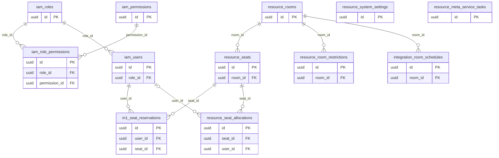
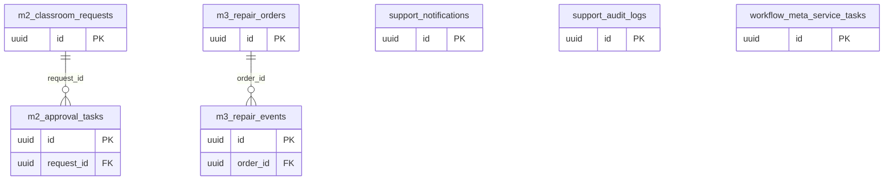
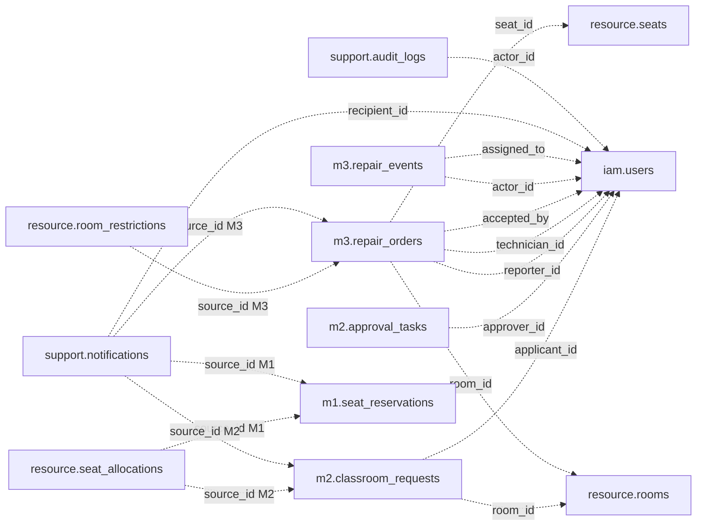

# PostgreSQL 表结构与关系

| 属性 | 作用 |
| --- | --- |
| 设计范围 | 覆盖 M1、M2、M3 和公共层；19 张应用表，Flyway 工具历史按模块维护，不计入应用表。 |
| 当前实现 | T07 已实现 iam 四张表、V2 密码迁移与资源服务 Flyway 历史；其余业务表按后续任务迁移。 |
| 简化原则 | 不建立组织层级、校区楼宇主表、多范围授权、通用审批模板、独立签到违约验收表或多源同步平台。 |
| 非空 | 是表示不能保存 SQL NULL；否表示允许为空，条件必填另列。 |
| 主键 | 唯一定位记录。业务创建重试复用同一个 UUID，同 ID 不同参数必须拒绝。 |
| 外键 | 是为数据库实际外键；跨服务用逻辑引用，不跨服务直接联表。 |
| 唯一 | 单列或组合唯一；组合 U1 对应下方 U1 约束。 |
| 默认值 | 插入缺省值，不代表修改时会自动更新。 |
| CHECK | 校验当前行的取值或字段组合。 |
| EXCLUDE | 防止同一座位或同一用户的有效占用时间重叠。 |
| 扩展依赖 | seat_allocations 的 UUID 与时间范围组合排他约束，需要迁移启用 btree_gist。 |
| INDEX | 加快查询，普通索引不保证唯一。 |
| 应用校验 | 由业务事务或公开接口验证，不能当作数据库自动保证。 |
| 时间约定 | 采用 timestamptz 时间点，按 Asia/Shanghai 展示；占用范围左闭右开。 |
| JSONB 范围 | 仅存参数、规则快照、事件参数和外部缓存；核心用户与资源关联仍用明确字段。 |

## 1 身份与权限

### iam.roles

| 字段 | 类型 | 非空 | 主键 | 外键 | 唯一 | 默认值 | 其他约束 | 引用目标 |
| --- | --- | --- | --- | --- | --- | --- | --- | --- |
| `id` | `uuid` | 是 | 是 | 否 | 是 | gen_random_uuid() | — | — |
| `created_at` | `timestamptz` | 是 | 否 | 否 | 否 | now() | — | — |
| `updated_at` | `timestamptz` | 是 | 否 | 否 | 否 | now() | — | — |
| `code` | `varchar(64)` | 是 | 否 | 否 | 是 | — | — | — |
| `name` | `varchar(64)` | 是 | 否 | 否 | 否 | — | — | — |
| `enabled` | `boolean` | 是 | 否 | 否 | 否 | true | — | — |

**字段作用**

- `id`：唯一标识本表记录；业务创建重试复用同一业务 UUID
- `created_at`：记录这一行首次创建的时间
- `updated_at`：记录最近修改时间，由应用更新；历史日志只追加
- `code`：角色的稳定编码，预置 USER、SYSTEM_ADMIN、MAINTAINER，允许管理员增加新角色
- `name`：界面显示的角色名称
- `enabled`：控制该角色是否继续提供权限

| 约束类型 | 定义 |
| --- | --- |
| U1 | UNIQUE (code) |

### iam.permissions

| 字段 | 类型 | 非空 | 主键 | 外键 | 唯一 | 默认值 | 其他约束 | 引用目标 |
| --- | --- | --- | --- | --- | --- | --- | --- | --- |
| `id` | `uuid` | 是 | 是 | 否 | 是 | gen_random_uuid() | — | — |
| `created_at` | `timestamptz` | 是 | 否 | 否 | 否 | now() | — | — |
| `updated_at` | `timestamptz` | 是 | 否 | 否 | 否 | now() | — | — |
| `code` | `varchar(128)` | 是 | 否 | 否 | 是 | — | — | — |
| `name` | `varchar(128)` | 是 | 否 | 否 | 否 | — | — | — |
| `module` | `varchar(32)` | 是 | 否 | 否 | 否 | — | — | — |

**字段作用**

- `id`：唯一标识本表记录；业务创建重试复用同一业务 UUID
- `created_at`：记录这一行首次创建的时间
- `updated_at`：记录最近修改时间，由应用更新；历史日志只追加
- `code`：后端识别的操作权限编码，例如 room:update、room:approve
- `name`：管理员配置角色时看到的操作名称
- `module`：用于按用户、资源、预约、审批和报修分组展示权限

| 约束类型 | 定义 |
| --- | --- |
| U1 | UNIQUE (code) |

### iam.role_permissions

| 字段 | 类型 | 非空 | 主键 | 外键 | 唯一 | 默认值 | 其他约束 | 引用目标 |
| --- | --- | --- | --- | --- | --- | --- | --- | --- |
| `id` | `uuid` | 是 | 是 | 否 | 是 | gen_random_uuid() | — | — |
| `created_at` | `timestamptz` | 是 | 否 | 否 | 否 | now() | — | — |
| `updated_at` | `timestamptz` | 是 | 否 | 否 | 否 | now() | — | — |
| `role_id` | `uuid` | 是 | 否 | 是 | 组合 U1 | — | — | iam.roles.id |
| `permission_id` | `uuid` | 是 | 否 | 是 | 组合 U1 | — | — | iam.permissions.id |

**字段作用**

- `id`：唯一标识本表记录；业务创建重试复用同一业务 UUID
- `created_at`：记录这一行首次创建的时间
- `updated_at`：记录最近修改时间，由应用更新；历史日志只追加
- `role_id`：关联获得权限的角色
- `permission_id`：关联该角色允许执行的操作

| 约束类型 | 定义 |
| --- | --- |
| U1 | UNIQUE (role_id, permission_id) |
| FOREIGN KEY | 所有实际外键 ON DELETE RESTRICT、ON UPDATE RESTRICT；有历史引用的账号和主数据采用停用 |

### iam.users

| 字段 | 类型 | 非空 | 主键 | 外键 | 唯一 | 默认值 | 其他约束 | 引用目标 |
| --- | --- | --- | --- | --- | --- | --- | --- | --- |
| `id` | `uuid` | 是 | 是 | 否 | 是 | gen_random_uuid() | — | — |
| `created_at` | `timestamptz` | 是 | 否 | 否 | 否 | now() | — | — |
| `updated_at` | `timestamptz` | 是 | 否 | 否 | 否 | now() | — | — |
| `login_name` | `varchar(128)` | 是 | 否 | 否 | U1、U2 | — | 本地接口限定规范化后 3—32 位 | — |
| `password_hash` | `varchar(255)` | 条件必填 | 否 | 否 | 否 | — | LOCAL 来源非空；格式见下方 CHECK | — |
| `display_name` | `varchar(128)` | 是 | 否 | 否 | 否 | — | — | — |
| `email` | `varchar(254)` | 否 | 否 | 否 | 否 | — | — | — |
| `identity_type` | `varchar(16)` | 否 | 否 | 否 | 否 | — | CHECK：STUDENT、STAFF；允许 NULL | — |
| `identity_source` | `varchar(16)` | 是 | 否 | 否 | 否 | 'LOCAL' | CHECK：LOCAL、FUDAN_UIS、DEVELOPMENT | — |
| `identity_active` | `boolean` | 是 | 否 | 否 | 否 | false | — | — |
| `role_id` | `uuid` | 是 | 否 | 是 | 否 | — | — | iam.roles.id |
| `department_code` | `varchar(64)` | 否 | 否 | 否 | 否 | — | identity_type = 'STUDENT' OR department_code IS NULL | — |
| `can_apply_room` | `boolean` | 是 | 否 | 否 | 否 | false | — | — |
| `enabled` | `boolean` | 是 | 否 | 否 | 否 | true | — | — |
| `auth_version` | `integer` | 是 | 否 | 否 | 否 | 1 | CHECK：大于 0 | — |

**字段作用**

- `id`：唯一标识用户，业务表使用该 ID 关联账号
- `created_at`：记录账号首次建立时间
- `updated_at`：记录最近修改时间，由应用更新
- `login_name`：本系统账号；本地注册时去首尾空格并转小写，首位为字母或数字，其余允许字母、数字、下划线、点、短横线
- `password_hash`：保存随机盐和密码哈希，不保存明文；旧非 LOCAL 账号允许为空，不能直接使用本地密码登录
- `display_name`：界面显示名称；新注册时初始为账号
- `email`：通知邮箱，未补全时允许为空；当前用户接口以 profileIncomplete 标记，后续邮件业务要求验证和补全
- `identity_type`：保留旧学生、教职工身份元数据；新本地账号为空，不作为普通登录条件
- `identity_source`：标记本地账号或历史账号来源；本地密码查询只接受 LOCAL，不代表已完成学校身份核验
- `identity_active`：保留旧学校资格记录值；本地密码登录不使用此字段，不据此宣称复旦身份
- `role_id`：每个账号关联一个角色；注册固定为 USER，管理和维护角色由管理员分配
- `department_code`：管理员维护的可选院系资格，用于后续院系限定资源匹配；注册不接收此字段，未核实前不授予院系资格
- `can_apply_room`：是否获得整教室申请资格，后续业务还需检查相应权限
- `enabled`：控制账号是否可以登录及访问系统
- `auth_version`：退出或变更访问权限时递增，使所有设备的旧会话失效

| 约束类型 | 定义 |
| --- | --- |
| U1 | UNIQUE (login_name)，保留原有精确值唯一约束 |
| U2 | UNIQUE INDEX ON lower(login_name) WHERE identity_source = 'LOCAL'，保证本地账号大小写不重复 |
| INDEX | (role_id) |
| CHECK | identity_type IN ('STUDENT', 'STAFF')；identity_source IN ('FUDAN_UIS', 'DEVELOPMENT', 'LOCAL') |
| CHECK | identity_source <> 'LOCAL' OR password_hash IS NOT NULL |
| CHECK | password_hash IS NULL OR password_hash ~ '^\{pbkdf2-sha256-v1\}[0-9a-f]{96}$' |
| CHECK | identity_type = 'STUDENT' OR department_code IS NULL；auth_version > 0 |
| 兼容规则 | PostgreSQL CHECK 接受 TRUE 或 NULL：identity_type 为空时该院系 CHECK 不禁止 department_code；院系资格由管理员核实，注册不能自报 |
| 应用校验 | 本地账号匹配密码且账号、角色均启用才允许登录；哈希采用 PBKDF2-HMAC-SHA256，16 字节盐、600,000 次迭代、256 位结果 |
| 应用校验 | 注册仅接收账号和密码；角色与启用状态变更校验 expectedAuthVersion，成功后递增；不能通过授权接口启用无密码旧账号 |
| FOREIGN KEY | role_id 引用 iam.roles.id，ON DELETE RESTRICT、ON UPDATE RESTRICT；历史账号采用停用 |

V1 迁移不修改；V2 增加本地密码约束，保留全部旧账号、身份字段值及启用状态。当前用户接口不返回历史学校属性或密码哈希。详见 [普通账号登录](12-password-login.md)。

## 2 教室座位与参数

### resource.rooms

| 字段 | 类型 | 非空 | 主键 | 外键 | 唯一 | 默认值 | 其他约束 | 引用目标 |
| --- | --- | --- | --- | --- | --- | --- | --- | --- |
| `id` | `uuid` | 是 | 是 | 否 | 是 | gen_random_uuid() | — | — |
| `created_at` | `timestamptz` | 是 | 否 | 否 | 否 | now() | — | — |
| `updated_at` | `timestamptz` | 是 | 否 | 否 | 否 | now() | — | — |
| `code` | `varchar(64)` | 是 | 否 | 否 | 是 | — | — | — |
| `name` | `varchar(128)` | 是 | 否 | 否 | 否 | — | — | — |
| `campus` | `varchar(64)` | 是 | 否 | 否 | 组合 U2 | — | — | — |
| `building` | `varchar(128)` | 是 | 否 | 否 | 组合 U2 | — | — | — |
| `capacity` | `integer` | 是 | 否 | 否 | 否 | — | CHECK：大于 0 | — |
| `department_code` | `varchar(64)` | 否 | 否 | 否 | 否 | — | — | — |
| `open_time` | `time` | 是 | 否 | 否 | 否 | — | — | — |
| `close_time` | `time` | 是 | 否 | 否 | 否 | — | — | — |
| `checkin_code` | `char(6)` | 否 | 否 | 否 | 否 | — | — | — |
| `checkin_code_date` | `date` | 否 | 否 | 否 | 否 | — | — | — |
| `external_code` | `varchar(128)` | 否 | 否 | 否 | 组合 U2 | — | — | — |
| `booking_enabled` | `boolean` | 是 | 否 | 否 | 否 | false | — | — |
| `enabled` | `boolean` | 是 | 否 | 否 | 否 | true | — | — |

**字段作用**

- `id`：唯一标识本表记录；业务创建重试复用同一业务 UUID
- `created_at`：记录这一行首次创建的时间
- `updated_at`：记录最近修改时间，由应用更新；历史日志只追加
- `code`：全平台唯一的房间编号，例如 HD-HGX-103
- `name`：展示房间名称
- `campus`：保存校区名称供筛选，不单独建立校区表
- `building`：保存楼宇名称供筛选，不单独建立楼宇表
- `capacity`：整室申请时校验预计人数是否超出房间容量
- `department_code`：空表示全校开放；非空时仅允许相同院系编码的用户使用
- `open_time`：每天开始开放的时刻，按 Asia/Shanghai 解释
- `close_time`：每天结束开放的时刻；小于开始时刻表示跨午夜，相等表示全天开放
- `checkin_code`：当天签到编码，仅由教室屏幕专用接口展示，普通资源查询不返回
- `checkin_code_date`：签到编码对应的上海日期，跨日后必须更新
- `external_code`：可选的复旦查询源教室编号；无需独立映射表
- `booking_enabled`：管理员取得实际管理授权后开放预约；仅查询的校方教室保持关闭
- `enabled`：停用后禁止新预约，仍保留教室及历史记录

| 约束类型 | 定义 |
| --- | --- |
| U1 | UNIQUE (code) |
| U2 | UNIQUE (campus, building, external_code) |
| CHECK | checkin_code 与 checkin_code_date 同时为空或同时非空；编码为 6 位数字 |
| 应用校验 | 院系代码为空时不限制院系；非空时与用户编码匹配。临时关闭使用 room_restrictions，不另建节假日表 |
| 应用校验 | open_time < close_time 为当日时段；大于时为跨午夜；相等时表示全天开放 |

### resource.seats

| 字段 | 类型 | 非空 | 主键 | 外键 | 唯一 | 默认值 | 其他约束 | 引用目标 |
| --- | --- | --- | --- | --- | --- | --- | --- | --- |
| `id` | `uuid` | 是 | 是 | 否 | 是 | gen_random_uuid() | — | — |
| `created_at` | `timestamptz` | 是 | 否 | 否 | 否 | now() | — | — |
| `updated_at` | `timestamptz` | 是 | 否 | 否 | 否 | now() | — | — |
| `room_id` | `uuid` | 是 | 否 | 是 | 组合 U1 | — | — | resource.rooms.id |
| `code` | `varchar(64)` | 是 | 否 | 否 | 组合 U1 | — | — | — |
| `socket_type` | `varchar(16)` | 是 | 否 | 否 | 否 | 'NONE' | CHECK：NONE、FIXED、RAIL | — |
| `enabled` | `boolean` | 是 | 否 | 否 | 否 | true | — | — |

**字段作用**

- `id`：唯一标识本表记录；业务创建重试复用同一业务 UUID
- `created_at`：记录这一行首次创建的时间
- `updated_at`：记录最近修改时间，由应用更新；历史日志只追加
- `room_id`：标识座位所在的教室
- `code`：教室内唯一座位编号，供选择和现场定位
- `socket_type`：标注无插座、固定插座或导轨插座
- `enabled`：控制座位是否允许新预约，不存储某个时段的占用状态

| 约束类型 | 定义 |
| --- | --- |
| U1 | UNIQUE (room_id, code) |
| INDEX | (room_id, enabled, socket_type) |
| 应用校验 | 变更座位清单与整室占用使用同一教室事务锁；新增座位须同步既有整室占用 |
| FOREIGN KEY | 所有实际外键 ON DELETE RESTRICT、ON UPDATE RESTRICT；有历史引用的账号和主数据采用停用 |

### resource.system_settings

| 字段 | 类型 | 非空 | 主键 | 外键 | 唯一 | 默认值 | 其他约束 | 引用目标 |
| --- | --- | --- | --- | --- | --- | --- | --- | --- |
| `id` | `uuid` | 是 | 是 | 否 | 是 | gen_random_uuid() | — | — |
| `created_at` | `timestamptz` | 是 | 否 | 否 | 否 | now() | — | — |
| `updated_at` | `timestamptz` | 是 | 否 | 否 | 否 | now() | — | — |
| `key` | `varchar(128)` | 是 | 否 | 否 | 是 | — | — | — |
| `value` | `jsonb` | 是 | 否 | 否 | 否 | — | — | — |

**字段作用**

- `id`：唯一标识本表记录；业务创建重试复用同一业务 UUID
- `created_at`：记录这一行首次创建的时间
- `updated_at`：记录最近修改时间，由应用更新；历史日志只追加
- `key`：识别参数，例如最长预约小时数、提醒间隔、审批期限和维修期限
- `value`：保存参数的具体值；由固定参数定义校验类型、单位和范围

| 约束类型 | 定义 |
| --- | --- |
| U1 | UNIQUE (key) |
| 应用校验 | 默认最长预约 4 小时，提前 15 分钟提醒，开始后 10 分钟提醒，15 分钟未签到取消。初始化只补缺失值 |

## 3 个人预约签到与违约

### m1.seat_reservations

| 字段 | 类型 | 非空 | 主键 | 外键 | 唯一 | 默认值 | 其他约束 | 引用目标 |
| --- | --- | --- | --- | --- | --- | --- | --- | --- |
| `id` | `uuid` | 是 | 是 | 否 | 是 | gen_random_uuid() | — | — |
| `created_at` | `timestamptz` | 是 | 否 | 否 | 否 | now() | — | — |
| `updated_at` | `timestamptz` | 是 | 否 | 否 | 否 | now() | — | — |
| `user_id` | `uuid` | 是 | 否 | 是 | 否 | — | — | iam.users.id |
| `seat_id` | `uuid` | 是 | 否 | 是 | 否 | — | — | resource.seats.id |
| `starts_at` | `timestamptz` | 是 | 否 | 否 | 否 | — | — | — |
| `ends_at` | `timestamptz` | 是 | 否 | 否 | 否 | — | CHECK：ends_at > starts_at | — |
| `status` | `varchar(24)` | 是 | 否 | 否 | 否 | 'RESERVED' | CHECK：RESERVED、CHECKED_IN、COMPLETED、CANCELLED、NO_SHOW | — |
| `checked_in_at` | `timestamptz` | 否 | 否 | 否 | 否 | — | — | — |
| `checkin_deadline_at` | `timestamptz` | 是 | 否 | 否 | 否 | — | — | — |
| `cancel_reason` | `varchar(32)` | 否 | 否 | 否 | 否 | — | CHECK：USER、NO_SHOW、REPAIR、ADMIN、EXTERNAL_CONFLICT | — |
| `cancelled_at` | `timestamptz` | 否 | 否 | 否 | 否 | — | — | — |
| `policy_snapshot` | `jsonb` | 是 | 否 | 否 | 否 | — | — | — |
| `version` | `integer` | 是 | 否 | 否 | 否 | 1 | CHECK：大于 0 | — |

**字段作用**

- `id`：唯一标识本表记录；业务创建重试复用同一业务 UUID
- `created_at`：记录这一行首次创建的时间
- `updated_at`：记录最近修改时间，由应用更新；历史日志只追加
- `user_id`：记录预约用户
- `seat_id`：记录预约座位
- `starts_at`：计划开始使用座位的时间
- `ends_at`：计划结束使用座位的时间
- `status`：同时承载预约生命周期和违约记录；NO_SHOW 就是一条未签到违约
- `checked_in_at`：签到成功的实际时间，不另建签到记录表
- `checkin_deadline_at`：保存该次预约的签到截止时间，避免以后修改参数影响已创建预约
- `cancel_reason`：区分用户取消、未签到、维修或管理员取消
- `cancelled_at`：预约取消或失约终止的时间
- `policy_snapshot`：固定保存本次预约的时长、提醒和签到规则
- `version`：用于签到、取消和超时任务的并发更新判断

| 约束类型 | 定义 |
| --- | --- |
| CHECK | status = CHECKED_IN 时 checked_in_at 非空；status IN (CANCELLED, NO_SHOW) 时 cancel_reason、cancelled_at 非空 |
| INDEX | (user_id, starts_at DESC)；(status, checkin_deadline_at) |
| 应用校验 | 整点小时预约且不超规则时长；检查开放时间、院系和资源冲突。仅用本人预约及当天教室编码签到 |
| 应用校验 | 违约页面按 status = NO_SHOW 查询；历史复用创建新预约。维修取消不记违约；没有独立申诉、多轮纠正流程 |
| FOREIGN KEY | 所有实际外键 ON DELETE RESTRICT、ON UPDATE RESTRICT；有历史引用的账号和主数据采用停用 |

## 4 统一占用与维修限制

### resource.seat_allocations

| 字段 | 类型 | 非空 | 主键 | 外键 | 唯一 | 默认值 | 其他约束 | 引用目标 |
| --- | --- | --- | --- | --- | --- | --- | --- | --- |
| `id` | `uuid` | 是 | 是 | 否 | 是 | gen_random_uuid() | — | — |
| `created_at` | `timestamptz` | 是 | 否 | 否 | 否 | now() | — | — |
| `updated_at` | `timestamptz` | 是 | 否 | 否 | 否 | now() | — | — |
| `seat_id` | `uuid` | 是 | 否 | 是 | 组合 U1 | — | — | resource.seats.id |
| `occupied_period` | `tstzrange` | 是 | 否 | 否 | 否 | — | CHECK：非空、有限上下界、[开始,结束) | — |
| `source_module` | `varchar(8)` | 是 | 否 | 否 | 组合 U1 | — | CHECK：M1、M2 | — |
| `source_id` | `uuid` | 是 | 否 | 否 | 组合 U1 | — | — | 逻辑引用：m1.seat_reservations / m2.classroom_requests |
| `source_version` | `integer` | 是 | 否 | 否 | 否 | 1 | CHECK：大于 0 | — |
| `user_id` | `uuid` | 否 | 否 | 是 | 否 | — | — | iam.users.id |
| `active` | `boolean` | 是 | 否 | 否 | 否 | true | — | — |

**字段作用**

- `id`：唯一标识本表记录；业务创建重试复用同一业务 UUID
- `created_at`：记录这一行首次创建的时间
- `updated_at`：记录最近修改时间，由应用更新；历史日志只追加
- `seat_id`：记录实际占用的座位
- `occupied_period`：以左闭右开的时间范围检测重叠
- `source_module`：区分个人预约 M1 和整室审批 M2
- `source_id`：记录来源预约或整室申请 ID；按 source_module 解释
- `source_version`：阻止迟到的旧占用指令覆盖更新的释放指令
- `user_id`：M1 时填写预约用户，用于阻止同一人同时占用多个座位；M2 为空
- `active`：是否仍占用资源；解除后保留来源记录

| 约束类型 | 定义 |
| --- | --- |
| U1 | UNIQUE (source_module, source_id, seat_id) |
| CHECK | source_module = M1 时 user_id 非空；M2 时为空 |
| EXCLUDE | GiST (seat_id WITH =, occupied_period WITH &&) WHERE active |
| EXCLUDE | GiST (user_id WITH =, occupied_period WITH &&) WHERE active AND source_module = 'M1' |
| 应用校验 | M2 为教室全部启用座位批量写占用；同一教室使用统一事务入口。相同来源版本重复调用无副作用，旧版本拒绝 |
| 应用校验 | 先到的释放指令也保存失效记录和版本，防止稍后重试的旧占用重新生效 |
| FOREIGN KEY | 所有实际外键 ON DELETE RESTRICT、ON UPDATE RESTRICT；有历史引用的账号和主数据采用停用 |

### resource.room_restrictions

| 字段 | 类型 | 非空 | 主键 | 外键 | 唯一 | 默认值 | 其他约束 | 引用目标 |
| --- | --- | --- | --- | --- | --- | --- | --- | --- |
| `id` | `uuid` | 是 | 是 | 否 | 是 | gen_random_uuid() | — | — |
| `created_at` | `timestamptz` | 是 | 否 | 否 | 否 | now() | — | — |
| `updated_at` | `timestamptz` | 是 | 否 | 否 | 否 | now() | — | — |
| `room_id` | `uuid` | 是 | 否 | 是 | 否 | — | — | resource.rooms.id |
| `blocked_period` | `tstzrange` | 是 | 否 | 否 | 否 | — | CHECK：非空、[开始,结束) | — |
| `source_type` | `varchar(16)` | 是 | 否 | 否 | 组合 U1 | — | CHECK：M3、ADMIN | — |
| `source_id` | `uuid` | 是 | 否 | 否 | 组合 U1 | — | — | 逻辑引用：m3.repair_orders / 管理员操作 |
| `source_version` | `integer` | 是 | 否 | 否 | 否 | 1 | CHECK：大于 0 | — |
| `reason` | `text` | 是 | 否 | 否 | 否 | — | — | — |
| `active` | `boolean` | 是 | 否 | 否 | 否 | true | — | — |

**字段作用**

- `id`：唯一标识本表记录；业务创建重试复用同一业务 UUID
- `created_at`：记录这一行首次创建的时间
- `updated_at`：记录最近修改时间，由应用更新；历史日志只追加
- `room_id`：记录被限制的教室
- `blocked_period`：整室不可预约的时间范围；维修可暂不设结束时间
- `source_type`：区分维修工单和管理员临时关闭
- `source_id`：M3 使用工单 ID，ADMIN 使用该次关闭操作的稳定 UUID
- `source_version`：阻止旧的维修下架指令覆盖更新的恢复状态
- `reason`：说明维修或关闭原因
- `active`：表示此来源的限制是否生效；仅解除自己的来源

| 约束类型 | 定义 |
| --- | --- |
| U1 | UNIQUE (source_type, source_id) |
| INDEX | (room_id, active)；blocked_period USING GiST |
| 应用校验 | 多张维修单允许重叠；解除一条不能清除其他限制。受影响预约取消并通知，不计违约 |
| 应用校验 | 状态来源和变更写入 audit_logs，不再维护重复的资源日志表；保留来源版本以处理乱序重试 |
| FOREIGN KEY | 所有实际外键 ON DELETE RESTRICT、ON UPDATE RESTRICT；有历史引用的账号和主数据采用停用 |

## 5 整教室申请与多级审批

### m2.classroom_requests

| 字段 | 类型 | 非空 | 主键 | 外键 | 唯一 | 默认值 | 其他约束 | 引用目标 |
| --- | --- | --- | --- | --- | --- | --- | --- | --- |
| `id` | `uuid` | 是 | 是 | 否 | 是 | gen_random_uuid() | — | — |
| `created_at` | `timestamptz` | 是 | 否 | 否 | 否 | now() | — | — |
| `updated_at` | `timestamptz` | 是 | 否 | 否 | 否 | now() | — | — |
| `applicant_id` | `uuid` | 是 | 否 | 否 | 否 | — | — | 逻辑引用：iam.users.id |
| `room_id` | `uuid` | 是 | 否 | 否 | 否 | — | — | 逻辑引用：resource.rooms.id |
| `starts_at` | `timestamptz` | 是 | 否 | 否 | 否 | — | — | — |
| `ends_at` | `timestamptz` | 是 | 否 | 否 | 否 | — | CHECK：ends_at > starts_at | — |
| `purpose` | `text` | 是 | 否 | 否 | 否 | — | — | — |
| `attendee_count` | `integer` | 是 | 否 | 否 | 否 | — | CHECK：大于 0 | — |
| `status` | `varchar(24)` | 是 | 否 | 否 | 否 | 'PENDING' | CHECK：PENDING、APPROVED、REJECTED、CANCELLED、EXPIRED、CONFLICT | — |
| `expires_at` | `timestamptz` | 是 | 否 | 否 | 否 | — | — | — |
| `version` | `integer` | 是 | 否 | 否 | 否 | 1 | CHECK：大于 0 | — |

**字段作用**

- `id`：唯一标识本表记录；业务创建重试复用同一业务 UUID
- `created_at`：记录这一行首次创建的时间
- `updated_at`：记录最近修改时间，由应用更新；历史日志只追加
- `applicant_id`：保存申请人 ID，通过身份服务验证资格和权限
- `room_id`：保存申请教室 ID，通过资源服务验证
- `starts_at`：申请使用整室的开始时间
- `ends_at`：申请结束时间
- `purpose`：说明用途，供管理员审批
- `attendee_count`：预计参与人数，不得超过教室容量
- `status`：保存申请、通过、驳回、撤销、超时和冲突结果
- `expires_at`：到期未完成则自动撤销，并确保来源占用被解除
- `version`：防止审批、撤销和超时任务并发覆盖，并传给资源服务去重

| 约束类型 | 定义 |
| --- | --- |
| INDEX | (applicant_id, created_at DESC)；(status, expires_at) |
| 应用校验 | 申请人同时满足角色权限和 can_apply_room；禁止自审；申请范围满足教室开放和院系条件 |
| 应用校验 | 按配置的管理员顺序生成至少两级 approval_tasks。所有节点通过且资源占用确认成功后才写 APPROVED |
| 应用校验 | 待审批不硬占座位；驳回、撤销、超时按来源 ID 幂等释放。正在同步的动作由 service_tasks 展示和恢复 |

### m2.approval_tasks

| 字段 | 类型 | 非空 | 主键 | 外键 | 唯一 | 默认值 | 其他约束 | 引用目标 |
| --- | --- | --- | --- | --- | --- | --- | --- | --- |
| `id` | `uuid` | 是 | 是 | 否 | 是 | gen_random_uuid() | — | — |
| `created_at` | `timestamptz` | 是 | 否 | 否 | 否 | now() | — | — |
| `updated_at` | `timestamptz` | 是 | 否 | 否 | 否 | now() | — | — |
| `request_id` | `uuid` | 是 | 否 | 是 | 组合 U1、组合 U2 | — | — | m2.classroom_requests.id |
| `step_no` | `smallint` | 是 | 否 | 否 | 组合 U1 | — | CHECK：大于 0 | — |
| `approver_id` | `uuid` | 是 | 否 | 否 | 组合 U2 | — | — | 逻辑引用：iam.users.id |
| `status` | `varchar(16)` | 是 | 否 | 否 | 否 | 'WAITING' | CHECK：WAITING、PENDING、APPROVED、REJECTED、EXPIRED、CANCELLED | — |
| `due_at` | `timestamptz` | 否 | 否 | 否 | 否 | — | — | — |
| `acted_at` | `timestamptz` | 否 | 否 | 否 | 否 | — | — | — |
| `comment` | `text` | 否 | 否 | 否 | 否 | — | — | — |

**字段作用**

- `id`：唯一标识本表记录；业务创建重试复用同一业务 UUID
- `created_at`：记录这一行首次创建的时间
- `updated_at`：记录最近修改时间，由应用更新；历史日志只追加
- `request_id`：关联具体整教室申请
- `step_no`：标明一级、二级等审批顺序
- `approver_id`：创建申请时固定本级审批人，不维护通用流程模板
- `status`：区分尚未轮到、待处理、通过、驳回、超时或取消
- `due_at`：本节点激活后的截止时间
- `acted_at`：实际作出审批决定的时间
- `comment`：保存通过意见或驳回原因

| 约束类型 | 定义 |
| --- | --- |
| U1 | UNIQUE (request_id, step_no) |
| U2 | UNIQUE (request_id, approver_id) |
| CHECK | status = PENDING 时 due_at 非空；APPROVED/REJECTED 时 acted_at 非空；REJECTED 时 comment 非空 |
| INDEX | (approver_id, status, due_at) |
| 应用校验 | 仅指定审批人可处理当前节点；申请人与各级审批人互不相同；状态条件更新防重复审批 |
| 应用校验 | 审批管理员顺序与超时参数保存于 system_settings；任务实例保存人员与期限，不随之后改配置而改变 |
| FOREIGN KEY | 所有实际外键 ON DELETE RESTRICT、ON UPDATE RESTRICT；有历史引用的账号和主数据采用停用 |

## 6 报修派单验收与评价

### m3.repair_orders

| 字段 | 类型 | 非空 | 主键 | 外键 | 唯一 | 默认值 | 其他约束 | 引用目标 |
| --- | --- | --- | --- | --- | --- | --- | --- | --- |
| `id` | `uuid` | 是 | 是 | 否 | 是 | gen_random_uuid() | — | — |
| `created_at` | `timestamptz` | 是 | 否 | 否 | 否 | now() | — | — |
| `updated_at` | `timestamptz` | 是 | 否 | 否 | 否 | now() | — | — |
| `reporter_id` | `uuid` | 是 | 否 | 否 | 否 | — | — | 逻辑引用：iam.users.id |
| `room_id` | `uuid` | 是 | 否 | 否 | 否 | — | — | 逻辑引用：resource.rooms.id |
| `seat_id` | `uuid` | 否 | 否 | 否 | 否 | — | — | 逻辑引用：resource.seats.id |
| `description` | `text` | 是 | 否 | 否 | 否 | — | — | — |
| `technician_id` | `uuid` | 否 | 否 | 否 | 否 | — | — | 逻辑引用：iam.users.id |
| `status` | `varchar(24)` | 是 | 否 | 否 | 否 | 'SUBMITTED' | CHECK：SUBMITTED、ASSIGNED、IN_PROGRESS、PENDING_ACCEPTANCE、COMPLETED、CANCELLED | — |
| `due_at` | `timestamptz` | 是 | 否 | 否 | 否 | — | — | — |
| `escalation_level` | `smallint` | 是 | 否 | 否 | 否 | 0 | CHECK：大于等于 0 | — |
| `repair_report` | `text` | 否 | 否 | 否 | 否 | — | — | — |
| `accepted_by` | `uuid` | 否 | 否 | 否 | 否 | — | — | 逻辑引用：iam.users.id |
| `accepted_at` | `timestamptz` | 否 | 否 | 否 | 否 | — | — | — |
| `acceptance_comment` | `text` | 否 | 否 | 否 | 否 | — | — | — |
| `rating` | `smallint` | 否 | 否 | 否 | 否 | — | CHECK：1 至 5 | — |
| `evaluation` | `text` | 否 | 否 | 否 | 否 | — | — | — |
| `evaluated_at` | `timestamptz` | 否 | 否 | 否 | 否 | — | — | — |
| `version` | `integer` | 是 | 否 | 否 | 否 | 1 | CHECK：大于 0 | — |

**字段作用**

- `id`：唯一标识本表记录；业务创建重试复用同一业务 UUID
- `created_at`：记录这一行首次创建的时间
- `updated_at`：记录最近修改时间，由应用更新；历史日志只追加
- `reporter_id`：保存报修人，供本人查询、通知、验收和评价
- `room_id`：保存故障教室，作为整室维修下架范围
- `seat_id`：故障涉及具体座位时填写
- `description`：故障现象和位置说明，第一版采用文字报修
- `technician_id`：当前负责的维护人员，管理员派单时填写
- `status`：记录从报修到派单、维修、待验收、完成或取消的阶段
- `due_at`：当前处理期限，供定时任务检查超时
- `escalation_level`：记录超时升级次数或层级，避免同级升级重复触发
- `repair_report`：保存最近一轮维修结果；历史过程写 repair_events
- `accepted_by`：最后通过验收的报修人或管理员
- `accepted_at`：验收通过的时间；驳回记录保存在处理历史
- `acceptance_comment`：保存最后一次验收意见
- `rating`：报修人对本次服务的 1 至 5 分评分
- `evaluation`：报修人的文字评价
- `evaluated_at`：保存报修人提交评价的时间
- `version`：控制派单、维修与验收并发，作为跨模块写回的来源版本

| 约束类型 | 定义 |
| --- | --- |
| INDEX | (technician_id, status, due_at)；(room_id, status)；(status, due_at) |
| CHECK | IN_PROGRESS/PENDING_ACCEPTANCE/COMPLETED 时 technician_id 非空；COMPLETED 时 accepted_by、accepted_at 非空 |
| CHECK | accepted_by 非空时不得等于 technician_id；rating 或 evaluation 非空时必须为 COMPLETED 且 evaluated_at 非空 |
| 应用校验 | 指定座位属于指定教室；维护人员仅操作自己任务；报修人或管理员验收，报修人评价 |
| 应用校验 | 下架成功后才对外写 IN_PROGRESS；验收通过并解除本工单限制后才写 COMPLETED。等待同步期间保留原状态并显示待处理动作 |
| 应用校验 | 验收失败回 IN_PROGRESS 并保留限制；每次维修、验收与升级均写 repair_events，不另建多轮验收表 |

### m3.repair_events

| 字段 | 类型 | 非空 | 主键 | 外键 | 唯一 | 默认值 | 其他约束 | 引用目标 |
| --- | --- | --- | --- | --- | --- | --- | --- | --- |
| `id` | `uuid` | 是 | 是 | 否 | 是 | gen_random_uuid() | — | — |
| `created_at` | `timestamptz` | 是 | 否 | 否 | 否 | now() | — | — |
| `updated_at` | `timestamptz` | 是 | 否 | 否 | 否 | now() | — | — |
| `order_id` | `uuid` | 是 | 否 | 是 | 否 | — | — | m3.repair_orders.id |
| `actor_id` | `uuid` | 否 | 否 | 否 | 否 | — | — | 逻辑引用：iam.users.id |
| `event_type` | `varchar(32)` | 是 | 否 | 否 | 否 | — | CHECK：SUBMIT、ASSIGN、REASSIGN、START、FINISH、ACCEPT、REJECT、ESCALATE、CANCEL | — |
| `from_status` | `varchar(24)` | 否 | 否 | 否 | 否 | — | — | — |
| `to_status` | `varchar(24)` | 是 | 否 | 否 | 否 | — | — | — |
| `assigned_to` | `uuid` | 否 | 否 | 否 | 否 | — | — | 逻辑引用：iam.users.id |
| `note` | `text` | 否 | 否 | 否 | 否 | — | — | — |

**字段作用**

- `id`：唯一标识本表记录；业务创建重试复用同一业务 UUID
- `created_at`：记录这一行首次创建的时间
- `updated_at`：记录最近修改时间，由应用更新；历史日志只追加
- `order_id`：关联所属工单
- `actor_id`：执行动作的人；系统超时升级可为空
- `event_type`：区分上报、派单、转派、开工、完工、验收、升级和取消
- `from_status`：本次动作前的工单状态
- `to_status`：本次动作后的工单状态
- `assigned_to`：派单或转派时记录新维修人，保留责任变更
- `note`：保存每轮维修结果、验收意见和升级原因

| 约束类型 | 定义 |
| --- | --- |
| INDEX | (order_id, created_at) |
| 应用校验 | 只追加，不覆盖旧历史；可从历史展示多次返工和验收，不建立通用附件或审批流程平台 |
| FOREIGN KEY | 所有实际外键 ON DELETE RESTRICT、ON UPDATE RESTRICT；有历史引用的账号和主数据采用停用 |

## 7 通知与审计

### support.notifications

| 字段 | 类型 | 非空 | 主键 | 外键 | 唯一 | 默认值 | 其他约束 | 引用目标 |
| --- | --- | --- | --- | --- | --- | --- | --- | --- |
| `id` | `uuid` | 是 | 是 | 否 | 是 | gen_random_uuid() | — | — |
| `created_at` | `timestamptz` | 是 | 否 | 否 | 否 | now() | — | — |
| `updated_at` | `timestamptz` | 是 | 否 | 否 | 否 | now() | — | — |
| `recipient_id` | `uuid` | 是 | 否 | 否 | 否 | — | — | 逻辑引用：iam.users.id |
| `channel` | `varchar(16)` | 是 | 否 | 否 | 否 | — | CHECK：IN_APP、EMAIL | — |
| `event_key` | `varchar(255)` | 是 | 否 | 否 | 是 | — | — | — |
| `source_module` | `varchar(16)` | 是 | 否 | 否 | 否 | — | CHECK：M1、M2、M3、D | — |
| `source_id` | `uuid` | 是 | 否 | 否 | 否 | — | — | 逻辑引用：m1.seat_reservations / m2.classroom_requests / m3.repair_orders / 公共事件 |
| `title` | `varchar(255)` | 是 | 否 | 否 | 否 | — | — | — |
| `body` | `text` | 是 | 否 | 否 | 否 | — | — | — |
| `scheduled_at` | `timestamptz` | 是 | 否 | 否 | 否 | — | — | — |
| `status` | `varchar(16)` | 是 | 否 | 否 | 否 | 'PENDING' | CHECK：PENDING、SENT、FAILED、CANCELLED | — |
| `retry_count` | `integer` | 是 | 否 | 否 | 否 | 0 | CHECK：大于等于 0 | — |
| `next_retry_at` | `timestamptz` | 否 | 否 | 否 | 否 | — | — | — |
| `sent_at` | `timestamptz` | 否 | 否 | 否 | 否 | — | — | — |
| `read_at` | `timestamptz` | 否 | 否 | 否 | 否 | — | — | — |

**字段作用**

- `id`：唯一标识本表记录；业务创建重试复用同一业务 UUID
- `created_at`：记录这一行首次创建的时间
- `updated_at`：记录最近修改时间，由应用更新；历史日志只追加
- `recipient_id`：通知接收用户
- `channel`：决定发送站内消息还是邮件
- `event_key`：稳定标识业务事件、接收人和渠道，防重复投递
- `source_module`：标明来自 M1、M2、M3 或公共层
- `source_id`：保存来源业务 ID，供校验提醒是否仍有效
- `title`：通知标题或邮件主题
- `body`：通知正文
- `scheduled_at`：应发送或允许重试投递的计划时间
- `status`：标识待发、成功、失败或取消
- `retry_count`：已重试次数，用于限制重试
- `next_retry_at`：失败后下次允许重试的时间
- `sent_at`：实际成功投递时间
- `read_at`：站内通知被阅读的时间

| 约束类型 | 定义 |
| --- | --- |
| U1 | UNIQUE (event_key) |
| CHECK | channel != IN_APP 时 read_at 为空；status = SENT 时 sent_at 非空 |
| INDEX | (status, scheduled_at, next_retry_at)；(recipient_id, created_at DESC) |
| 应用校验 | 业务模块决定提醒时机与是否有效；投递重试复用 event_key，邮件凭据只放运行环境 |

### support.audit_logs

| 字段 | 类型 | 非空 | 主键 | 外键 | 唯一 | 默认值 | 其他约束 | 引用目标 |
| --- | --- | --- | --- | --- | --- | --- | --- | --- |
| `id` | `uuid` | 是 | 是 | 否 | 是 | gen_random_uuid() | — | — |
| `created_at` | `timestamptz` | 是 | 否 | 否 | 否 | now() | — | — |
| `updated_at` | `timestamptz` | 是 | 否 | 否 | 否 | now() | — | — |
| `event_key` | `varchar(255)` | 是 | 否 | 否 | 是 | — | — | — |
| `source_service` | `varchar(32)` | 是 | 否 | 否 | 否 | — | — | — |
| `actor_id` | `uuid` | 否 | 否 | 否 | 否 | — | — | 逻辑引用：iam.users.id |
| `action` | `varchar(128)` | 是 | 否 | 否 | 否 | — | — | — |
| `source_module` | `varchar(16)` | 是 | 否 | 否 | 否 | — | CHECK：M1、M2、M3、D、EXTERNAL | — |
| `source_id` | `uuid` | 否 | 否 | 否 | 否 | — | — | 逻辑引用：按 source_module 与 action 解释 |
| `before_data` | `jsonb` | 否 | 否 | 否 | 否 | — | — | — |
| `after_data` | `jsonb` | 否 | 否 | 否 | 否 | — | — | — |
| `success` | `boolean` | 是 | 否 | 否 | 否 | — | — | — |
| `occurred_at` | `timestamptz` | 是 | 否 | 否 | 否 | — | — | — |
| `trace_id` | `varchar(64)` | 是 | 否 | 否 | 否 | — | — | — |

**字段作用**

- `id`：唯一标识本表记录；业务创建重试复用同一业务 UUID
- `created_at`：记录这一行首次创建的时间
- `updated_at`：记录最近修改时间，由应用更新；历史日志只追加
- `event_key`：来源服务生成的稳定事件键，防止重复写审计
- `source_service`：记录产生操作的后端服务
- `actor_id`：记录操作者；系统任务可为空
- `action`：标识修改权限、预约、审批、下架或恢复等具体动作
- `source_module`：记录 M1、M2、M3 或公共操作的写入来源
- `source_id`：记录来源业务或资源 ID，与来源模块一起追溯
- `before_data`：变化前的脱敏摘要；资源动作包含教室、座位与时间范围
- `after_data`：变化后的脱敏摘要，支持状态写回验收
- `success`：标记操作是否成功
- `occurred_at`：保存来源服务中的实际发生时间
- `trace_id`：串联网络请求、后台任务和日志

| 约束类型 | 定义 |
| --- | --- |
| U1 | UNIQUE (event_key) |
| INDEX | (source_module, source_id)；(actor_id, occurred_at DESC)；(trace_id) |
| 应用校验 | 只追加；不记录密码、令牌或签到码明文；来源服务通过本地 service_tasks 可靠投递 |

## 8 跨服务任务

### resource_meta.service_tasks

| 字段 | 类型 | 非空 | 主键 | 外键 | 唯一 | 默认值 | 其他约束 | 引用目标 |
| --- | --- | --- | --- | --- | --- | --- | --- | --- |
| `id` | `uuid` | 是 | 是 | 否 | 是 | gen_random_uuid() | — | — |
| `created_at` | `timestamptz` | 是 | 否 | 否 | 否 | now() | — | — |
| `updated_at` | `timestamptz` | 是 | 否 | 否 | 否 | now() | — | — |
| `task_key` | `varchar(255)` | 是 | 否 | 否 | 是 | — | — | — |
| `task_type` | `varchar(64)` | 是 | 否 | 否 | 否 | — | — | — |
| `source_id` | `uuid` | 是 | 否 | 否 | 否 | — | — | 逻辑引用：本服务业务记录 |
| `payload` | `jsonb` | 是 | 否 | 否 | 否 | — | — | — |
| `status` | `varchar(16)` | 是 | 否 | 否 | 否 | 'PENDING' | CHECK：PENDING、PROCESSING、DONE、FAILED | — |
| `attempt_count` | `integer` | 是 | 否 | 否 | 否 | 0 | CHECK：大于等于 0 | — |
| `next_run_at` | `timestamptz` | 是 | 否 | 否 | 否 | now() | — | — |
| `locked_until` | `timestamptz` | 否 | 否 | 否 | 否 | — | — | — |
| `last_error` | `text` | 否 | 否 | 否 | 否 | — | — | — |

**字段作用**

- `id`：唯一标识本表记录；业务创建重试复用同一业务 UUID
- `created_at`：记录这一行首次创建的时间
- `updated_at`：记录最近修改时间，由应用更新；历史日志只追加
- `task_key`：使用业务 ID、版本和动作生成稳定任务键
- `task_type`：选择占用、释放、维修下架、恢复、发送通知或审计等公开接口动作
- `source_id`：定位本服务的业务记录，便于查询未完成操作
- `payload`：保存目标接口所需参数和来源版本；接口地址与密钥在配置中
- `status`：记录待处理、处理中、完成或需人工处理的失败
- `attempt_count`：累计调用次数，用于有限重试
- `next_run_at`：下次允许处理的时间
- `locked_until`：任务处理中租约到期时间，中断后可恢复
- `last_error`：保存最近一次失败的脱敏摘要

| 约束类型 | 定义 |
| --- | --- |
| U1 | UNIQUE (task_key) |
| CHECK | status = PROCESSING 时 locked_until 非空 |
| INDEX | (status, next_run_at)；(source_id, status) |
| 应用校验 | 业务变更与待调用任务同一事务提交；超时任务可回收，失败可重试和对账。同一业务的互斥动作串行处理 |
| 应用校验 | 接收方依业务 ID、来源版本和唯一键幂等；同 ID 不同参数拒绝。无独立幂等框架或事件总线 |

### workflow_meta.service_tasks

| 字段 | 类型 | 非空 | 主键 | 外键 | 唯一 | 默认值 | 其他约束 | 引用目标 |
| --- | --- | --- | --- | --- | --- | --- | --- | --- |
| `id` | `uuid` | 是 | 是 | 否 | 是 | gen_random_uuid() | — | — |
| `created_at` | `timestamptz` | 是 | 否 | 否 | 否 | now() | — | — |
| `updated_at` | `timestamptz` | 是 | 否 | 否 | 否 | now() | — | — |
| `task_key` | `varchar(255)` | 是 | 否 | 否 | 是 | — | — | — |
| `task_type` | `varchar(64)` | 是 | 否 | 否 | 否 | — | — | — |
| `source_id` | `uuid` | 是 | 否 | 否 | 否 | — | — | 逻辑引用：本服务业务记录 |
| `payload` | `jsonb` | 是 | 否 | 否 | 否 | — | — | — |
| `status` | `varchar(16)` | 是 | 否 | 否 | 否 | 'PENDING' | CHECK：PENDING、PROCESSING、DONE、FAILED | — |
| `attempt_count` | `integer` | 是 | 否 | 否 | 否 | 0 | CHECK：大于等于 0 | — |
| `next_run_at` | `timestamptz` | 是 | 否 | 否 | 否 | now() | — | — |
| `locked_until` | `timestamptz` | 否 | 否 | 否 | 否 | — | — | — |
| `last_error` | `text` | 否 | 否 | 否 | 否 | — | — | — |

**字段作用**

- `id`：唯一标识本表记录；业务创建重试复用同一业务 UUID
- `created_at`：记录这一行首次创建的时间
- `updated_at`：记录最近修改时间，由应用更新；历史日志只追加
- `task_key`：使用业务 ID、版本和动作生成稳定任务键
- `task_type`：选择占用、释放、维修下架、恢复、发送通知或审计等公开接口动作
- `source_id`：定位本服务的业务记录，便于查询未完成操作
- `payload`：保存目标接口所需参数和来源版本；接口地址与密钥在配置中
- `status`：记录待处理、处理中、完成或需人工处理的失败
- `attempt_count`：累计调用次数，用于有限重试
- `next_run_at`：下次允许处理的时间
- `locked_until`：任务处理中租约到期时间，中断后可恢复
- `last_error`：保存最近一次失败的脱敏摘要

| 约束类型 | 定义 |
| --- | --- |
| U1 | UNIQUE (task_key) |
| CHECK | status = PROCESSING 时 locked_until 非空 |
| INDEX | (status, next_run_at)；(source_id, status) |
| 应用校验 | 业务变更与待调用任务同一事务提交；超时任务可回收，失败可重试和对账。同一业务的互斥动作串行处理 |
| 应用校验 | 接收方依业务 ID、来源版本和唯一键幂等；同 ID 不同参数拒绝。无独立幂等框架或事件总线 |

## 9 复旦查询缓存

### integration.room_schedules

| 字段 | 类型 | 非空 | 主键 | 外键 | 唯一 | 默认值 | 其他约束 | 引用目标 |
| --- | --- | --- | --- | --- | --- | --- | --- | --- |
| `id` | `uuid` | 是 | 是 | 否 | 是 | gen_random_uuid() | — | — |
| `created_at` | `timestamptz` | 是 | 否 | 否 | 否 | now() | — | — |
| `updated_at` | `timestamptz` | 是 | 否 | 否 | 否 | now() | — | — |
| `room_id` | `uuid` | 是 | 否 | 是 | 组合 U1 | — | — | resource.rooms.id |
| `schedule_date` | `date` | 是 | 否 | 否 | 组合 U1 | — | — | — |
| `busy_periods` | `jsonb` | 是 | 否 | 否 | 否 | — | — | — |
| `fetched_at` | `timestamptz` | 是 | 否 | 否 | 否 | — | — | — |
| `expires_at` | `timestamptz` | 是 | 否 | 否 | 否 | — | CHECK：expires_at > fetched_at | — |

**字段作用**

- `id`：唯一标识本表记录；业务创建重试复用同一业务 UUID
- `created_at`：记录这一行首次创建的时间
- `updated_at`：记录最近修改时间，由应用更新；历史日志只追加
- `room_id`：关联已登记且配置了外部编号的房间
- `schedule_date`：明确这份完整观测覆盖哪一天，避免误认为覆盖其他日期
- `busy_periods`：保存当天实际占用时间段数组；空数组表示该日查询结果为空闲
- `fetched_at`：保存最近一次完整、成功获取该日数据的时间
- `expires_at`：规定该日缓存的有效期

| 约束类型 | 定义 |
| --- | --- |
| U1 | UNIQUE (room_id, schedule_date) |
| 应用校验 | 仅完整且成功的结果替换对应日期；时间段数组按固定契约验证。失败保留旧数据，过期显示未知而非空闲 |
| 应用校验 | 配置外部编号且开放实际预约的教室，相关日期数据应新鲜并无冲突；查询接口、网络和刷新参数在部署配置中，不建立多源平台 |
| 应用校验 | 此项承接用户希望接入复旦查询的需求；不代表获得学校预约写入权，未获管理授权的房间不开放预约 |
| FOREIGN KEY | 所有实际外键 ON DELETE RESTRICT、ON UPDATE RESTRICT；有历史引用的账号和主数据采用停用 |

## 10 迁移工具历史表

### resource_meta.flyway_schema_history

| 字段 | 类型 | 非空 | 主键 | 外键 | 唯一 | 默认值 | 其他约束 | 引用目标 |
| --- | --- | --- | --- | --- | --- | --- | --- | --- |
| `installed_rank` | `integer` | 是 | 是 | 否 | 是 | — | 工具自动维护 | — |
| `version` | `varchar` | 否 | 否 | 否 | 否 | — | 工具自动维护 | — |
| `description` | `varchar` | 是 | 否 | 否 | 否 | — | 工具自动维护 | — |
| `type` | `varchar` | 是 | 否 | 否 | 否 | — | 工具自动维护 | — |
| `script` | `varchar` | 是 | 否 | 否 | 否 | — | 工具自动维护 | — |
| `checksum` | `integer` | 否 | 否 | 否 | 否 | — | 工具自动维护 | — |
| `installed_by` | `varchar` | 是 | 否 | 否 | 否 | — | 工具自动维护 | — |
| `installed_on` | `timestamp` | 是 | 否 | 否 | 否 | CURRENT_TIMESTAMP | 工具自动维护 | — |
| `execution_time` | `integer` | 是 | 否 | 否 | 否 | — | 工具自动维护 | — |
| `success` | `boolean` | 是 | 否 | 否 | 否 | — | 工具自动维护 | — |

**字段作用**

- `installed_rank`：迁移执行顺序，也是历史表主键
- `version`：版本化迁移的版本号；可重复迁移可为空
- `description`：本次迁移的名称或说明
- `type`：迁移类型，如 SQL 或 Java
- `script`：执行的迁移文件或类名
- `checksum`：检查已经执行的迁移内容是否被修改
- `installed_by`：执行迁移的数据库账号
- `installed_on`：迁移实际安装时间
- `execution_time`：执行耗时，单位毫秒
- `success`：该次迁移是否成功

### workflow_meta.flyway_schema_history

| 字段 | 类型 | 非空 | 主键 | 外键 | 唯一 | 默认值 | 其他约束 | 引用目标 |
| --- | --- | --- | --- | --- | --- | --- | --- | --- |
| `installed_rank` | `integer` | 是 | 是 | 否 | 是 | — | 工具自动维护 | — |
| `version` | `varchar` | 否 | 否 | 否 | 否 | — | 工具自动维护 | — |
| `description` | `varchar` | 是 | 否 | 否 | 否 | — | 工具自动维护 | — |
| `type` | `varchar` | 是 | 否 | 否 | 否 | — | 工具自动维护 | — |
| `script` | `varchar` | 是 | 否 | 否 | 否 | — | 工具自动维护 | — |
| `checksum` | `integer` | 否 | 否 | 否 | 否 | — | 工具自动维护 | — |
| `installed_by` | `varchar` | 是 | 否 | 否 | 否 | — | 工具自动维护 | — |
| `installed_on` | `timestamp` | 是 | 否 | 否 | 否 | CURRENT_TIMESTAMP | 工具自动维护 | — |
| `execution_time` | `integer` | 是 | 否 | 否 | 否 | — | 工具自动维护 | — |
| `success` | `boolean` | 是 | 否 | 否 | 否 | — | 工具自动维护 | — |

**字段作用**

- `installed_rank`：迁移执行顺序，也是历史表主键
- `version`：版本化迁移的版本号；可重复迁移可为空
- `description`：本次迁移的名称或说明
- `type`：迁移类型，如 SQL 或 Java
- `script`：执行的迁移文件或类名
- `checksum`：检查已经执行的迁移内容是否被修改
- `installed_by`：执行迁移的数据库账号
- `installed_on`：迁移实际安装时间
- `execution_time`：执行耗时，单位毫秒
- `success`：该次迁移是否成功

## 11 任务书功能对应

| 要求 | 数据承载 | 验证重点 |
| --- | --- | --- |
| D 身份权限 | users、roles、permissions、role_permissions | 三种默认角色；仍可增加新角色和权限组合，第一版单账号单角色 |
| D 空间座位 | rooms、seats | 登记、停用、开放时间、插座标记、每日签到码 |
| D 通知审计 | notifications、audit_logs | 邮件或站内通知、操作审计、来源追踪 |
| M1 院系专用自习室 | users.department_code、rooms.department_code | 教室编码为空时全校开放；否则匹配经核实的学生院系资格。不建组织表 |
| M1 条件搜索 | rooms、seats、seat_allocations、room_restrictions | 按位置、时间、插座、资格和有效占用筛选 |
| M1 小时预约 | seat_reservations、system_settings | 整点小时，默认最多 4 小时，可配置 |
| M1 签到 | rooms.checkin_code / checkin_code_date、seat_reservations.checked_in_at | 每日教室码，验证本人预约、所属教室及签到期限 |
| M1 提醒和违约 | seat_reservations、notifications、service_tasks | 提前 15 分钟提醒，开始后 10 分钟提醒，15 分钟未签到取消并释放；NO_SHOW 即违约记录 |
| M1 历史与复用 | seat_reservations | 查询历史，新建预约并重新验证资源 |
| M1 运营统计 | seat_reservations、seat_allocations | 直接聚合预约、签到、失约与占用数据，不建统计平台 |
| M2 权限门槛 | users.can_apply_room、角色权限 | 申请资格和操作权限同时满足 |
| M2 多级审批 | classroom_requests、approval_tasks | 由配置生成至少两级、不同管理员的审批记录；禁止自审 |
| M2 超时撤销 | expires_at、service_tasks、seat_allocations | 自动撤销并幂等释放本申请的占用 |
| M3 报修和派单 | repair_orders、repair_events | 故障上报、派单、转派、维修过程及责任历史 |
| M3 超时升级 | due_at、escalation_level、repair_events、notifications | 定时检查、升级、留痕和通知 |
| M3 验收评价 | repair_orders 验收评价字段、repair_events | 通过后恢复，失败继续维修；多轮过程保留在历史中 |
| 跨模块写回 | seat_allocations、room_restrictions、service_tasks | B 通过 HTTP 调用 A；整室占用、维修下架和恢复保持一致 |
| 来源追溯 | source_module / source_type、source_id、audit_logs | 保留 M1、M2、M3 来源、业务 ID 与变更前后摘要 |
| 工程要求 | Flyway 历史表、目录文档中的流水线和版本规则 | 迁移与幂等种子、版本控制、有效测试、自动测试部署、生产审批发布和回滚均保留 |
| 复旦查询接入 | room_schedules、rooms.external_code | 承接用户希望的真实查询接入，只读缓存且有范围和时效，不自动获得校方预约权限 |
| 附加业务 Agent | 公开业务 API | 后续按课程附加项实现时复用现有数据，不新增 Agent 业务表 |

## 12 表关系图

### 资源预约服务实际外键

### 流程工单服务实际外键

### 逻辑引用关系

