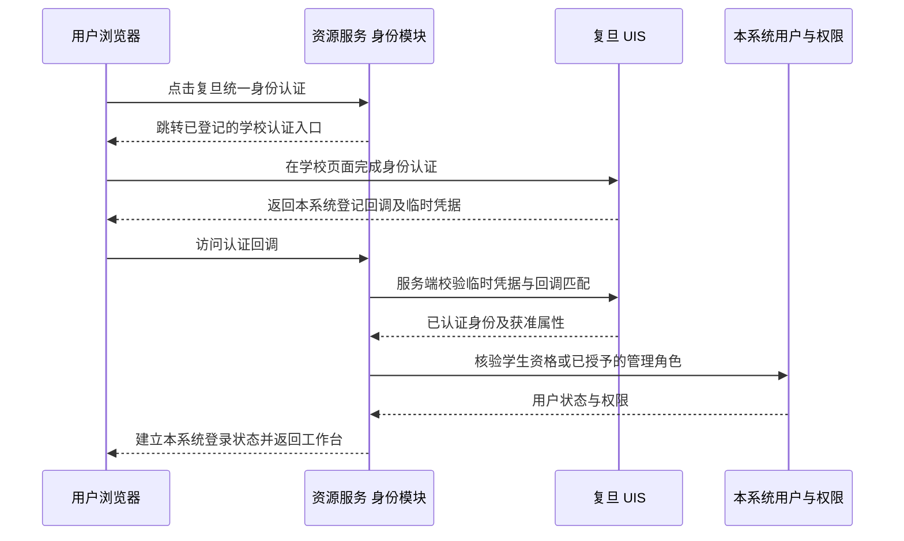

# 前端风格与复旦身份认证实施计划

日期：2026年10月25日。状态：方案与待办，尚未开发或接入校方服务。

本阶段采用 TypeScript、Vue 3、Java、Spring Boot、PostgreSQL，沿用既有两个后端服务和四人分工。前端参考 WisePen 的视觉语言；正式环境仅接受复旦统一身份认证。普通用户仅限复旦学生，系统管理员和维护人员也允许使用复旦工号。身份是否真实、是否符合学生资格、能执行哪些操作，分别由学校认证、资格核验、本系统权限控制解决。

## 1 调研结果与接入前提

| 项目 | 已核实 | 尚待确认 |
| --- | --- | --- |
| 复旦官方接入服务 | 信息办列有应用系统对接统一身份认证服务，并公布了线上申请入口 | 课程项目是否可以申请，是否需要指导教师或学院作为责任主体，办理时长 |
| 申请入口 | 信息办公布的 matterDetails?app_id=362 | 申请表的完整要求、审批结果、测试环境及回调地址登记规则 |
| 协议 | 复旦公开系统中存在 CAS 登录；Spring Security 有 CAS 接入能力 | 本项目获批使用 CAS、OIDC 或其他校方协议，具体端点与参数 |
| 身份属性 | 学工号是学校现有认证场景使用的标识 | 是否返回稳定用户 ID、学生或教职工类型、在读或有效状态、姓名、院系编码、邮箱 |
| WisePen 参考 | 已取得线上 HTML、构建样式及其公开前端仓库中的登录布局、主题和主框架源码 | 浏览器工具未能正常启动，无头预览也未完成；未实测登录后的页面，也未完成截图对照 |

复旦提供的是可申请的系统接入服务。公开资料不足以证明任意第三方项目可以免申请使用，也不能据此承诺接入工期。先取得接入条件，再填写实际配置；本计划不虚构校方校验地址、client_id 或返回字段。[复旦信息办服务目录](https://xxb.fudan.edu.cn/xxhzcfw/list.htm)

申请入口：[统一身份认证接入申请](https://workflow5.fudan.edu.cn/fe/site/matterDetails?app_id=362)。申请和联系由团队或指导教师完成，本次未提交申请、邮件或任何个人账号信息。

## 2 前端视觉方案

公开源码体现的参考特征包括：居中的登录面板、柔和的渐变装饰背景、浅底色和内容面板、细边框、统一圆角、克制的字体层级，以及可折叠侧栏与窄屏抽屉。公开仓库默认配色为 aqua，但本次没有核实用户浏览器当前选择的主题。[登录布局](https://github.com/Oriole-FDU/WisePenView/blob/main/src/layouts/Auth/style.module.less)、[背景样式](https://github.com/Oriole-FDU/WisePenView/blob/main/src/layouts/Auth/AuthBackground/style.module.less)、[主框架](https://github.com/Oriole-FDU/WisePenView/blob/main/src/layouts/MainShell/style.module.less)

以下数值为本项目原型起点，在原型评审时调整，不代表从线上页面精确量取。

| 设计项 | 本项目方案 |
| --- | --- |
| 整体 | 浅灰背景、白色面板、深色正文、低饱和蓝绿强调色，突出预约状态和操作 |
| 配色 | 首版一套浅色主题；集中定义背景、面板、边框、正文、弱化文字、主色和状态色 |
| 字体 | 中文无衬线字体；正文 14—16px、辅助文字 12—14px、页面标题 24—28px |
| 圆角 | 按钮、表单和内容面板统一约 8px，弹窗约 12px；通过公共变量维护 |
| 间距 | 以 4px 为基础刻度，页面与面板采用一致的内外间距 |
| 桌面框架 | 约 240px 可折叠侧栏，右侧包含页标题、筛选区、内容区；通知和个人入口集中 |
| 手机框架 | 侧栏改抽屉；预约列表改卡片，座位图允许在局部平移，主要操作保持可见 |
| 状态表达 | 可预约、已占用、维修、待审批使用不同标签，同时提供文字或图标，颜色不承担唯一含义 |
| 动效 | 短时过渡用于展开和反馈；支持减少动态效果的系统偏好 |
| 组件 | 推荐 Naive UI 承载表单、日期选择、表格、弹窗；通过统一主题覆盖并封装项目公共组件 |

Naive UI 提供 Vue 3、TypeScript 和主题定制能力，适合作为现有技术栈的组件基础；具体版本在实现时统一锁定。[Naive UI 官方仓库](https://github.com/tusen-ai/naive-ui)

WisePen 的公开前端采用 React，本项目保持 Vue 3。借鉴布局、颜色关系和交互规律，由团队实现自己的组件与品牌素材；如后续需要直接复用源文件，先核对对应仓库许可。首版不增加参考站的课程、云盘、协同编辑等业务，也不增加多套可切换主题。

### 首批原型与页面

| 页面 | 首批内容 | 负责人 |
| --- | --- | --- |
| 登录页 | 系统名称、简短用途、复旦统一身份认证按钮、适用身份说明、认证失败帮助 | 前端 B |
| 学生首页与座位搜索 | 校区、楼宇、日期、时段、插座筛选，空闲资源卡片，当前预约提醒 | 前端 A |
| 教室详情与座位选择 | 房间信息、状态图例、座位状态、选择时段与预约确认 | 前端 A |
| 我的记录 | 预约与签到、整室申请、报修状态；按业务模块分别实现 | A 负责预约，B 负责审批与报修 |
| 管理与维护页面 | 资源表格、审批列表、工单列表和详情，共用相同面板、表单与状态组件 | A 负责资源，B 负责其他页面 |

登录页不要求用户在本平台输入学校密码。页面可以模仿参考站的面板风格，但主要操作是进入学校认证页面；不保留本平台任意用户名注册入口。用户离开学校认证页、回到本平台时，显示处理中、资格不符、服务不可用等明确状态。

## 3 账号与角色规则

| 账号情况 | 登录及业务规则 |
| --- | --- |
| 经核实的复旦学生 | 首次正式认证且资格核验成功后创建普通用户；可以使用学生预约功能 |
| 使用工号的教职工 | 只有被本系统预先授予管理员或维护角色，才允许进入相应工作台 |
| 学生身份的管理员或维护人员 | 使用学号完成认证；按系统配置获得管理或维护权限，可另在同一角色中包含学生预约权限 |
| 校友、访客、临时账号、资格未知 | 不因 UIS 认证成功就自动获得学生预约资格；未满足允许条件时拒绝进入业务系统 |
| 已停用的本系统账号 | 学校认证成功也拒绝访问 |

“学校认证成功”证明登录身份；它不自动证明在读学生资格，也不自动赋予本平台管理权限。不能只检查输入是不是数字、学号长度或邮箱后缀。学生与教职工类型、在读或有效状态优先采用校方授权属性；若认证不提供这些属性，则需要另行获准的数据服务或经责任人核实的学生名单。

账号首次创建和授权都由后端处理。前端不提交可自行选择的身份类型或角色。学校身份属性只用于核验资格；SYSTEM_ADMIN、MAINTAINER 仍由本系统授予。首位管理员绑定到事先指定、经过正式认证的学工号，通过受控初始化配置建立，不提供公共管理账号。

学生资格与账号状态必须有更新机制：登录时重新核验，并按获准数据源定期同步或由管理员维护核实名单。资格过期、账号停用或角色修改后，更新 auth_version，现有登录状态按约定失效。无法取得可信学生资格的账号不自动放行。

## 4 正式认证流程

先按 CAS 的典型流程规划接口边界，最终实现服从学校下发的接入协议。若批准 OIDC，则替换协议适配部分，业务模块仍接收统一的本系统身份信息。[Spring Security CAS 文档](https://docs.spring.io/spring-security/reference/servlet/authentication/cas.html)

本系统只接收校方认证结果。临时凭据必须由后端向学校校验成功后使用；不能相信浏览器自己提交的学号或仅凭回调参数认定登录成功。返回业务页面时清理临时凭据，校验登录发起与回调的关联，回跳目标只允许站内登记路径。

| 接口职责 | 归属 | 计划行为 |
| --- | --- | --- |
| 发起学校登录 | resource-service / identity | 生成登录关联信息，记录合法回跳页，跳转登记认证入口 |
| 处理认证回调 | resource-service / identity | 校验凭据、核验资格、匹配唯一账号、建立本系统登录状态 |
| 查询当前用户 | resource-service / identity | 返回身份类型、角色、权限、必要资料与是否需要补全信息 |
| 退出本系统 | resource-service / identity | 清理本系统登录状态并使旧凭据失效；学校全局退出按校方支持单独定义 |
| 业务鉴权 | 两个后端各自负责 | 校验当前账号、操作权限与记录归属，拒绝跨用户和越权请求 |

初步路径可用 /api/auth/fudan/login、/api/auth/fudan/callback、/api/auth/me、/api/auth/logout。这些是本项目规划的接口名称，不是已经核实的校方 API；最终在 contracts/openapi 中定稿。

前后端部署在同一站点，通过路径转发访问两个后端。建议由身份模块签发本系统短期登录凭据，存入 HttpOnly、Secure Cookie，避免前端脚本读取；认证回调所需的临时状态也由后端保护。跨站请求保护、回调关联、凭据过期和日志脱敏一并实现。

为保持第一版简单，先不增加 Redis 或会话管理平台。两个服务验证本系统凭据；流程服务通过身份服务的受保护接口检查最新账号与权限状态，包含 enabled、auth_version 和身份资格。身份服务暂不可用时明确返回服务异常，不把前端传入角色当作替代。普通退出至少使该用户旧版本凭据失效，因此第一版可以采用“退出本系统使本系统所有设备退出”的简单规则。

## 5 没拿到校方接入配置时的安排

视觉原型、接口契约、权限规则和两服务联调可以先推进。开发环境使用明确标识的模拟身份，覆盖学生、工号管理员、维护人员、无资格和停用情况；生产配置必须禁用模拟入口，不允许认证失败时自动切换为本地账号。模拟认证通过不计作复旦登录验收通过。

如果课程周期内无法获准正式 UIS 接入，团队需要明确选择继续等待，或把阶段性交付界定为受控试点。经核实的学生名单加校邮验证可以另行讨论，但邮箱验证仅证明邮箱控制权，不能单独证明在读身份，也不能宣称已经完成学校统一认证接入。本计划以正式 UIS 接入为目标，不自动变更登录要求。

## 6 数据库最小调整计划

保持 19 张应用表，不引入组织树或通用身份平台。本次只记录下一轮修改建议，02-database-design.md 的 iam.users 仍是上一轮本地登录草案；实施认证前必须按此节统一修订字段表、用途与约束，不能直接照旧密码字段开发。

| 位置 | 建议调整 | 目的 |
| --- | --- | --- |
| iam.users.login_name | 保留字段和唯一约束，限定为校方验证后的规范学工号 | 避免增加一套用户名；认证重试与重复回调匹配同一用户 |
| iam.users.password_hash | 正式 UIS 单一入口方案删除该字段 | 本系统不管理学校密码或独立的本地登录密码 |
| iam.users.identity_type | 增加 STUDENT、STAFF 的受控身份类别 | 区分学生资格与管理角色，不能由用户自行提交 |
| 稳定主体 ID | 先确认校方契约；若另有独立稳定 ID，再增加唯一 uis_subject | 避免在未核实学工号生命周期前重复建模或错误合并账号 |
| iam.users.department_code | 保留可选字段，由学校授权数据或核实名单维护 | 仅服务院系自习室资格判断，不建立组织关系 |
| iam.users.email | 核实 UIS 是否返回；缺失时通过可信导入或首次验证补齐，重新确定是否允许待补全状态为空 | 保留任务书邮件通知能力，不能假定某种学号邮箱格式必然存在 |
| role_id、enabled、auth_version | 保留，学校身份认证不覆盖本系统角色和停用决定 | 延续既有单角色权限模型和凭据失效机制 |

身份来源固定为复旦，因此首版无需 identity_providers、external_accounts 等多提供方表。登录成功、失败、资格拒绝和管理授权变化接入既有 audit_logs，日志中不记录学校密码、完整临时凭据或本系统登录凭据。

## 7 目录和四人分工

以下均为后续新增位置，本次不创建代码文件。目录总览与所有权继续见 [项目目录与模块归属](01-project-structure.md)。

| 位置 | 内容 | 唯一维护人 |
| --- | --- | --- |
| frontend/src/shared/styles | 色彩、字体、间距、圆角、状态与动效变量；组件库主题覆盖 | 前端 A |
| frontend/src/shared/components | 按钮、状态标签、面板、空状态、业务表单等公共封装 | 前端 A |
| frontend/src/app | 公共布局、导航汇总、身份上下文入口 | 前端 B |
| frontend/src/modules/auth | 登录、认证回调状态、资格拒绝、资料补全、退出 | 前端 B |
| frontend/src/modules/reservation、resource | 学生预约流程、教室座位及资源管理页面 | 前端 A |
| frontend/src/modules/approval、repair、system | 审批、工单、用户角色配置，复用公共视觉组件 | 前端 B |
| backend/resource-service/.../identity | UIS 协议适配、身份核验、账号、角色和当前权限查询 | 后端 A |
| backend/platform-common/.../security | 两服务使用的凭据校验与身份上下文基础能力 | 后端 A |
| backend/workflow-service | 复用身份契约，执行审批与工单操作授权 | 后端 B |
| backend/workflow-service/.../audit | 认证及授权相关审计的可靠接收与查询 | 后端 B |
| contracts/openapi | 认证和当前用户契约由后端 A 维护，其他三人评审使用 | 后端 A |
| infra、scripts、skills/campus-build | 同站点转发、认证环境配置说明、模拟与正式环境隔离、联调入口 | 后端 B |

前端 B 需要新公共组件时先约定输入输出，由前端 A 维护共享实现；两名前端在各自模块内维护页面。后端 B 通过正式身份接口获取状态，不访问 iam 表，也不重复实现 UIS 登录。

## 8 Stage 顺序与验收

| Stage | 交付 | 负责人 | 通过条件 |
| --- | --- | --- | --- |
| 0 接入条件确认 | 学校申请材料、责任人、测试及正式域名、回调、协议、字段、测试账号与网络条件清单 | 后端 A 汇总，指导教师或学院协助 | 官方服务存在与本项目获准接入分别记录；所有外部条件有明确状态 |
| 1 视觉原型 | 登录、座位搜索、教室详情、后台列表四类原型及主题变量表 | 前端 A 主导，B 评审 | 用实际浏览器对照参考站；确认桌面与手机效果，锁定一套组件库与主题 |
| 2 契约和数据定稿 | 当前用户、发起登录、回调与退出契约；iam.users 调整及身份资格规则 | 后端 A，三人评审 | 明确学生与工号规则，资格未知不放行；同步数据库文档，无新增组织关系 |
| 3 公共骨架联调 | Vue 公共布局、公共组件、登录状态、受保护路由，后端权限接口 | 两名前端与两名后端按归属开发 | 模拟身份可以完整演练，界面明确区分开发身份与正式认证 |
| 4 正式 UIS 闭环 | 学校跳转、真实回调校验、唯一账号匹配、身份与角色判定 | 后端 A，前端 B | 用获准测试账号实际完成登录；伪造、过期或重复使用临时凭据均不能登录 |
| 5 跨服务与业务接入 | M1 学生资格、M2 审批权限、M3 派单范围、登录与授权审计 | A 负责 M1 与身份，B 负责 M2/M3 与审计 | 同一身份在两个服务行为一致；工号账号不因已认证而获得学生预约能力 |
| 6 验收与运行入口 | 真实浏览器行为验证、故障恢复验证、macOS/Windows 构建说明及 build skill 配置边界 | 后端 B 汇总，全员验收 | 生产无模拟或任意用户名入口，空库初始化可绑定指定管理员，缺少 UIS 配置时准确说明未就绪 |

Stage 1 和 Stage 0 的申请调查可以同时推进，Stage 3 的模拟联调可在等待审批期间开展。Stage 4 的正式认证和最终真实接入验收必须等校方配置就绪；依赖未解决时不得标记完成，不承诺申请所需天数。

验收至少覆盖：有效学生首次和重复登录；工号普通用户被拒绝、已授予的工号管理员或维护人员可进入；非学生和资格未知被拒绝；身份或角色篡改无效；临时凭据重放或过期失败；停用与改权使旧凭据失效；正常退出；UIS 或身份服务不可用；院系限定；手机与桌面布局、键盘操作、加载及错误提示。工号登录不应代替角色授权，模拟数据不应混入正式用户。
