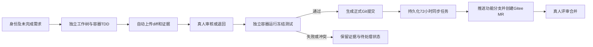

# 团队技能、六模块限界与缓冲站

本阶段建立协作基线，不执行六模块剩余业务开发。任务来源为 `sources/task-book.pdf`（6页），可执行需求清单为 `../spec/requirements.json`；明确、推导、用户补充与可选项分别标记，验收标准不能只有功能名称。

## 现有六模块与旧示例账号

本页保留现有四个示例开发账号的配置说明。业务功能见[业务Spec与关系图](17-spec-topology-and-assignment.md)；从业务图移出的分工、环境、测试、报告和交付要求见[workflow清单](18-workflow-obligations.md)。六人规划资料放在workflow中，尚未激活真实账号与权限，旧示例账号不代表六位真实成员。

| 编号 | 范围 | 前端示例成员 | 后端示例成员 | 独占代码位置 |
| --- | --- | --- | --- | --- |
| M01 | 账号、角色、权限、系统配置 | frontend-b | backend-a | auth、system；identity |
| M02 | 教室、座位、开放时间、统一占用/限制 | frontend-a | backend-a | resource |
| M03 | 座位预约、签到、违约、历史 | frontend-a | backend-a | reservation |
| M04 | 整教室申请、多级审批、超时撤销 | frontend-b | backend-b | approval |
| M05 | 报修、派单、维修、升级、验收、评价 | frontend-b | backend-b | repair |
| M06 | 通知、审计、统计、工程验收、可选Agent | frontend-b | backend-b | notification、audit、statistics、agent |

完整可写前缀、层、端口和迁移历史见 `../spec/modules.json`。四位成员是示例身份，需要协调人配置为真实成员；Gitee用户名只是别名，必须用个人访问码认证。开发身份与应用里的普通用户、系统管理员、维护人员三角色相互独立。一个人可负责多个模块，每个模块仍使用独立工作区。

六个开发模块继续运行在原有两个Java服务内，不拆成六套生产微服务。原任务书要求同一项目组共享整组测试/生产环境；开发沙箱按成员/模块/层隔离。M2/M3必须影响M1，不能把“独立开发”理解为没有业务依赖。公开HTTP契约用于集成，独立开发可stub，最终必须真实网络验收。实际门禁检查跨模块Java/TypeScript私有引用；仅允许清单列出的公共身份hook/types和shared/common接口。静态检查用于防止常见耦合，不宣称可证明任意恶意代码安全。

## 基线优化与限制

- 模块路由自动收集，保持现有菜单顺序并拒绝重复名称/路径；统计入口从system拆给statistics。
- 模块字典位于 `frontend/src/modules/<模块>/i18n/zh-CN.ts` 和 `en.ts`，通过 `modules.<模块>.*` 使用，键不一致拒绝启动。公共字典、样式和锁文件冻结，由协调人维护。
- workflow-service进入Maven构建，复用安全基础，通过真实HTTP向资源服务确认当前身份，不复制账号库；审批/报修功能尚未实现。
- 已发布身份V1/V2和种子不修改；后续迁移进入 `db/modules/<模块>/migration`，种子进入对应seed，各用独立Flyway历史。避免两人同时编写同一V3或用版本号区间造成乱序。
- 业务数据库仍遵循原19张应用表设计。模块历史表和缓冲站的独立工具数据库不计入这19张。跨表权限、既有外键和公共表改动需schema评审，不因写入白名单就获得跨域改库授权。
- 共同入口、依赖、公共库、部署配置和本需求基线由协调人冻结；成员需要变更时提出基线请求，不能自行扩充白名单。文件不重叠降低文本冲突，不能保证接口、数据语义永无冲突。

## 方案取舍

比较过三种方案：按三业务组各复制公共代码会造成身份与主数据漂移；拆成六个生产微服务能增加运行边界，但会扩大部署与数据库变更并偏离现有两服务基线；因此采用六开发域、原两服务及冻结公共层。文件/开发环境隔离与真实集成同时保留。该决策和公共层改动等待团队评审，不虚构已经达成的一致意见。

## 五个 skill 与统一入口

统一入口为 [campus-workflow](../skills/campus-workflow/SKILL.md)，按顺序调用 [campus-build](../skills/campus-build/SKILL.md)、[campus-req](../skills/campus-req/SKILL.md)、[campus-test](../skills/campus-test/SKILL.md)、[campus-tdd](../skills/campus-tdd/SKILL.md)。借鉴来源、阶段产物和本轮验证见 [全流程说明](16-workflow-reference.md)。

在项目根目录执行 `python scripts/team.py install-skills` 安装到本机Codex；Claude Code使用 `--client claude`。已有同名技能会保留并报告冲突，先用 `--check` 比较差异后人工安排升级。自定义安装位置用 `--skills-dir <目录>`。安装后刷新对应客户端技能列表；仓库源文件改变不会自动更新已安装副本。

构建入口：

```text
$campus-build
```

或Windows运行 `scripts/build.ps1`，macOS运行 `sh scripts/build.sh`。缓冲站用 `-Buffer` / `--buffer`。检查IDE并提示缺失，兼容Git/Node24/Java21复用；启动脚本会检查Python版本，缺失或低于3.12时尝试安装3.13；普通工具可从受信源补齐，Docker初次许可、虚拟化、重启、安装权限和网络不可伪造通过。Python仅用于工具，应用仍为TypeScript/Vue、Java/Spring、PostgreSQL。

统一开发入口示例（按检查点自动推进，不再逐阶段停下询问）：

```text
$campus-workflow 我的身份是 frontend-a，处理未完成需求
```

协调人可用 `python scripts/team.py provision-member <新身份> --gitee <账号> --layer frontend --modules M02,M03 --replace frontend-a` 将示例成员替换为真实成员，服务重启后生效；单独发送生成的该成员凭据文件。同一模块和层只允许一个负责人，网站启动和登记成员均校验，避免两个成员取得相同文件写权限。协调人先给该成员配置 `.campus/member.local`（只含本人身份、buffer_url、token）。随后只需提供身份/已登记Gitee别名和“完成/未完成/全部”。完成判断以基线证据及缓冲记录为准；模块验证通过不等于真实集成、MR合并和生产验收通过。

## 文件与环境隔离

`worktree` 创建 `campus/<成员>/<模块>/<层>/<基线摘要>` 分支和 `.campus/worktrees/` 独立工作区。容器只挂载该冻结工作树：公共部分只读，当前成员模块和层的白名单可写；后端私有PostgreSQL、网络、缓存和数据卷按仓库、成员、模块及基线命名；前端容器使用network=none，不取得数据库口令。后端严格网络要求Docker Engine 28+，使用internal加isolated网关模式，避免暴露宿主桥接地址。无Docker socket、其他成员凭据和生产配置。

manifest中的端口为后续联调预留，成员沙箱不发布业务服务端口；浏览器与真实跨模块联调在整组测试环境进行。

所有实现/测试命令通过容器执行；宿主IDE本身有其他工具权限时，SKILL文本不能撤销它的OS权限。宿主`guard`是越界检测，缓冲站再次验证实际patch；强制读写边界来自容器挂载及受控执行，不宣称只写一份SKILL就能隔离宿主系统。

RED必须是预期业务断言失败；GREEN必须运行同一测试；修改隔离副本破坏规则后测试应失败。日志摘要不能单独证明测试真实有效，因此人工验收加独立CI是正式提交前的门禁。编译/缺工具/网络失败不算RED，mock不算跨模块集成证据。

## 本机缓冲站

```sh
python scripts/team.py init-buffer
python scripts/team.py build --buffer --install --start
```

默认 http://127.0.0.1:7780 。网站前端完全复用主应用 `frontend/package-lock.json` 和已安装依赖，不新增第二份依赖锁文件。后端Java21/SpringBoot4.1.2，专用PostgreSQL端口55434、数据库campus_buffer，持久化数据卷与自习室业务库分离。

私有文件均Git忽略：

| 文件 | 用途 |
| --- | --- |
| `.campus/buffer/config.local` | 服务端成员、令牌哈希、冻结baseline、远程仓库和调度开关 |
| `.campus/buffer/member-credentials.local` | 首次示例个人访问码；协调人只给各成员自己的条目 |
| `.campus/buffer/runtime.local` | 独立工具数据库密码和端口 |
| `.campus/buffer/server.log` | 本机服务日志，不公开展示敏感内容 |
| `.campus/buffer/jobs/` | 服务器私有的diff、工作树、CI日志和验证结果 |

令牌与Gitee推送凭据不会挂载到成员容器。只有协调人能审核、触发验证或同步；成员只能查询自己所属需求和自己的变更。用户名不是无密码认证。

自动化顺序：



任务书第2—3页要求AI变更人工验收、测试门禁、MR评审与人工解决冲突。为同时支持自动收件和这些要求，成员自动上传的是Git diff草稿，审核/独立验证后才生成正式提交；三天同步功能分支与MR，不直推main。生产发布审批独立于缓冲同步，不能用“满三天”代替。

`next_due`保存在PostgreSQL，周期为72小时；服务每分钟检查，事务咨询锁防止多实例重复同步。停机后启动补处理，失败5分钟后可重试，禁止强推和自动解冲突。本机休眠/关机时不会执行；按时运行需要常驻服务或后续服务器部署。

manifest的baseline_commit记录本次优化来源；实际工作冻结版本以私有config.local的baseline为准，必须与检出的HEAD一致。新基线使用新工作树和新沙箱，旧版差异保留，不自动变基或处理冲突。

首次默认 `enabled=false`：先发布优化后的基线，配置正确baseline及Gitee写入/MR凭据、构建隔离CI镜像，再由协调人启用。`giteeApiToken`可放私有配置，或通过服务端环境 `CAMPUS_GITEE_API_TOKEN` 提供；Git推送复用服务器受控凭据，不把凭据发给队友。现有Git缓存可用于推送，不代表已验证MR API权限。

CI镜像构建：`docker build -t fdu-campus-ci:baseline -f infra/team/ci.Dockerfile .`。镜像预热依赖，验证运行时只连接本次私有数据库、无外网。正式使用前固定可信镜像ID；镜像或依赖不可用时保持未验证，不回退到宿主机执行队友代码。

## 外部阻塞与验收

完整限制见 `15-requirements-baseline.md`：校方UIS已取消；校方教室数据与场地授权、真实SMTP、模型/DSH、CI与服务器、Gitee权限、人工评审/生产审批/个人论文都需要真实条件。没有条件时保留需求并说明可先完成的部分。

以下为上一阶段（2026-10-29）的验证记录和当时运行状态，不代表服务在当前机器仍持续运行。本轮 skill 改进的独立验证见16号文档。

已验证：主应用前端112项测试、类型检查及构建；主应用后端24项测试（含真实PostgreSQL模块迁移/幂等种子）；缓冲站后端6项测试，前端1项字典测试、类型检查及构建；Python权限/TDD门禁15项测试。两个skill通过格式校验及隔离试装，Windows入口通过语法检查。

实际容器验证了公共文件只读、所属文件可写、前端无网络路由且无Docker socket、后端internal/isolated网络；另在副本中故意关闭私有路径检查，确认测试会失败。真实双服务HTTP验证了注册、CSRF、跨服务身份确认、退出后旧会话失效以及Vite分流代理。验证结束后停止本次专用应用进程和数据库容器，保留私有数据卷；原5173预览和7780缓冲站继续运行。

缓冲站使用独立临时Git仓库和PostgreSQL完成HTTP检查：个人令牌认证、模块/层筛选、拒绝已验收需求/错误语言/越界补丁/篡改证据、上传幂等、他人补丁隔离、审核权限、退回恢复待办、审核后自动检查、72小时计划持久化及关闭时拒绝同步。测试审核均标注为隔离测试，没有写入真实缓冲数据库。缺少可信CI镜像时实际进入blocked_external，不生成正式提交。

Docker Hub从本机Docker引擎访问超时，隔离CI镜像构建暂受网络阻塞；因此尚未完成可信镜像内的全流程成功验收和真实Gitee MR发布，三天同步保持关闭。真实浏览器视觉与macOS尚未实跑，不能把Windows/HTTP验证当成这些验证。首次使用需先审查发布优化基线，再更新私有config.local中的baseline。

本阶段未自动开发六模块业务、未推送当前基线改动到Gitee、未触发生产发布。优化基线经审查发布后，队友才能使用包含新规则的工作树。

网络模式依据：[Docker Engine 28 变更说明](https://github.com/moby/moby/discussions/49497)。成员测试命令限制为所属前后端层，每次最多运行15分钟。

## 服务器部署与交付分流（2026-11-13）

GitHub 接收独立导出的开发分支；Gitee 正式交付仍通过缓冲站审核与独立 CI。原模块工作树和测试输入保持不变，GitHub 推送失败单独重试。

缓冲站新增已认证成员可见的 RAM、磁盘、JVM 和本人队列摘要，协调人查看全队；历史曲线只在浏览器保留最近60次采样。
正常每72小时开始逐项发布合格队列。RAM 按 MemTotal−MemAvailable 计算，达到85%时可提前发布一项，默认冷却300秒。
内存压力不跳过审核或 CI，不清除证据，不保证 Git 推送释放 RAM。列表只加载摘要，完整证据按单读取。

124.223.110.193 的部署配置限制 API 为512MiB、PostgreSQL为256MiB，复用 docker_default 中现有 Caddy 入口。
初始为收件模式：verificationEnabled=false、enabled=false。受信 CI、批准基线、Git 仓库与 Gitee 写入/MR凭据配置完成前，界面显示未启用。
操作步骤与待补条件见 [服务器部署](19-buffer-server-deployment.md)。
