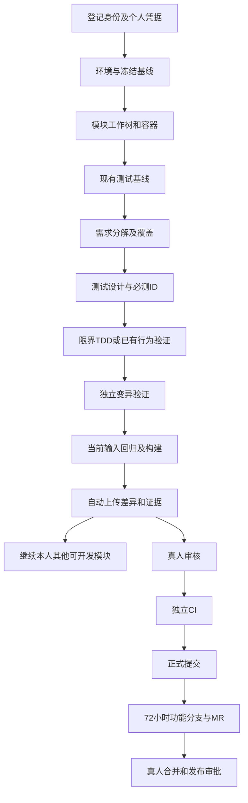

# 全流程 skill：参考、执行与验证

当前版本按参考原文复用通用段落，逐项差异与 Web UI 缺口见 [原文复用与平台差异](workflow/harmony-reuse.md)。
来源 / 目标文件摘要见 [复用清单](workflow/reference-reuse.json)。

## 统一入口

```text
$campus-workflow 我的身份是 frontend-a，处理未完成需求
```

成员先取得协调人提供的个人 `.campus/member.local`。身份只用于匹配登记记录，个人令牌才是认证依据。总入口由当前AI会话执行，自动选择本人的可开发需求、调用技能、写代码和测试、检查证据并上传缓冲站；Python工具负责状态、隔离和门禁，不单独承担代码生成。

| skill | 责任 |
| --- | --- |
| [campus-workflow](../skills/campus-workflow/SKILL.md) | 调度本人的各模块、阶段检查点、恢复、等待和结果汇报 |
| [campus-build](../skills/campus-build/SKILL.md) | Windows/macOS工具检查、必要安装、构建和启动，提示缺失IDE |
| [campus-req](../skills/campus-req/SKILL.md) | 原始需求→验收项→稳定场景→对象、依赖与问题 |
| [campus-test](../skills/campus-test/SKILL.md) | 场景→等价类、样本、观察点、比较方法与真实测试ID |
| [campus-tdd](../skills/campus-tdd/SKILL.md) | 所属模块Red→Green→重构、独立变异验证及交付 |



已授权的开发阶段连续执行。重大验收歧义、范围外公共变更、真实资源授权、人工验收和Git冲突按项目规则处理，只等待受影响项。主应用仍为TypeScript/Vue 3、Java 21/Spring Boot 4.1.2、PostgreSQL；前后端层、六模块白名单、中英字典、数据库迁移和公共文件冻结规则不变。

## SKILL.md 的执行结构

五个入口保留“目标、执行条件、输入、执行流程（Stage）、输出、完成条件”。
需求、测试、TDD 以参考原文为底稿，配套参考保留等价类、检查方案与分级回归的详细方法；项目接口另写适配说明。

| 入口 | Stage范围与交接 |
| --- | --- |
| campus-workflow | 0启动恢复，1工作区，2基线，2.5边界，3需求，4测试方案，5TDD，6回归，7上传，8跟踪 |
| campus-build | 0定位至9真实检查；保留现有 Web / Java 构建实现与受阻处理 |
| campus-req | 1原文和场景，2对象，3待实现，4问题回查，5澄清交接 |
| campus-test | 1检查方案（设计模式完成后交回）；运行模式继续2编写、3实际测试、4浏览器能力与证据 |
| campus-tdd | 0施工单，1Red，2Green，3重构与分级回归，4变异，5证据；单独调用继续6模块收尾与上传 |

父流程检查点名称保持workspace、baseline、requirements、test-plan、tdd、regression，未修改执行工具或业务代码。阶段通过必须有实际产物，不能仅按文本列表勾选就记为完成；已有有效证据和检查点可以复用。

本次格式修订会改变技能摘要。已有流程恢复仍按升级规则核对，不能直接改state.local指纹绕过校验，也不要求为每次格式调整重新安装兼容工具。

## 借鉴来源与改造

本轮找到并阅读的是用户提供“鸿蒙杯提交物/system-config/skills”中的Harmony v2.5.1技能包；这能确认所参考文件，不代表已核实Claude Code当前实际加载的是哪一份。原文件未修改，也未复制其中个人凭据、会话记录或竞赛产物。

| 参考部分 | 采用的做法 | FduStudyRoom中的落点 |
| --- | --- | --- |
| harmony-req | 保留来源；稳定场景；初态、动作、预期；现有/缺失/待核验对象 | 本模块本层analysis.json，不直接改权威需求清单 |
| harmony-test | 等价类、样本来源、观察与比较；测试定位和覆盖 | cells逐一引用acceptance及真实test_ids；交互、API、持久化分层验证 |
| harmony-tdd-code | 真正的业务Red；相同测试Green；证据；已有功能先验证 | 版本2收据、实际报告解析、baseline_satisfied及独立mutation副本 |
| harmony-global-workflow | 统一调度、来源版本、检查点、恢复、继续独立工作 | 身份/基线/技能及执行工具摘要、持久状态、审核后恢复 |
| harmony-single-problem-workflow | 分阶段产物与问题定位、明确人机边界 | 模块检查点、受阻条件、人工验收与独立CI门禁 |

没有照搬ArkTS、Hypium、HDC、模拟器分配、固定三轮、每阶段直接提交、赛事封存或完整会话上传。项目原要求人工验收后才有正式提交，依旧由缓冲站执行；“全流程自动”不包含AI代替真人审核。

## 需求与测试产物

`spec/requirements.json`仍是批准需求，原54条不因借鉴工作流而自行增删。执行时核对来源、任务书页码和既有用户决策；发现新的重大隐含规则先记录依据与影响，需协调人纳入基线后执行，不能伪称原文。已完成项先查其证据和缓冲审核/CI状态，再跳过开发；缺证据是核验缺口，不等于缺功能。

工作树 `spec/progress/<模块key>/<层>/analysis.json` 记录完整验收、稳定场景ID、初态/动作/预期、对象事实、依赖和测试cells。工具校验来源原值、全量覆盖、ID、无环依赖及测试映射；语义是否正确仍需AI阅读和人工验收，不能仅凭字段齐全推定正确。

测试收据从实际Vitest JSON或Surefire XML提取用例ID和PASS/FAIL/ERROR/SKIPPED计数。必测项缺失、零执行、编译/依赖错误、跳过用例及报告缺失都拒绝作为有效TDD证据。预期失败断言可来自原始控制台或实际报告中的failure内容；原始日志和报告分别保留。

| 情形 | 执行规则 |
| --- | --- |
| 新行为未实现 | 预期断言失败的Red→相同命令和必测ID的Green |
| 实现前断言全部通过 | 自动归类baseline_satisfied，保存实际baseline/Green，不制造Red；产品必须与模块起始版本一致 |
| 变异验证 | 新建独立工作树和容器，仅破坏产品规则；相同命令及必测ID必须失败，输入关联原Green，原工作树不变 |
| 模块收尾 | 当前源码回归覆盖全部可完成需求，另有构建/类型检查回执 |
| 最新Green已覆盖全部且输入相同 | 可以复用为回归，避免无依据重复运行 |
| 审核退回 | 保留历史，重新测试并提供退回之后的新证据 |
| 已验收/网站已验证 | 核对证据后跳过实现，保留真实集成和合并状态 |
| 外部资源不可用 | 标记BLOCKED、原因、已试动作及解除条件；继续独立项 |

## 恢复与安装

每次测试保存 `.campus/runs/<UUID>/`：实际命令、退出码、原始stdout/stderr、报告、源码补丁和变化文件快照；汇总收据指向最新有效run。模块流程状态与只追加的检查点位于 `.campus/workflows/<身份>-<基线摘要>/`。这些私有运行材料不进Git，analysis.json随模块差异提交。

恢复检查身份、基线、技能及工具摘要、工作树与网站状态；上传前再次核对analysis、源码和证据摘要。源码或测试变更后重跑受影响测试，口径变更从需求/测试设计检查点重建。reset不删除旧日志；新基线使用新流程，旧工作树保留。工作流升级不能静默复用旧指纹。

```sh
python scripts/team.py install-skills
python scripts/team.py install-skills --client claude
python scripts/team.py install-skills --client claude --check
```

第一、二行按使用的客户端二选一；自定义目录加 `--skills-dir <目录>`。一次安装五个技能；先检查所有同名目标，存在冲突不覆盖、不留下半套升级。实际安装目录与项目源可用--check逐文件比较。本轮没有覆盖本机Claude/Codex已有技能。

AI会话关闭后，不会继续自行生成代码。网站只会继续处理已经上传且满足真人审核条件的任务，以及已启用的定时同步。本机休眠、网络和服务器停机仍会影响执行。

## 本轮原文复用验证（2026-11-13）

- 五个 skill 通过 skill-creator 格式检查；临时目录试装、Codex / Claude 安装摘要核对通过，未覆盖本机已安装技能。
- 仓库与安装副本共 87 处本地引用可解析；参考复用清单 12 条目标摘要一致。
- 现有 tests/team 下 38 项流程 / 权限 / 报告 / 证据测试通过；没有把它们描述成新增业务或浏览器 E2E 测试。
- 本轮没有修改运行工具实现、业务 spec、公共依赖、锁文件、人工审核规则；没有生成正式提交或推送。
- 浏览器 runner、报告接入及独立 CI 仍待实现，具体差异与方案见本文件开头的对照表。

## 前一轮验证与交付记录（2026-11-12）

- Python权限、报告解析和工作流测试：38项通过。覆盖来源/覆盖漂移、阶段越序、输入变化、旧报告、零用例、错误/跳过、断点恢复、跨模块继续、审核退回及已有行为分类。
- 缓冲站后端：Maven verify通过，实际Surefire报告15项全部通过；包含版本2证据门禁和旧收据兼容。
- 五个skill格式校验、独立目录试装、安装摘要比对通过；已有同名技能及后段名称冲突均不会覆盖原文件或留下半套安装。
- 新增门禁先获得真实断言失败，修复后通过；另在独立工具副本关闭Green输入关联校验，同一测试再次失败，原源码未改动。
- 实际Java报告由新解析器读入并核对15项；没有把示例JSON、状态夹具或success字段当作真实业务验收。流程上传/退回/恢复链在独立夹具中验证，未代替真人审核。

Windows下直接用原生Maven构建UNC目录有路径限制，本轮将确切源码复制到专用临时目录构建，并逐文件比对Java输入一致。原生Vitest的真实JSON采集尝试因UNC worker加载路径失败，未算通过；Vitest格式解析由针对性用例覆盖。本轮未宣称新增浏览器、macOS或六模块业务端到端验证。

本轮探测未连通本机缓冲站127.0.0.1:7780，因此没有把本轮工具测试描述成正在运行的网站及真实审核/CI/Gitee发布全链路已成功。

本轮仅优化协调基线、工具、测试和技能文档，没有展开六模块业务实现，没有生成真实人工审核，也没有提交或推送当前基线。优化基线需团队审查并发布，成员才能取得新规则工作树。可信CI镜像、实际Gitee推送/MR权限和常驻服务仍是全链路验收前置条件；上一阶段的外部阻塞记录见14号文档。

## 参考文件摘要

以下为实际读取的原SKILL.md的SHA-256，便于对照参考版本；本项目没有运行Harmony原流程。

| 原技能 | SHA-256 |
| --- | --- |
| harmony-global-workflow | `388a867f76f1e6fa1a8416cfdffb29ceb6b1897d0149948b16b6e62647ec01f6` |
| harmony-single-problem-workflow | `3b428b7f42137a35c775eca4bd6e91ba8a4590e9db2925e9d5ff01fab0f4111a` |
| harmony-req | `69194394934b8299cc31542b5d5519468f19009c573b3e0f1a6d2896f65e6bc7` |
| harmony-test | `f8574b43c30218574d260261b6cf7fc62dca6f77af53ba145d8a8d3bdda65a02` |
| harmony-tdd-code | `b2cba5f1ea02df35482099ab8df26d107d76ac45035cde69713b396f6810bcac` |
