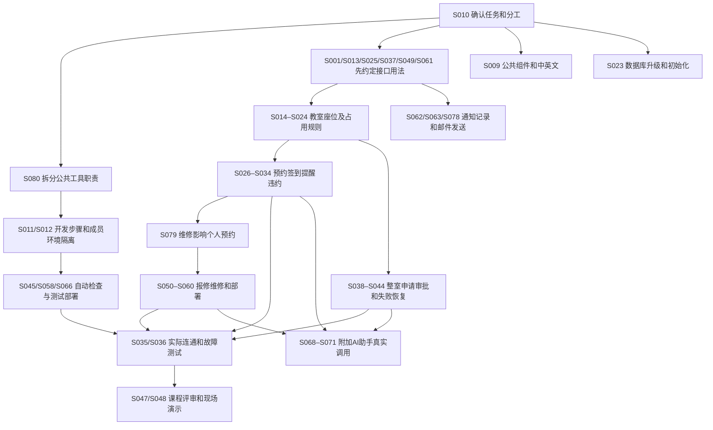

> 历史资料：已从业务spec拆分中移出，由workflow文档管理；不代表已经实现或验收。

# 六人任务分工和先后顺序

## 从哪里看

这份计划按a至f共6个人安排，每个人负责一个领域，可以同时做这个领域的前端和后端。[任务书](../../sources/task-book.pdf)全部6页、54条需求目录，以及用户补充都已纳入，共81项任务、236个场景。170条验收要求都能找到对应场景。**这说明计划没有漏项，不表示功能已经做好。**

- 打开[任务关系图](previous-topology.html)，点击任务，或在“查看目标”中选择任务，就能看具体要做什么。
- 打开[全部任务清单](spec-index.md)，进入每份任务文档阅读操作步骤。
- 打开[要求和场景对照表](coverage.md)，查看每条要求落在哪些场景。
- 打开[测试准备和待确认规则](policies.md)，查看测试账号、教室、时间，以及还需要团队讨论的方案。
- 工具使用的原始数据在[spec-network.json](../../../spec/spec-network.json)，图的文字源文件在[topology.mmd](../../../spec/topology.mmd)。

附加AI助手也在目标中，对应S068至S071。核心功能和附加功能分开验收：缺少模型服务时，其他独立功能可以继续，但助手任务不能从未完成清单中删掉。

## 每份任务怎么读

这里的Spec就是一份有编号的小任务说明。它会告诉你谁负责、需要先准备什么、要做哪些场景，以及做到什么程度才算完成。它不等于一张数据库表，也不一定是一整块业务模块。

场景尽量照实际使用过程来写：

1. **开始前准备**：谁已经登录，有什么教室和预约，现在是几点。
2. **怎么操作**：打开哪个页面，填写什么，点击什么；自动任务则说明怎样触发。
3. **应该看到什么结果**：页面应该显示什么，记录怎样变化，以及哪些不该变化。
4. **这条场景对应的要求**：用编号找到来源，防止遗漏或自行扩大功能。

例如[S029签到](../../../spec/specs/S029.md)：user1预约了R101的A01，09:00开始。到09:00，打开“我的预约”，找到这笔记录，输入教室当天的签到码，点击“签到”。随后显示已签到，后端只记一次签到，不再对它发送未签到提醒或记录违约。

边界也要说清楚：按目前待讨论的建议，08:59:59不能签到，09:00可以，09:15:00已到截止则不能签到。已经在09:14:59完成的签到，不能再被到期检查改成违约。最早允许何时签到是本组建议，任务书没有直接规定，仍要团队确认。

页面和按钮名称是在说明计划中的功能，不表示页面已经存在；实现时可以调整名称，但不能改变要求。字段名、状态值和精确技术约束保留在每个场景可展开的“开发者核对项”里，普通阅读时可以先跳过。

## 六个人分别做什么

| 人员 | 主要负责 | 另外负责 | 任务数 | 场景数 | 大致难度合计 |
| --- | --- | --- | --- | --- | --- |
| [a](../assignments/a.md) | 账号权限、公共页面组件、任务安排和开发流程 | 技能、命令入口、权限规则、个人隔离环境和测试记录 | 15 | 44 | 40 |
| [b](../assignments/b.md) | 教室座位、可用性共同规则和数据库升级 | 升级与初始化工具、数据库文档、资源接口约定 | 13 | 40 | 40 |
| [c](../assignments/c.md) | 个人预约、签到、提醒、违约 | 完整业务流程验证、维修影响预约的接口 | 13 | 38 | 42 |
| [d](../assignments/d.md) | 整室申请和审批 | 自动检查、合并规则、两次课程评审和期末演示 | 13 | 36 | 39 |
| [e](../assignments/e.md) | 报修维修和独立安全验收 | Windows和Mac运行、测试部署、生产发布回退 | 13 | 37 | 41 |
| [f](../assignments/f.md) | 通知、操作记录、统计、缓冲网站、AI助手 | 邮件发送、72小时同步和故障验证 | 14 | 41 | 42 |

难度点数只用来比较任务大小，不是小时数或交付日期。6人的合计在39至42之间，不能只看任务数量判断谁轻谁重。已有登录、导航、开发流程和缓冲网站代码应先检查能否复用；原来某条需求已验收，不代表扩展后的整个新任务都已完成。

每个人都要自己完成对应的风险记录和课程论文，见S072至S077。f可以维护报告索引，但不能替其他人写参与经历或签结论。团队评审、代码验收、生产批准和现场演示仍由真人完成。

## 图中的箭头是什么意思

箭头从需要先做的任务，指向之后会用到它的任务。完整图有81项任务、237条依赖，分成18层。这里的层数只表示前后关系，不是18周，也不是规定要迭代18次。

图里有两种看法：

- **开始开发前需要准备什么**：接口用法和规则已约定后，就可以先独立开发。临时模拟要注明只是测试替身，还需要本人的工作单和容器环境。
- **验收前需要先完成什么**：相关功能要真实完成并验证，才能说整项任务完成。只跑通模拟不算真实联调成功。

还有一些条件来自项目以外，例如学校数据授权、正式邮件服务和服务器。缺少它们要说明影响哪一部分，不是让所有人一律停工。

下面是主线概要，具体每一条前后关系请看完整图：



概要把同类任务放在一起，不能理解成一个大框里的每项都必须等另一个大框全部做完。例如报修和派单可以先开发，只有维修开始后处理已有预约的部分才需要S079。准确顺序以完整图中的单项任务为准。

## 怎样同时开发，尽量不改到同一文件

1. **先确认方案和公共调整。** S010审查任务来源与分工，S080把混在同一文件里的工具职责拆开。这是公共准备工作，要单独评审，不混进某人的普通业务任务。
2. **各自先写好接口约定。** a负责身份，b负责资源，c负责预约，d负责审批，e负责报修，f负责通知和操作记录。说明输入、返回结果、权限、状态、失败情况和版本；不共享内部类，不直接查对方表。
3. **接口准备好后各自开发。** 自己写本模块的页面、接口调用、中英文字典、数据库升级和测试。临时模拟可用于独立检查，最后仍需真实连通。
4. **座位能否使用只维护一套规则。** b统一处理个人与整室占用、维修限制和来源；c、d、e调用它，不各造一套判断。
5. **提醒可以分别开发。** 开始前15分钟、开始后10分钟和15分钟取消各自有任务；业务发生有先后，不代表开发也必须依次等待。邮件发送单列S078，缺正式邮箱不阻止站内通知；S081负责本人邮箱补全和验证。
6. **验证人员不替别人修改业务。** c负责S035正常主流程，f负责S036断网、重复和晚到消息。查出问题后，由原模块负责人修改产品代码。
7. **部署尽早准备。** 自动检查和测试部署不必等所有功能完成，或等到Mac实机验收后才开始。AI助手后续调用真实接口，模型或插件条件不具备时保留待办。

课程中的M1、M2、M3分别是c的预约、d的审批和e的报修。a、b、f负责课程要求的公共部分。工程里另外使用M01至M06作为6个开发模块编号，两套编号不要混淆。

## 现有项目还要先调整什么

技术继续使用TypeScript/Vue 3、Java 21/Spring Boot 4.1.2和PostgreSQL，保留现有两个Java服务。6人分工不表示要建6套生产服务。

| 当前情况 | 计划怎么处理 | 谁负责 |
| --- | --- | --- |
| scripts/team.py和environment.py混有开发流程、本机运行和缓冲网站职责 | 按流程、构建和缓冲命令拆目录，成员隔离与本机工具安装也分开。保留原命令兼容，公共入口由a统一维护 | a主责S080，e和f提出各自需要的接口 |
| 示例成员目前只按前端或后端一种身份登记 | 同一成员分别取得前端和后端工作单，每份只开放自己的范围；公共任务另授权 | S011、S012、S065、S080 |

计划文件范围见[各人清单](spec-index.md#六人清单)。不同成员的目标路径已检查不重叠，未明确分配的公共文件仍冻结。b维护数据库升级工具，但各模块自己的表和脚本由各负责人写，不能因此让b随意改所有业务表。

这些是计划，尚未改动正式成员、容器权限或旧模块清单。现在不能只输入a，就认为6人任务调度和前后端权限已生效；要完成并评审对应公共工作后再启用。

## 哪些规则还要讨论，哪些条件还缺

测试例子要写得确定，才能检查；但确定的测试值不等于团队已批准的正式政策。完整规则见[阅读约定](policies.md)。重点包括签到从何时开始、何时可取消、整室审批期限、维修怎样结束原预约、取消维修怎样确认安全、维修时限与评分、统计怎么算、助手何时需要确认、任务挑选顺序和邮箱验证。

| 还需要什么 | 涉及任务 | 现在能先做什么 | 还不能说已经完成的部分 |
| --- | --- | --- | --- |
| 真实学校数据及使用授权 | S022 | 查询适配、来源和过期提示、测试数据 | 复旦真实接口和教室实际开放授权 |
| 正式邮件服务 | S030、S078 | 用真实测试收件箱检查发送和重试 | 正式对外投递；结果未知时不能保证外部邮件绝不重复 |
| Windows和Mac实机 | S057 | 先实现并检查当前可用平台 | 不能用Windows检查代替Mac验收 |
| 自动检查平台、可信镜像和服务器 | S045、S058、S066 | 本地隔离构建和配置 | 真实平台触发、独立检查和服务器部署 |
| Gitee写入、合并请求权限和常驻服务 | S046、S067 | 本地草稿接收及隔离推送演练 | 实际分支、合并请求和长期准时同步 |
| 模型服务和DSH插件文档、环境 | S068至S071 | Java业务入口、工具约定和隔离测试 | 真实会话调用与插件部署；不兼容时说明原因 |
| 真实成员参与和决定 | S010、S046至S048、S059、S072至S077 | 整理材料、模板和待办 | 团队结论、人工验收与发布批准、6份个人论文、现场演示 |

学校统一登录和只允许学号注册已被取消，不再加入。院系限制仍按任务书保留，但只用管理员核实的少量资格字段，不建立复杂组织树。整室或维修期间新增、启用的座位也不能绕过限制；管理员查看预约明细和缺邮箱时的提示同样已写入场景。

原目录里ENG-14.AC3的4人安排，按本次确认改为6人规划；原始条目仍保留，源数据中有替代记录。

## 修改文档后怎样检查

修改spec-network.json后运行：

```sh
python tools/spec_plan/render.py
python tools/spec_plan/render.py --check
```

工具会检查原要求有没有漏、编号和链接是否存在、任务有没有互相循环等待、文件分工是否重叠，以及生成文档是否一致。它不会开发业务、登记成员或推送Git。

## 这轮文字调整做了什么

81项任务、236个场景、170条验收说明，以及分工、共用规则和关系图都改为自然语言。页面任务按“打开页面—填写或点击—看到结果”描述；自动任务和开发工具则写清准备情况、触发方式和检查结果。原技术描述放在可展开的“开发者核对项”，方便实现时检查精确字段和约束。

任务与场景编号、6人分工、依赖、来源、待评审状态和原始约束保留。没有开发业务功能，也没有生成正式提交或改变成员权限。

检查结果：92份生成文件一致；81项任务的编号、分工和依赖未变，原技术约束可完整还原；236个场景的正文和折叠核对项已在独立浏览器逐项检查，搜索、跳转、展开和缩放正常；1139处内部文件链接和场景定位有效。这些是文档检查，不是业务功能验收。
